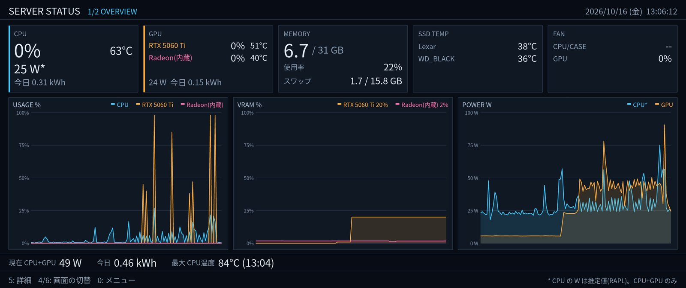
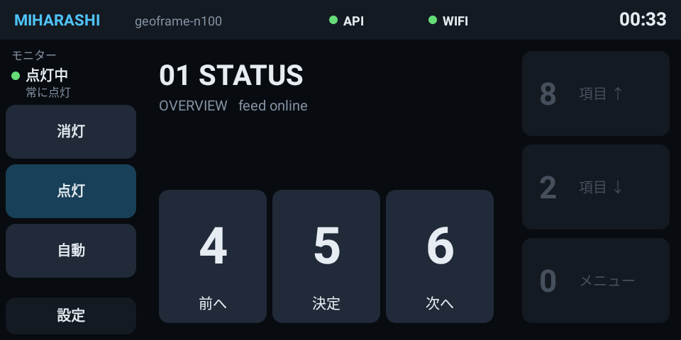

# Miharashi

**サーバーの今を、ひとつの画面に。**

Miharashi(ミハラシ)は、Linux マシンのそばに置くキオスク・ダッシュボードです。サーバーの負荷と、写真と、地震や災害の知らせを、1 台のモニターに映します。

**紹介ページ(LP): https://ysogabe.github.io/miharashi/**

## 何ができるか

- **サーバーの状態を一目で**: CPU と GPU の使用率・温度・電力、メモリ、SSD の温度、通信量、今日の電力量と最高温度。グラフで推移も分かります。
- **写真を流す**: 写真サーバーの写真を、旅ごと・季節ごとにまとめて巡回します。大きな時計と日付つきのフォトフレームになります。
- **地震と災害を見逃さない**: 住んでいる地方の強い揺れや、自宅の近くに出た特別警報を、どの画面の上にも地図つきで重ねて知らせます。
- **部屋の空気と天気**: Home Assistant の室内センサー(温度・湿度・CO₂ など)と 24 時間の推移、気象庁の予報と、住んでいる市町村の警報・注意報を 1 枚にまとめます。
- **上空の航空機**: ADS-B 受信機があれば、近くを飛ぶ機体を管制レーダー風に表示し、機種や経路を出します。
- **AI エージェントの様子**: T3 Code のプロジェクトとスレッドの状態をカードで並べ、新しく動いたものを中央に出します(読み取りだけ)。
- **放っておけば画面が巡回する**: 写真を中心に、設定した順番と時間で全部の画面を回します。触ると数分止まります。
- **固定表示の焼き付きを抑える**: 航空機の画面を既定で 5 分ごとに短く暗転させ、表示位置を少しずらします。間隔と対象画面は設定で変更できます(T3 Agent は未対応)。
- **留守ならモニターを消す**: Home Assistant の在宅判定で、不在が続けば消灯し、帰れば点灯します。
- **テンキーか、手元のパネルで操作**: 4 / 6 で画面を切り替え、8 / 2 / 5 で画面の中を操作します。Android 化した Echo Show 5 を専用の操作盤にすることもできます。

デスクトップ環境は要りません。モニターに直接描くので、画面の無いサーバーにモニターをつなぐだけで動きます。

## 操作パネル(Echo Show 5)

机の上の Echo Show 5 から、画面の切り替え、画面内の操作、メニューからの直接選択と、モニターの消灯・点灯・自動を操作できます。掲載画像は v0.1.0 の表示です。現在の v0.2.0 では、アイコンと操作ラベル、メニュー、巡回状態の表示に対応しています。

- アプリのソース: [ysogabe/miharashi-panel](https://github.com/ysogabe/miharashi-panel)

## いまの状態

作者の自宅のサーバーで毎日動かしながら、少しずつ機能を足しています。いまは 5 つの画面(状況・写真・室内環境と天気・航空機・T3 Agent)と自動巡回まで入っています。次は、毎日使い続けるための仕上げ(長時間の試験、電源を入れたときの自動起動、写真のキャッシュ)です。予定は[ロードマップ(#3)](https://github.com/ysogabe/miharashi/issues/3)にあります。

## もっと詳しく

使い方(ビルド、常駐、設定)、要件、技術設計、検証記録は [docs/](docs/README.md) にまとめています。
