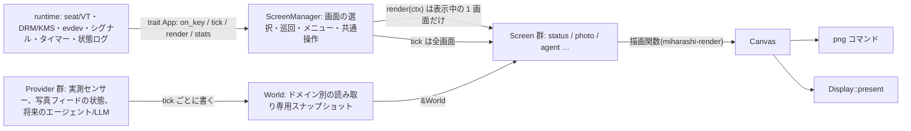
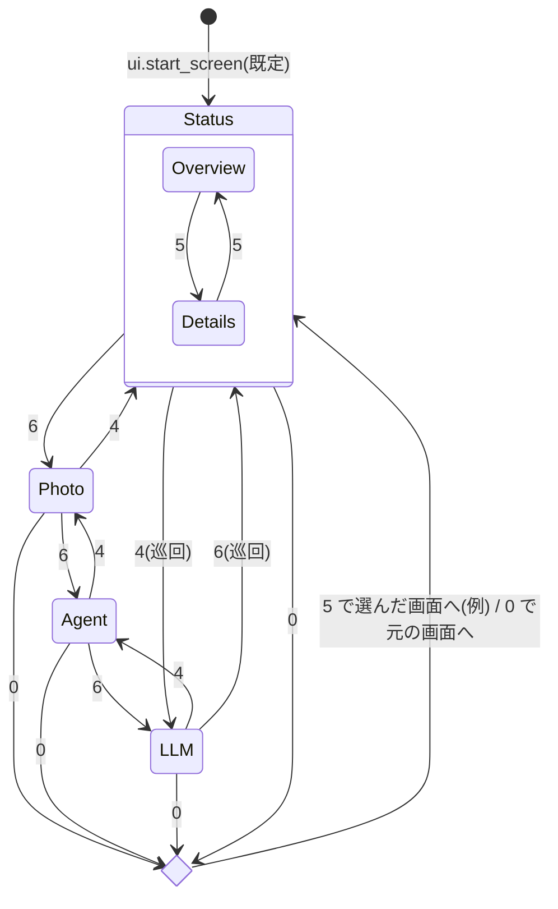

# 画面管理インターフェースの最小設計(Issue #9)

状態: **S1・S2 を実装**(2026-10-15、[#5](https://github.com/ysogabe/miharashi/issues/5))。実装で変えた点は §10・§11。2026-10-13 作成。対象: [#9](https://github.com/ysogabe/miharashi/issues/9)。
基準にしたコード: ブランチ `trial/poc-002-kiosk-runtime`([PR #8](https://github.com/ysogabe/miharashi/pull/8))の `crates/miharashi-app`(`runtime.rs` / `app.rs` / `data.rs` / `photos.rs`)。`main` の `miharashi-poc` ではない。

[DESIGN.md](DESIGN.md) §3 のワークスペース案(`core` / `screens` / `data` crate)と §4 の trait 例は実装前の案で、実際の crate は `render` / `linux` / `app` の 3 つである。この文書は、その現実のコードを起点に、画面を追加するための最小の契約を決める。§4 の trait 例はこの文書で置き換える。

本格的な実装(全画面の trait 化、レジストリー、3 画面での検証)は [#5](https://github.com/ysogabe/miharashi/issues/5)(PoC-003)で行う。ここで決めるのは **境界と名前** であり、PoC-002 のコードに今すぐ入れる変更は §8 の 2 点だけに限る。

表記: **決定** = この文書で確定、**推奨** = 実装時に覆してよい、**#5 へ** = PoC-003 で実装、**未検証** = 実機で確かめていない。

## 1. 現状と問題

| 現状(PoC-002) | 問題 |
|---|---|
| `runtime.rs` の `run()` は `KioskApp` と `Key` を直接 import し、状態ログで `app.screen()` / `app.photo_position()` / `app.feed_notice()` / `app.snapshot().cpu` を読む | 実行ループが 2 画面の具体型と、写真・センサーという画面固有のデータを知っている。画面を足すと `runtime.rs` を触ることになる |
| `app.rs` の `enum Screen { Status(StatusPage), Photo }` と、`on_key` の `match (key, screen)` に全画面の操作が並ぶ | 画面を足すたびに既存画面の分岐を触る(#5 の受け入れ条件に反する) |
| `KioskApp` が写真フィード・フェード・状況ページ・スナップショット・フォントを 1 つの構造体で持つ | 画面固有の状態と、共通の状態の区別がない |
| `screens::Snapshot` は 1 つの平らな構造体で、PoC-002 で電力・詳細の項目が増え続けている。`feed_status` は `KioskApp` が写真フィードの状態から設定し、状況画面の HEALTH タイルが表示する | 画面をまたいで使うデータ(写真フィードの状態)があるため、画面ごとに完全に閉じたデータにはできない |
| `miharashi-linux::input::Action` は Prev / Switch / Next / Quit の 4 つ。`app::Key` はそれから Quit を除いたもの | PRD §6 の 0(メニュー)・8/2(項目移動)がなく、名前も `Action` / `Key` / DESIGN.md の `Action` / #9 の `InputAction` と揺れている |
| `main.rs` の `png` は status / status-details / photo の 3 枚を直書きしている | 画面を足すと `png` も触る |

## 2. 責務の分離(決定)



| 層 | 責務 | 知ってよいもの | 知ってはいけないもの |
|---|---|---|---|
| runtime(`runtime.rs`) | seat の有効・無効、VT、DRM の選択と present、evdev の読み出し、SIGINT/SIGTERM、`max_seconds`、状態ログ | `trait App`、物理キー(`KeyPress`) | 画面の型、写真、センサーの項目 |
| ScreenManager(`app/manager.rs`) | 登録された画面の保持と巡回、開始画面、共通操作(4/6/0/Esc)の解釈、メニューの重ね描き、Provider の更新、全画面の `tick`、表示中の画面の `render` | `trait Screen`、`trait Provider`、`World` | 個々の画面の中身 |
| Screen(`app/screens/*.rs`) | 自分の画面内の状態(ページ、選択項目、現在の写真、フェード)、画面内の操作、描画 | `&World`、`Canvas`、`TextEngine`、自分が所有する資源(写真フィードなど) | 他の画面、runtime、DRM |
| Provider(`app/providers/*.rs`) | 取得元(センサー、HTTP、ファイル)から値を集め、`World` の自分の領域を更新する。取得は自前のスレッドで行い、`update` はブロックしない | 取得元 | 画面、表示中かどうか |
| miharashi-render | `Canvas` / `TextEngine` / 画面の描画関数(`screens::status`、`screens::photo_frame`)/ レイアウト | 描画に必要な値 | デバイス、スレッド、設定ファイル |

**描画エンジンは変えない。** `screens::status(canvas, text, &snapshot, page)` と `screens::photo_frame(...)` の関数はそのまま使い、新しい `Screen` 実装はこれらを呼ぶ薄い層になる。PNG 出力と KMS 出力は同じ `Canvas` を使う(現状どおり)。

## 3. 契約(API 案)

場所は `crates/miharashi-app/src/screen.rs`(**推奨**)。新しい crate は作らない(画面と Provider は app crate の中のモジュールで足りる。Linux 以外でも PNG がビルドできる現状の構成を保つ)。型の実体は #5 で確定し、ここでは形と意味を決める。

```rust
/// 画面の識別子(設定 `ui.start_screen` と、状態ログ・PNG のファイル名に使う)。
pub type ScreenId = &'static str;

/// 物理キー(miharashi-linux が evdev から正規化する)。PRD §6 の操作単位。
#[derive(Clone, Copy, PartialEq, Eq, Debug)]
pub enum KeyPress { Prev, Next, Select, Up, Down, Menu, Quit }

/// 画面に渡す操作(ScreenManager が共通操作を取り除いたあとの意味)。
#[derive(Clone, Copy, PartialEq, Eq, Debug)]
pub enum ScreenAction { Select, Up, Down }

/// 画面が操作を受けた結果。
pub enum Outcome { Consumed { redraw: bool }, Ignored }

/// 描画に必要なものを 1 つにまとめて渡す(借用を 1 か所に集める)。
pub struct RenderContext<'a> {
    pub canvas: &'a mut Canvas,
    pub text: &'a mut TextEngine,
    pub world: &'a World,
    pub now: Instant,
}

pub trait Screen {
    fn id(&self) -> ScreenId;
    fn title(&self) -> &'static str;
    /// 表示される直前。写真画面は自動切替のタイマーをここで戻す。
    fn on_enter(&mut self, _world: &World, _now: Instant) {}
    /// 別の画面へ移る直前。
    fn on_leave(&mut self) {}
    /// 表示中かどうかに関係なく、毎周期呼ばれる(フィードの受信、フェードの進行)。
    /// 戻り値は再描画の要求(表示中の画面のものだけ採用される)。
    fn tick(&mut self, _world: &World, _now: Instant) -> bool { false }
    fn handle_action(&mut self, _action: ScreenAction, _world: &World) -> Outcome { Outcome::Ignored }
    fn render(&mut self, ctx: &mut RenderContext<'_>);
    /// ヘッドレス PNG 用: 初期状態のほかに描き分けたい状態の名前(状況画面なら "details")。
    fn variants(&self) -> &'static [&'static str] { &[] }
    /// `variants()` の名前の状態にする(PNG 専用。実機では使わない)。
    fn set_variant(&mut self, _name: &str) {}
    /// 状態ログに足す key=value(写真画面なら photo=12)。
    fn stats(&self, _out: &mut Vec<(&'static str, String)>) {}
}

/// 実測値などの取得。`update` は最新値を World に写すだけで、ブロックしない。
pub trait Provider {
    fn update(&mut self, world: &mut World, now: Instant);
}

/// 画面が読む共有データ。ドメインごとの部分スナップショットの集まり。
#[derive(Default)]
pub struct World {
    pub clock: Clock,                       // date / time(毎 tick、ScreenManager が設定)
    pub system: SystemSnapshot,             // 今の screens::Snapshot(名前の変更は #5 へ)
    pub photo_feed: FeedState,              // online / 再接続中。状況画面の HEALTH と写真画面の通知が読む
    pub agents: Option<AgentSnapshot>,      // #6(PoC-004)。None = 未接続
    pub llm: Option<LlmSnapshot>,           // gpu-eval #19。None = 未接続
}

/// runtime から見える画面ロジック。ScreenManager が実装する。
pub trait App {
    fn on_key(&mut self, key: KeyPress) -> bool;      // 戻り値: 再描画
    fn tick(&mut self, now: Instant) -> bool;         // 戻り値: 再描画
    fn render(&mut self, canvas: &mut Canvas);
    /// 状態ログ用。runtime は中身を解釈せず、`k=v` を並べて出す。
    fn stats(&self) -> Vec<(&'static str, String)>;
}
```

この形で、`Screen` を 2 つ持つ `ScreenManager` が `App` を実装し、`render` の中で `RenderContext` を組み立てて表示中の画面に渡し、`tick` で全画面を回す骨組みを `cargo check` で確認した(スタブ型。リポジトリには入れていない)。借用上の要点は 2 つ: `World` は ScreenManager が所有し、Provider の `update(&mut World)` と画面の `render(&World)` を同じ周期の別の段で呼ぶ(同時に借りない)。画面固有の資源(写真フィード、フェード用の `Pixmap`)は画面の構造体が所有し、`World` には入れない。

### 3.1 決めたこと

| 項目 | 決定 | 理由 |
|---|---|---|
| 名前 | 物理キー = `KeyPress`(miharashi-linux)、画面への操作 = `ScreenAction`(app)。既存の `input::Action` と `app::Key` はこの 2 つに置き換える(#5 へ) | 物理と意味を分け、名前の揺れをなくす |
| 共通操作の優先順位 | ScreenManager が先に **4/6(画面の巡回)、0(メニュー)、Esc/q(終了、§7)** を処理する。残り(5・8/2)を表示中の画面へ渡し、`Ignored` なら何もしない | #5 の決定「4/6 は画面切替、8/2 は項目移動、5 は決定・詳細、0 はメニュー」に従う |
| **写真の前後は 8/2 へ** | 現在の PoC-002 は写真画面で 4/6 = 前後の写真、5 = 状況画面へ戻る。これを 4/6 = 画面の巡回、8/2 = 前後の写真、5 = 情報帯の表示切替(推奨)に変える。**24 時間試験と [POC-002.md](poc/POC-002.md) に記録した操作と変わる** | 2 画面では 4/6 を写真に使えたが、3 画面以上では画面の巡回に 4/6 が要る |
| 状況画面の 5 | ページ切替(OVERVIEW ↔ DETAILS)のまま | PRD §6「5 = 画面ごとの詳細を開閉」と一致 |
| メニュー(0) | ScreenManager が重ね描きする画面一覧。8/2 で選び 5 で移動、0 で閉じる。メニュー中は画面に操作を渡さない | PRD §6 |
| 画面の遷移要求 | 画面からは出さない。画面の切替は共通操作(4/6・メニュー)と設定の開始画面だけ | 最小契約。必要になれば #5 で `Outcome::Switch(ScreenId)` を足す |
| 非表示の画面 | `tick` は全画面に毎周期呼ぶ。`render` は表示中の画面だけ。Provider は表示中かどうかを知らない | 「非表示でも収集を継続」。写真画面は非表示でもフィードの受信を続け、自動切替は止める(現状どおり) |
| ライフサイクル | `on_enter` / `on_leave`。写真画面は `on_enter` で自動切替のタイマーを戻す。状況画面はページを自分で保持する(今 `KioskApp` にある `status_page` を移す) | 「フォトフレームから戻ると最後に見ていたページ」を画面の中で実現 |
| データ | 共有の `World`(ドメイン別の部分スナップショット)を ScreenManager が所有し、Provider が書き、画面は `&World` を読む。画面固有の状態は画面の構造体に持つ | `feed_status` のように画面をまたぐデータがある。平らな `Snapshot` の分割・改名は #5 へ |
| 登録 | コンパイル時の静的な `Vec<Box<dyn Screen>>`(`app/registry.rs`)。並び順 = 4/6 の巡回順。開始画面は `ui.start_screen` の id で選ぶ(今の文字列比較 `== "photo"` を置き換える) | #9「初期登録はコンパイル時の静的方式」 |
| PNG | `png` コマンドはレジストリーを回し、各画面の初期状態と `variants()` の各状態を `<id>.png` / `<id>-<variant>.png` に書く(今の `status.png` / `status-details.png` / `photo.png` と同じ出力になる) | 画面を足しても `main.rs` を触らない |
| 状態ログ | runtime は `App::stats()` の `k=v` を並べる。共通部分(t, rss, fds, frames, worst_frame)は runtime、`ticks` / `keys` / `screen` は ScreenManager、`photo` / `feed` / `cpu` / `gpu` は各画面と Provider が足す。`screen=` の値は `ScreenId`(`status` / `photo`)にそろえる。**注意**: 今の `tools/soak_summary.py` の正規表現 `screen=(?P<screen>\w+)` は PoC-002 が出す `screen=Status(Overview)` を読めず、3 回目の試験のログに対して「stats 行がない」と出る(2026-10-13 に確認)。試験後の集計の前に PR #8 側で正規表現を直す必要がある(本 Issue の範囲外) | runtime が画面固有の値を読まなくなる |

## 4. 遷移(System / Photo と、将来の Agent / LLM)



- Agent(#6)と LLM(gpu-eval #19)は登録順に巡回へ入るだけで、既存画面の分岐は変わらない。
- 写真画面の 8/2 = 前後の写真、Agent 画面の 8/2 = 一覧の項目移動、5 = 詳細の開閉、は各画面の `handle_action` の中で完結する。

## 5. データの流れ(1 周期)

1. runtime が evdev から `KeyPress` を取り出し `App::on_key` に渡す。ScreenManager は 4/6/0/Esc を自分で処理し、残りを `ScreenAction` にして表示中の画面へ渡す。
2. `App::tick(now)`: ScreenManager が(a)1 秒ごとに全 Provider の `update(&mut world)` と `clock` の更新、(b)全画面の `tick(&world, now)`、を順に呼ぶ。再描画の要求は表示中の画面の分だけ採用する。
3. 再描画が要るときだけ `App::render(canvas)`: `RenderContext { canvas, text, &world, now }` を組み立て、表示中の画面の `render` を呼ぶ。メニューが開いていれば、その上に重ね描きする。
4. runtime が `Canvas` を `Display::present` に渡す(PNG コマンドなら `save_png`)。
5. 60 秒ごとに `App::stats()` を状態ログに出す。

Provider のスレッド(`metrics::Sampler`、写真の `Feed`)は今と同じく自前で動き、`update` / `tick` は最新値を写すだけでブロックしない。外部(GeoFrame、将来の HTTP API)が止まっても、この周期は止まらない。

## 6. 既存コードとの対応

| 今(PoC-002) | 後(#5 で実装) |
|---|---|
| `app.rs` の `KioskApp` | `app/manager.rs` の `ScreenManager`(App 実装)+ `app/screens/status.rs` の `StatusScreen` + `app/screens/photo.rs` の `PhotoScreen` |
| `enum Screen { Status(StatusPage), Photo }` | `ScreenId`("status" / "photo")。`StatusPage` は `StatusScreen` の内部状態 |
| `KioskApp::on_key` の `match (key, screen)` | ScreenManager の共通操作 + 各画面の `handle_action` |
| `KioskApp` の `status_page` / `current` / `fade` / `notice` / `last_photo_change` | それぞれの画面の構造体へ |
| `KioskApp` の `text: TextEngine` | ScreenManager が所有し `RenderContext` で貸す |
| `data.rs` の `trait DataSource { fn update(&mut self, &mut Snapshot) }` | `trait Provider { fn update(&mut self, &mut World, Instant) }`。`LiveData` / `DummyData` は `world.system` を書く |
| `Snapshot.feed_status`(`KioskApp` が設定) | `World.photo_feed`。**決定**: 共有データを書くのは Provider だけ(§2)なので、画面には書かせない。`Feed` に状態を読める共有ハンドル(`Arc<Mutex<FeedStatus>>` など)を持たせ、`FeedStatusProvider` がそれを `world.photo_feed` へ写す。`Feed::try_recv` のイベント受信は `PhotoScreen::tick` の 1 か所だけが行う(受信者を 2 つにしない) |
| `photos::Feed` | `PhotoScreen` が所有(スレッドは今のまま) |
| `runtime.rs` が `KioskApp` と `Key` を import | `trait App` と `KeyPress` だけを import。`make_app: FnOnce(&Output) -> Box<dyn App>` |
| `input::Action` / `map_key` | `KeyPress` を返す `map_key`。KP0 / Insert / 主列 0 → Menu、KP8 / Up / 8 → Up、KP2 / Down / 2 → Down を追加(**未検証**: 物理テンキーでの実測は #5) |
| `main.rs` の `png` | レジストリーを回して `<id>[-<variant>].png` |
| `ui.start_screen = "status" / "photo"` | 同じ設定値を `ScreenId` と照合。未知の id は設定エラー |

## 7. 終了キー(Esc / q)

終了は画面でも ScreenManager でもなく **runtime が扱う**(`KeyPress::Quit`)。常用時に無効にするかどうかは設定(`runtime.quit_key = true / false`、**推奨**: サービスでは false)で決める。無効化そのものは 24 時間試験後の未決事項([POC-002.md](poc/POC-002.md))であり、ここでは置き場所だけを決める。

## 8. PoC-002 のコードに今入れる変更(最小)

24 時間試験(2026-10-13 20:00 JST まで)の間はバイナリ・サービスを変えない。試験後、PR #8 を Ready にする前に入れるか、#8 のマージ後の小さな PR にするかはユーザーの判断。内容は次の 2 点だけで、画面の動作は変えない。

1. `runtime::run` の引数を `FnOnce(&Output) -> Box<dyn App>` にし、`runtime.rs` から `KioskApp` と `Key` の import を外す。`KioskApp` に `impl App` を付ける(`on_key` / `tick` / `render` は既にある)。
2. 状態ログの画面固有の値(`screen` / `photo` / `feed` / `cpu` / `gpu`)を `App::stats()` 経由にする。出力の文字列は今と同じにし、`tools/soak_summary.py` が読めることをテストで確認する。

これで「実行ループが 2 画面の具体型に依存しない」を満たす。`enum Screen` の廃止、画面の分割、`World` への移行、キー割当の変更は #5。

## 9. #5(PoC-003)へ引き継ぐ未実装事項

- `screen.rs` の型の確定と、`StatusScreen` / `PhotoScreen` への分割。`ScreenManager` とレジストリー。
- `Snapshot` を `World` のドメイン別に分ける(`system` / `clock` / `photo_feed`)。`feed_status` の書き手を決める(§6 の推奨)。
- キー: `KeyPress` への統一、0 / 8 / 2 の追加、写真の前後を 8/2 へ、メニュー画面。物理テンキー(NumLock ON/OFF)での実測。
- 3 つ目のサンプル画面(Agent のモック、または LLM 画面のフィクスチャ表示)で、PNG と実機の両方で巡回を検証。
- `png` のレジストリー化と `variants()`。
- 状態ログの `stats()` 化と `soak_summary.py` の互換テスト。
- 設定: `ui.start_screen` の id 照合、`runtime.quit_key`。
- DESIGN.md §3 のワークスペース案を実際の crate 構成に合わせて更新(この文書の §2 を反映)。 → 2026-10-15 に更新済み(S2)。

## 10. 実装(S1、2026-10-15)

[DESIGN-screens.md](DESIGN-screens.md) §7 の S1(今の 2 画面とアラート層・操作パネルを、動作を変えずに分ける)を実装した。

| 場所 | 中身 |
|---|---|
| `src/screen.rs` | `App`(runtime との境界、変更なし)に加えて `Screen` / `ScreenAction` / `Outcome` / `RenderContext` / `World` / `FeedState` / `Provider` |
| `src/app.rs` | `kiosk()`: 画面の登録(並び順 = 切り替わる順)。画面を足すときはここだけを変える。`DataSource` / `set_clock` / `text_engine` |
| `src/app/manager.rs` | `ScreenManager`(`App` を実装)。画面の切り替え、アラート層、1 秒ごとの実測値と時刻、Provider、状態ログ、操作パネルの状態 |
| `src/app/screens/status.rs` | `StatusScreen`。ページ(OVERVIEW / DETAILS)を自分で持つ |
| `src/app/screens/photo.rs` | `PhotoScreen`。写真フィード、フェード、カード、写真の合間の航空機の画面(S3 で独立させるまでここに置く)。`FeedStateProvider` |

§3 の案から変えた点:

- **`Screen` に足したもの**: GPU 経路の `render_composite`(PoC-005 で入った `Composite` を返す)、`animating`(航空機の回る線)、`page`(操作パネルのページ名)。`RenderContext` には、アラートを重ねるか(`alert`)と、GPU 経路の重ね絵を描き直させるか(`force_overlay`)を足した。アラートは ScreenManager が画面の上に描くので、写真画面の重ね絵を描き直させないと GPU 経路で消える。
- **`Outcome` に redraw を持たせない**: キーを受けたら必ず描き直す(今の動作)。
- **キー**: `KeyPress` は今の Prev / Switch / Next のまま(S2 で 0・8・2 を足す)。ScreenManager は Prev → `Up`、Switch → `Select`、Next → `Down` にして表示中の画面へ渡し、画面が使わなかったら今の操作どおりに切り替える(6 = 次の画面、4 = 前の画面で端で止まる、5 = 先頭の状況画面)。写真画面は `Up` / `Down` を前後の写真に使うので、写真画面の 4/6 は今までどおり写真の前後になる。
- **データ**: `World` は `system`(今の `Snapshot`。日付と時刻もここ)と `photo_feed` の 2 つ。実測値は今の `DataSource` のまま 1 秒ごとに ScreenManager が呼ぶ。`Provider::update(&mut World)` は毎周期呼び、写真フィードの状態だけを写す(写真画面が共有ハンドルに書き、`FeedStateProvider` が `World` に写す。`Feed` から受け取るのは写真画面だけ)。
- **非表示の画面**: `tick` は全画面に呼び、再描画の要求は表示中の画面の分だけ使う。写真画面は非表示の間、写真を自動で進めず、航空機の画面も挟まない(今と同じ)。戻ったときの自動切替のタイマーは戻さない(今と同じ)。
- **状態ログ**: `screen=` を画面の id(`status` / `photo`)にした。今までの `screen=Status(Overview)` のページは、末尾の `page=overview` / `page=details` に分けた。ほかの項目と並び順は変えていない(`tools/soak_summary.py` はそのまま読める)。
- **まだのもの**: `png` コマンドのレジストリー化と `variants()`、`KeyPress` の統一と 0・8・2、メニュー、`runtime.quit_key`(S2 以降)。

## 11. 実装(S2、2026-10-15)

[DESIGN-screens.md](DESIGN-screens.md) §4.1 の操作に変えた(2026-10-15 にユーザーが承認)。

| キー | `KeyPress` | 動き |
|---|---|---|
| 4 / ← / 主列 4 | `Prev` | 前の画面(先頭では最後へ折り返す) |
| 6 / → / 主列 6 | `Next` | 次の画面(最後では先頭へ折り返す) |
| 5 / 主列 5 | `Select` | 表示中の画面へ `ScreenAction::Select`。状況画面はページ切替、写真画面は写真の情報(撮影地・日付)の表示切替 |
| 8 / ↑ / 主列 8 | `Up` | `ScreenAction::Up`。写真画面は前の写真 |
| 2 / ↓ / 主列 2 | `Down` | `ScreenAction::Down`。写真画面は次の写真 |
| 0 / Insert / 主列 0 | `Menu` | メニューを開く・閉じる |

- `input::Action` と `KeyPress` に Up / Down / Menu を足し、Switch を Select に改めた。テンキーは NumLock に関係なく `KEY_KP*` で届く(evdev)。物理テンキーでの実測は本番に入れてから行う。
- **メニュー**: ScreenManager が持つ。開いたときは表示中の画面を選んでいる。8/2(4/6 も)で選び、5 で移る、0 で閉じる(移らない)。メニュー中は画面に操作を渡さない。描画は `miharashi_render::menu`(画面の上に重ね、その上にアラート)。GPU 経路では写真の重ね絵に描き、航空機のレーダーはメニュー中は CPU の完成画面にする(`RenderContext::covered`)。
- **操作パネル**: `POST /api/v1/input` は `up` / `down` / `menu` も受け付ける。`POST /api/v1/screen {"id": "..."}` で画面を直接選ぶ(登録されていない id は 404、起動直後で画面の一覧がまだ無ければ 503)。パネルのスレッドは公開済みの画面一覧で id を確かめ、実行ループへ `PanelInput::Screen` を送る。実行ループは `App::show_screen` を呼ぶ(メニューとアラートは閉じる)。`/api/v1/status` の形は変えていない(`schema_version` は 1 のまま)。
- 状況画面の下のキーの案内を「4/6: 画面の切替  0: メニュー」にした。
- `Outcome` は残した(S3 の航空機の画面などで、画面が使わない操作を区別するため)。今の ScreenManager は `Ignored` でも何もしない。
- まだのもの: `png` コマンドのレジストリー化と `variants()`(S3 で航空機の画面を足すときに合わせる)、`runtime.quit_key`。
