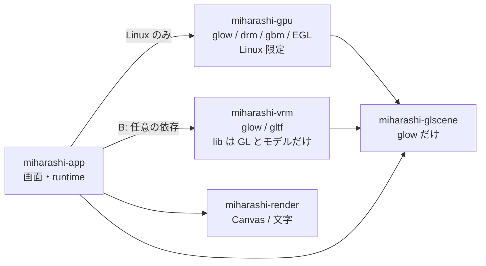

# Screen Plugin API v2 — 画面に GL を貸す口(Issue #72)

状態: **#74 で実装済み**(2026-10-19。実測は [POC-007](poc/POC-007.md)。#71 B は未着手)。設計は 2026-10-19 作成、同日 Opus のレビュー指摘を反映。2026-10-18 午後の計画見直し後の範囲で書く。対象: [#72](https://github.com/ysogabe/miharashi/issues/72)(Screen Plugin API v2 の設計)。実装は [#74](https://github.com/ysogabe/miharashi/issues/74)(GLES 3D 描画境界。キューブで確かめる)と [#71](https://github.com/ysogabe/miharashi/issues/71) の B(VRM の組み込み)。

前提にする文書: [画面管理インターフェース](DESIGN-screen-interface.md)(現行契約は §0)、[画面の全体構成](DESIGN-screens.md)、[技術設計](DESIGN.md)、[POC-006](poc/POC-006.md)(VRM の単体・実モニター試験)。

表記: **決定** = この文書で確定、**推奨** = 実装でぶれたら見直してよい、**未検証** = 実機で確かめていない、**#74 へ** / **#71 B へ** = その Issue で実装・確認する。行番号は 2026-10-19 時点の `main`(13312b8)。`manager.rs` は `crates/miharashi-app/src/app/manager.rs`、`photo.rs` / `agents.rs` / `aircraft.rs`(画面)は `app/screens/`、`screen.rs` / `runtime.rs` / `config.rs` は `miharashi-app/src/` にある。

## 0. 目的と範囲

目的: 画面が**自前のメッシュ・シェーダーで GL に描く**(キューブ、VRM)ために、今の画面 API に何を足すかを決める。既存 5 画面(status / photo / room / aircraft / agents)は変えない(#5 の機能維持)。

範囲は次の 5 点だけ。

1. 画面に GL を貸す口の形
2. GPU リソースの解放時期
3. アラート・メニューの重ね方
4. GPU 状態の責任分担
5. CPU 経路(`renderer = cpu`)と PNG ヘッドレスの扱い

あわせて、1 フレームの流れ、描き直しの要求と省電力、panic・GL エラーの扱いを決める。**後回し**: `World` の分割、Cargo feature による静的登録の手順、画面 API の外部クレート化(#73 を再開するときに決める)。**スコープ外**(Issue 本文): 動的ライブラリロード、Rust ABI の公開、ホットプラグイン、汎用 Widget レイアウト、既存 5 画面の全面移行。

### 0.1 決まったことの要約

| # | 論点 | 決定 | Issue の案から変えた所 |
|---|---|---|---|
| 1 | GL を貸す口 | glow だけに依存する新クレート `miharashi-glscene` に `GlScene { draw, release }` を置く。画面は `Composite::Gl(GlComposite)` を返す。描画先は **Compositor が持つ深度つきの層(FBO)**で、画面は premultiplied alpha でそこへ描く。ScreenManager から `GlScene` へは `Screen::gl_scene()` で届く | `Composite::Gl(&mut dyn GlScene)` に、下地・領域・重ね絵を足した。GPU 側は `Frame` でなく別の入口 `SceneFrame` / `present_scene` にした(`&Frame` は `&mut dyn` を運べない) |
| 2 | 解放時期 | **非表示中も持ち続ける**。作るのは最初の `draw`(遅延・冪等)。解放は終了時とエラー時だけ(エラー時は `present_scene` の中で Compositor がその場で `release`)。`App::gl_scenes()`(ScreenManager が各画面の `gl_scene()` を集める)で解放の道は作り、タイムアウト付き解放は VRAM+GTT の実測後に足す | 「破棄キュー」案は v1 では採らない(理由は §4) |
| 3 | アラート・メニュー | 下地 → 3D → **重ね絵**の順。重ね絵は、画面自身の重ね絵(写真の文字)とは別の**最上段の層**で、ScreenManager が描く | 「Photo / Radar と同じ」にはできない。写真の重ね絵は下地の一部として 3D の下に入るため、アラートが 3D の下に隠れる。Radar の「重ねるときは Canvas で返る」も 3D には使えない。GL の可否・失敗が変わる切り替えでは、重ね絵を必ず描き直させる(§6.1、§9.1) |
| 4 | GPU 状態 | Compositor が **自分の描画の前と、3D を呼ぶ前**に、状態を毎回決まった値へ設定し直す。画面は「戻す」責任を持たない。画面が閉じるべきもの(query など)だけを契約にする | 案どおり。さらに「3D に渡すときの初期状態」も Compositor が保証する |
| 5 | CPU / PNG | `renderer = cpu` と GL が使えないときは、**GL 専用の画面は「GPU が必要」の案内を CPU で描き、巡回では飛ばす**(飛ばすのは GL 専用画面だけ)。既存画面に 3D を足す装飾(VRM)は、3D だけ消して元の画面を出す。PNG は CPU の案内に加え、`--renderer gles` で `offscreen.rs` に 3D を描く | 案どおり。CPU の代替は案内の 1 枚に限る(3D の CPU 描画はしない)。GL の可否は `make_app(&Output)` の `gpu_max_texture.is_some()` で渡す(`set_gl_available` は作らない) |
| 6 | 描き直しの要求 | 動かし続ける画面は `animating()` と `tick` の戻り値の**両方**を true にする。3D 由来の分は `Screen::scene_animating()` に分け、ScreenManager が GL が使えて失敗していないときだけ足す | 「`animating()` を true にすれば描かれる」ではない(止めるのは 20ms の待ちだけ) |

## 1. 今のコードで分かっていること

| 事実 | 場所 | 設計への影響 |
|---|---|---|
| 画面は GL に触れない。`Screen::render_composite` が決まった種類の `Composite`(Canvas / Photo / Radar / Agents)を返し、runtime が `miharashi-gpu` の `Frame` に直し、`Compositor` が描く | `screen.rs:273-299`、`runtime.rs:227-267`、`compose.rs:188-210` | 自前のメッシュ・シェーダーを持つ画面は、この方式に収まらない |
| `Composite<'a>` は `&mut self` の借用に結ばれている(`render_composite(&mut self, …) -> Composite<'_>`) | `screen.rs:107` | 画面が持つ `GlScene` への `&mut` を `Composite` に入れても借用が成り立つ |
| `screen.rs` は Linux 以外でもビルドされる。`miharashi-gpu` は Linux 限定の依存 | `miharashi-app/Cargo.toml` の `[target.'cfg(target_os = "linux")'.dependencies]` | `Composite` に `miharashi-gpu` の型を出せない。`miharashi-vrm` も gpu に依存させたくない(lib 部は glow と gltf だけ) |
| `Frame` は `&Frame` で渡す | `display.rs:112`、`compose.rs:377` | `&mut dyn GlScene` を入れられない |
| EGL の config に `DEPTH_SIZE` がない。標準の framebuffer に深度は保証されない | `egl.rs:38-50` | 3D は深度つきの別 FBO に描いて合成する(`layer.rs` が PoC で実証済み) |
| 重ね絵(写真の文字)は `overlay_tex` で、写真の上に `ONE, ONE_MINUS_SRC_ALPHA` で重ねる。Radar と Agents は、アラート・メニューが出ると画面が Canvas(CPU の完成画面)を返す | `compose.rs:402-416`、`manager.rs:655-663` | 3D 画面は CPU の完成画面を持てないので、Radar の逃げ道は使えない |
| `draw_frame_with` は「合成 → GL を貸す」の順。借りた側の絵が**一番上**に載る | `display.rs:239-255` | PoC(`vrm-view`)ではアラートがないので問題が出ていない。キオスクでは順序の入れ替えが必要 |
| `restore_gl_state` は、貸す側が借りた側の後に状態を戻す関数。戻すもの・戻さないものは `with_gl` の doc にある | `display.rs:144-153`、`display.rs:273-304` | 「貸す側が戻す」を「Compositor が使う前に設定し直す」へ移す(§5) |
| `Compositor` は framebuffer を前提にしている(`draw` は今 bind 済みのものに描く)。`present_frame` は先頭で `bind_framebuffer(None)` する。写真の GPU 合成は、前の FBO を覚えて戻す | `compose.rs:376`、`display.rs:117-118`、`compose.rs:342-344` | #71 の「`present_frame` の `bind_framebuffer(None)` の戻し忘れ」は、現コードでは先頭で bind し直すので問題なし(確認済み) |
| `display.draw(...)?` は、どんな `Err` でも実行ループを抜ける。`catch_unwind` は `crates/` に 1 件もない(テストにもない)。`Cargo.toml` に `panic = "abort"` はない | `runtime.rs:549`、リポジトリ全体 | 3D を入れると、画面 1 つの失敗でキオスク全体が止まる。境界を作る必要がある(§9) |
| `Screen::render` は必須メソッドで、`Presenter::Cpu` が呼ぶ。`render_refresh`(焼き付き対策)も呼ぶ | `screen.rs:105`、`runtime.rs:213`、`manager.rs:353` | 3D 専用画面も、CPU で描く何か(案内)を持つ |
| 消灯中は描かない(`redraw && screen_on`)。`animating()` が true の間だけ 20ms の待ちを入れない。**描くかどうかは `tick` の戻り値(`redraw |= app.tick(..)`)で決まる**。航空機の画面は動かし続けるとき tick も毎回 true を返す | `runtime.rs:514`、`547`、`613`、`aircraft.rs:102-105` | 消灯中の扱いは既存のままでよい。`animating()` は待ちを省くだけなので、動かし続ける画面は tick も true にする(§10) |
| GLES の可否は、Presenter を開いた後に `make_app(&Output)` の引数として画面ロジックへ渡している。`Output.gpu_max_texture` は GLES のときだけ `Some`(`auto` で CPU に戻ったときは `None`) | `runtime.rs:289-293`、`353-356`、`main.rs:153`(`Presenter::gpu_max_texture` は `runtime.rs:169`) | GL の可否は `Output.gpu_max_texture.is_some()` をそのまま使う。`App::set_gl_available` は作らない(§6) |

## 2. 論点 1: 画面に GL を貸す口

### 2.1 決めたこと

- **新クレート `miharashi-glscene`**(依存は `glow` だけ)に、画面が実装する `GlScene` と、描画先の説明 `GlTarget` を置く。app・gpu・vrm の 3 つが無条件に依存する。Linux 限定の `miharashi-gpu` や、`miharashi-app` の型は出さない。
- 画面は `Composite::Gl(GlComposite)` を返す。`GlComposite` は、`scene`(画面が持つ `GlScene` への `&mut`)、`region`(3D を置く画面上の矩形)、`base`(3D の下に出す下地。無ければ黒)を持つ。
- **ScreenManager から `GlScene` に届く口**: `Screen::gl_scene(&mut self) -> Option<&mut dyn GlScene>`(既定 `None`)。`WithScene` は自分の `VrmScene` を返す(内側の画面は `GlScene` を持たない)。ScreenManager は `App::gl_scenes()`(終了時の解放用)でこれを全画面から集める。`Composite::Gl` の `scene` は描画のための借用で、解放には使えない(`render_composite` の戻り値は `&mut self` の借用に結ばれているので、描画の途中で別の画面の `release` はできない)。失敗時の `release` は、`scene` を手に持っている `present_scene` の中で Compositor がする(§3.1、§9.1)。
- **描画先は Compositor が用意する層**。画面の `draw` には、深度つきの FBO(色は RGBA8 のテクスチャ、深度・ステンシルは `DEPTH24_STENCIL8` の renderbuffer(`render.rs` の `attach_depth` と同じ)、大きさは `region`)が bind 済みで渡される。Compositor は呼ぶ前に色を `(0,0,0,0)`、深度を 1.0 で塗る。画面が出す色は **premultiplied alpha**(`layer.rs` の約束と同じ)。Compositor が呼んだあとに、その層を `ONE, ONE_MINUS_SRC_ALPHA` で画面へ重ねる。
- 画面は `draw` の中で、自分の GL オブジェクト(プログラム・VBO・テクスチャなど)を**最初の呼び出しで作り**(遅延)、`release` で消す。`draw` は何度呼ばれても、`release` の後でも作り直せる(冪等)。
- 時刻・表情・身振りの指示といった毎フレームの**入力**は、画面が `tick` などで自分の `GlScene` の具体型に直接入れる。`GlScene` の窓口は GL の呼び出しだけで、時間は渡さない(PNG・動画の固定刻みで、同じ入力から同じ絵になる)。
- **入力から絵を作る CPU 処理**(VRM の姿勢・SpringBone・morph の計算)は `draw` の中で行う(**決定**)。`catch_unwind` で隔離されるのは `draw` の中だけなので、ここで panic しても実行ループは止まらず、`tick` 側(隔離しない)には入力を置くだけにする。

### 2.2 ほかの案と、選ばなかった理由

| 案 | 選ばなかった理由 |
|---|---|
| `Composite::Gl(&mut dyn GlScene)` だけ(Issue の案) | 下地(写真・Agent 画面)と領域がない。VRM は写真・Agent 画面の上の領域に重なる(POC-006 の実測はその形)。下地なしの全画面だけでは B に足りない |
| 画面が `&glow::Context` を受け取って自由に描く(framebuffer も画面が選ぶ) | 標準の framebuffer に深度がない。画面ごとに VrmLayer 相当の FBO を持つことになり、アルファの約束(premultiplied)が画面ごとにばらける。#74 の「描画ターゲット・深度・アルファ合成の契約」を Compositor 側に置く方が確かめやすい |
| トレイトを `miharashi-gpu` に置く | gpu は drm・gbm・EGL に依存する Linux 限定のクレート。`screen.rs`(Linux 以外の PNG でもビルド)と `miharashi-vrm`(glow と gltf だけ)から使えない |
| トレイトを `miharashi-vrm` や `miharashi-app` に置く | gpu が app に依存する向きになる。vrm 以外の 3D 画面(キューブ)も、同じクレートに依存することになる |
| `Frame` に `Gl` を足す | `Frame` は `&Frame` で渡され、`&mut dyn GlScene` を運べない。`Frame` の利用者(`png`、`vrm-view`、ベンチ)を全部直すことになる。`Frame` は 2D 用のまま置き、別の入口を作る方が影響が小さい |
| 3D を CPU で描ける画面だけを許す | VRM(14 万三角形)は CPU 描画の対象外。GPU 専用でよい |

### 2.3 型のスケッチ(実装はしない)

```rust
// ── miharashi-glscene (依存: glow だけ) ──────────────────────────────
/// 画面上の矩形。画素。原点は左上(Canvas と同じ)。GL の左下原点への換算は Compositor がする。
#[derive(Clone, Copy, PartialEq, Eq, Debug)]
pub struct Region { pub x: u32, pub y: u32, pub w: u32, pub h: u32 }

/// Compositor が `draw` に渡す描画先。`fbo` は bind 済みで、色(RGBA8)と深度・ステンシル(DEPTH24_STENCIL8)つき。
pub struct GlTarget {
    /// 層の FBO。画面が自前の深度パスなどで bind を変えたら、これに戻す
    pub fbo: glow::Framebuffer,
    /// 層の大きさ(= region の大きさ)。viewport は (0, 0, w, h) に設定済み
    pub size: (u32, u32),
}

/// 画面が実装する 3D 描画。呼ぶのは Compositor だけ(GL が current なスレッド = 実行ループ)。
pub trait GlScene {
    /// `target` に今の状態を描く。初回は GL オブジェクトを作る(遅延・冪等)。
    /// 出力は premultiplied alpha。失敗は Err(文字列。コードベースの他と同じ)。
    fn draw(&mut self, gl: &glow::Context, target: &GlTarget) -> Result<(), String>;
    /// 自分が作った GL オブジェクトをすべて消す。呼んだあとの `draw` で作り直せること。
    fn release(&mut self, gl: &glow::Context);
}

// ── miharashi-app/src/screen.rs ─────────────────────────────────────
pub enum Composite<'a> {
    Canvas, Photo { .. }, Radar { .. }, Agents { .. },   // 既存。変えない
    /// 3D を含む画面。`Canvas` は下地(または何も描かない)に使う
    Gl(GlComposite<'a>),
}
pub struct GlComposite<'a> {
    /// 3D の下に出す下地。None なら黒。`Gl` は入れ子にできない。入れ子は `debug_assert!` で検出し、
    /// リリースでは `SceneFailed` と同じ失敗扱いにする(`Err` で返すと `runtime.rs:549` の `?` で実行ループを抜ける)
    pub base: Option<Box<Composite<'a>>>,
    pub scene: &'a mut dyn GlScene,
    pub region: Region,
    /// アラート・メニューの重ね絵。画面は `Top::Off` で返し、ScreenManager が埋める(§4)
    pub top: Top<'a>,
}
pub enum Top<'a> { Off, Keep, Upload(&'a miharashi_render::Pixmap) }  // Keep = 前回の重ね絵のまま。Off の次のフレームは必ず Upload(§4.1)

// Screen に足すもの(既定値があるので、既存 5 画面は変わらない)
trait Screen {
    /// GL が使えないと意味がない画面(キューブ)。true なら、GL が使えない・失敗中は CPU の案内を出して巡回で飛ばす
    fn needs_gl(&self) -> bool { false }
    /// この画面が持つ GlScene(終了時の解放・将来のタイムアウト解放用)。`WithScene` は自分の VrmScene を返す
    fn gl_scene(&mut self) -> Option<&mut dyn GlScene> { None }
    /// 3D が動き続けるか。内側の画面の `animating()` / `tick` とは分ける。ScreenManager が、
    /// GL が使えて失敗していないときだけ `animating()` と `tick` の戻り値に足す(§10)
    fn scene_animating(&self) -> bool { false }
}
// App に足すもの
trait App {
    /// 持っているすべての GlScene(終了時・将来のタイムアウト解放用)。ScreenManager が各画面の `gl_scene()` を集めて返す
    fn gl_scenes(&mut self) -> Vec<&mut dyn GlScene> { Vec::new() }
    // GL の可否は App のメソッドで渡さない。`make_app(&Output)` の `Output.gpu_max_texture.is_some()` を、
    // `kiosk()` が ScreenManager の作成時に受け取る(既に `gpu_max_texture` を渡している: main.rs:153)
    /// 3D の描画が失敗した(panic を含む)。`release` は `present_scene` の中で済んでいる。今出していた画面を GL 失敗の扱いにする(§9)
    fn report_scene_failure(&mut self, _msg: &str) {}
}

// ── miharashi-gpu ──────────────────────────────────────────────────
/// `Frame` の隣に置く 3D 用の入口。`Frame` は変えない。
pub struct SceneFrame<'a> {
    pub base: Option<Frame<'a>>,           // 下地(2D の Frame。runtime が Composite から作る)
    pub scene: &'a mut dyn GlScene,
    pub region: Region,
    pub top: Top2<'a>,                     // Off / Keep / Upload(&[u8])。Pixmap でなく画素列
}
impl GlesDisplay {
    pub fn present_scene(&mut self, f: &mut SceneFrame<'_>) -> Result<SceneOutcome, SceneError>;
    pub fn release_scenes(&mut self, scenes: &mut [&mut dyn GlScene]);
}
/// 3D の失敗は表示全体の失敗にしない(Err は DRM・EGL などの致命的なもの)。
/// `SceneFailed` のとき、失敗した scene の `release`(catch_unwind つき)は `present_scene` の中で済んでいる
pub enum SceneOutcome { Drawn, SceneFailed(String) }
/// 致命的な失敗(下地の描画・最上段の重ね絵・swap・page flip・DRM)。場面の失敗より**後**に起きたときも
/// 場面の失敗を失わない(`Err` だけ返すと、`release` 済みの場面が終了時にもう一度 `release` される)
pub struct SceneError { pub message: String, pub scene_failed: Option<String> }
```

呼び出し側は、`Ok(SceneFailed)` でも `Err(e)` の `e.scene_failed` が `Some` でも、**必ず** `App::report_scene_failure` を呼んでから終了処理(`end_run`)へ進む。`Compositor::draw_scene`・`Offscreen::render_scene` も同じ `SceneError` を返す。

`Top`(app。`Pixmap`)と `SceneTop`(gpu。`&[u8]`)は持つものが違うだけ(app は gpu の型に依存できない)。実装(#74 T2)では、`runtime.rs` の `FrameParts`(`Frame` が借りるレーダーの点・Agent のカードの置き場)・`frame_of`(`Gl` 以外の `Composite` → `Frame`)・`scene_frame`(`GlComposite` → `SceneFrame`)が変換を受け持つ。

### 2.4 依存の向き



- 矢印は「依存する」。glscene は何にも依存しない(glow を除く)ので、循環は起きない。
- app → vrm は B で足す任意の依存(`vrm` feature)。**静的登録の手順(#73 で決める)ではなく**、ただの optional 依存。feature をオフにしたビルドは今と同じ。app から vrm への依存は **`default-features = false`** にする。vrm の既定 feature(`bench` / `view`)は `miharashi-gpu`・`miharashi-linux`・`signal-hook`・`miharashi-render` を引き込み、Linux 以外のビルドが壊れる(`miharashi-vrm/Cargo.toml` の `[features]`)。
- `miharashi-linux` は gpu が依存するまま(DRM・入力)。変えない。

### 2.5 今のコードとの対応

| 新しいもの | 今のコード |
|---|---|
| `GlTarget` の層(色テクスチャ + 深度 renderbuffer + FBO) | `miharashi-vrm/src/layer.rs` の `VrmLayer`(PoC で、領域と同じ大きさの FBO に描いてあとで合成)。B で FBO の所有を Compositor へ移し、VRM 側は描くだけにする |
| 層の合成(`ONE, ONE_MINUS_SRC_ALPHA`、領域の原点は左下) | `VrmLayer::composite`(`layer.rs`)。Compositor の `draw_scene` へ移す |
| `GlScene::draw` を呼ぶ位置と前後の状態設定 | `draw_frame_with` / `draw_with`(`display.rs:239-269`)と `restore_gl_state`(`display.rs:273`)。順序を入れ替えて Compositor の中に取り込む(§5、§8) |
| `present_scene` | `present_frame`(`display.rs:112`)と `present_frame_with`(`display.rs:126`)。`present_frame_with` と `with_gl` は PoC(`vrm-view`)用に残す |
| `Screen::gl_scene()` → `App::gl_scenes()` | 今は ScreenManager から画面の内部に届く口がない(`Composite` の借用は描画の間だけ)。画面の一覧 `screens` を持つ ScreenManager が集める(`manager.rs`) |
| `Composite::Gl` → `SceneFrame` | `Presenter::draw` の `Composite` → `Frame` の変換(`runtime.rs:218-268`)。下地の変換を関数に分けて、`Gl` の `base` にも使う |

### 2.6 #74 と #71 B でやること

- **#74**: `miharashi-glscene` を作る。`Compositor` に層の FBO・`draw_scene`・`SceneFrame`・`present_scene` を足す。`runtime.rs` の変換を `Composite::Gl` に対応させる。**キューブ画面**(`miharashi-app` の画面、`needs_gl() = true`、下地なし、全面)を `GlScene` で作って確かめる。`Region` は全面と、1/3 幅の両方で試す。
- **#71 B**: `miharashi-vrm` に `VrmScene: GlScene` を足す(`VrmLayer` の FBO 所有をやめる)。`miharashi-app` に VRM を載せる画面(§11.2)を足す。

## 3. 論点 2: GPU リソースの解放時期

### 3.1 決めたこと

- **非表示中も GL オブジェクトを持ち続ける**。作るのは `draw` の最初の呼び出し(遅延)。
- 解放するのは、(a) 終了時、(b) その画面の 3D が失敗したとき(§9)。
  - (a) 終了時: runtime が `App::gl_scenes()`(ScreenManager が各画面の `gl_scene()` を集める)で全部の `GlScene` を取り、`drop(display)`(`runtime.rs:624`)の前に `GlesDisplay::release_scenes` で GL を current にして `release` を呼ぶ。
  - (b) 失敗時: ScreenManager は `glow::Context` を持たないので、後からは `release` できない。**scene を手に持っている `present_scene` の中で、Compositor がその場で `release`(`catch_unwind` つき)を呼ぶ**。`SceneFailed` を返した時点で解放は済んでいる。
  - **`release` は 1 つの場面に高々 1 回**。(b) で解放済みの場面(3D が失敗した画面)は、`gl_scenes()` が返さないので終了時には呼ばれない。実行ループが描画の致命的なエラー(下地・EGL・page flip)で終わるときも、エラーを持ったまま同じ終了処理(`runtime::end_run`)に進み、`drop(display)` の前に (a) を行ってからエラーを返す(解放はベストエフォート)。場面の失敗のあとに致命的なエラーが起きたとき(最上段の重ね絵、swap・page flip の失敗)も、場面の失敗は `SceneError::scene_failed` で届くので、`report_scene_failure` を通して `gl_scenes()` から外れる(二重の `release` にならない)。`GlScene` 実装も、2 回目の呼び出しに耐える書き方(`Option::take()` など)を勧める。
  - 層(FBO)の作り直しは `region` の大きさが変わったときに Compositor が行う。表示サイズは実行中に変わらない(`resume` も同じモードで設定し直すだけ: `display.rs:88-97`)ので、きっかけは `region` の大きさの変化だけ。層は Compositor の持ち物なので、`GlScene` の解放は伴わない(`GlScene` は毎回 `GlTarget::size` を見る)。
  - `present_scene` は、一時停止中(VT が離れている間)は `draw` を呼ばずに戻る(`present_frame` と同じ: `display.rs:113-115`)。
- 将来「しばらく見えていない画面を解放する」を足せる形にする。ScreenManager が `gl_scenes()` の返す一覧から、離れてからの経過が長いものを選び、runtime が `release_scenes` で解放する。**v1 のタイムアウトは無限(= 解放しない)**。足すかは #74 の VRAM+GTT の実測で決める。
- `GlScene` 実装は、GL オブジェクトを**再構築できるキャッシュ**として扱う。モデルの解析結果のような CPU 側のデータは `GlScene` が持ち続けてよい(解放の対象にしない)。これで、あとからタイムアウト解放を足しても、再入場は GL への転送だけで済む。

### 3.2 ほかの案と、選ばなかった理由

| 案 | 選ばなかった理由 |
|---|---|
| 離れたら Compositor の破棄キューで後から消す(Issue の案 A) | `on_leave` は `switch_to` の中で呼ばれ(`manager.rs:382-391`。`switch_to` は `tick` の巡回のほか、`on_key` と `show_screen` からも呼ばれる: `manager.rs:484`、`492`、`496`、`523`)、GL がない。消すには、離れた画面の `GlScene` に `release` を呼ぶ必要があるが、runtime が見えるのは `App` だけで、非表示の画面には届かない。結局 `Screen::gl_scene()` → `App::gl_scenes()` 相当が要る。そのうえ、再入場のたびに GL への転送(VRM は 14 万三角形とテクスチャ)が起き、巡回のたびに引っかかる可能性がある。キオスクは巡回で 5 画面を回り続けるので、毎周回の作り直しが常態になる |
| `Drop` で破棄キューへ入れる(画面が `GlScene` を捨てれば消える) | 画面が作る GL オブジェクトを全部ラップする必要があり、`miharashi-vrm` の既存コード(生の glow オブジェクト + `destroy`)を書き換える範囲が広い。panic の巻き戻しでも消える利点はあるが、v1 には過剰 |
| 描画ごとに作って消す | 論外(毎フレームの転送) |

### 3.3 懸念と確かめ方

- 非表示中に保持するメモリが問題になるか。内蔵 GPU は VRAM+GTT(PR #61 と同じ数え方)。キューブは小さいので影響はない。**VRM はモデルによる**(ニケちゃんは 14 万三角形、テクスチャは複数枚)。B で実測し、大きければタイムアウト解放を足す。**未検証**。
- 切り替えを重ねても増え続けないこと(#74 の受け入れ条件)は、「作るのは 1 回だけ」で構造的に満たす。確かめ方: キューブ画面と写真画面を数百回切り替え、(1) VRAM+GTT を開始時と終了時で比べる。(2) GL オブジェクトは、`glIs*` を名前の範囲で総当たりして数えない(Mesa が小さい整数から割り当てる前提に頼る)。代わりに、`GlScene` 実装の中で作成・削除の回数を数え(テクスチャ・バッファ・プログラムごと)、切り替え後に「作成 − 削除」が増えていないことを見る。**未検証**。
- GPU リセット(context lost)は v1 では扱わない。`draw` が Err を返したら §9 の失敗の扱いに入り、`release` したうえで、v1 は再起動まで 3D を出さない(§9.1)。

### 3.4 今のコードとの対応

| 今 | 変更 |
|---|---|
| `Compositor::destroy`(`compose.rs:623`)は `GlesDisplay::drop` から呼ばれる(`display.rs:334`) | 変えない。`GlScene` は画面の側にあるので、runtime が `display` を drop する前に `release_scenes` を呼ぶ(`runtime.rs:624` の `drop(display)` の前) |
| `Screen::on_leave`(`manager.rs:387`)は GL を持たない | 変えない。GL のオブジェクトには触れない |
| `drop(display)` の前に解放する | `ScreenManager::gl_scenes()` が全画面の `gl_scene()` を集め、`release_scenes` へ渡す |
| 写真・Agent のテクスチャキャッシュは Compositor が持つ(`PHOTO_CACHE`、`AGENT_CACHE`) | 変えない。3D の層(FBO)は 1 つだけ Compositor が持ち、`region` の大きさが変わったとき作り直す |

### 3.5 #74 と #71 B でやること

- **#74**: `release_scenes` と終了時の呼び出し(`Screen::gl_scene` / `App::gl_scenes`)。失敗時に `present_scene` の中で `release` が呼ばれること。切り替え 300 回後の VRAM+GTT と、`GlScene` 内の作成 − 削除の数が増えないことの確認。
- **#71 B**: VRM の GL 側と CPU 側のデータを分ける(モデルの解析結果は残し、テクスチャ・VBO・FBO だけが `release` の対象)。保持時の VRAM+GTT を実測し、タイムアウト解放を足すか決める。

## 4. 論点 3: アラート・メニューの重ね方

### 4.1 決めたこと

- 描く順番は **下地 → 3D → 重ね絵**。重ね絵は、**ScreenManager が描くアラートとメニュー専用の最上段の層**(透明な背景、premultiplied RGBA8、画面と同じ大きさ)。
- 画面は `GlComposite.top` を `Off` で返す。ScreenManager が、アラートかメニューが出ているときに専用の Canvas(最初に必要になったときに確保)へ描いて `Upload` / `Keep` に書き換える。出ていないときは `Off`。`Upload` は `force_overlay` が立ったとき(アラートが開く・閉じる、メニューのキー操作、画面の切り替え、それに `force_overlay |= redraw`(`manager.rs:556`)により 1 秒ごとの時計の更新でも立つ。今の写真の重ね絵と同じで、アラート・メニューが出ているあいだは毎秒 11MB の転送になる。気になれば #74 で層専用の印に分ける)。
- **最上段の層は `Off` の次のフレームは必ず `Upload`**(`Keep` は前回が `Upload` か `Keep` のときだけ)。`Gl` 以外を返したフレームも `Off` とみなす。層のテクスチャは `Off` のあいだ古い内容のままか、解放されている。
- 画面自身の重ね絵(写真の文字)は、これまでどおり**下地の一部**で、3D の下に入る。VRM が写真の文字の手前に出る(`vrm-view` の見た目と同じ)。
- 3D の画面は、アラート・メニューの間も 3D を描き続ける(`Composite::Canvas` に切り替えない)。

### 4.2 ほかの案と、選ばなかった理由

| 案 | 選ばなかった理由 |
|---|---|
| 「Photo / Radar と同じ」: アラートを画面が使う Canvas に描く(Issue の案をそのまま) | 写真の重ね絵は下地として 3D の**下**に入る。アラートを同じ Canvas に描くと、3D(特に全面のキューブや VRM の体)がアラートを隠す。アラートは地震や災害の警報で、見えないのは許されない |
| Radar と同じく、重ねるものがあるときは画面が `Canvas`(CPU の完成画面)を返す(`manager.rs:660-663`) | 3D 画面は CPU の完成画面を持たない。持たせると、アラートのたびに 3D が消えて案内の絵に変わる |
| 重ね絵を 3D の層(深度つき FBO)の中に描く | 層は領域の大きさ(1/3 幅など)で、画面全体のアラートを描けない。層の中に入れると深度テストの対象にもなる |
| 画面ごとの `overlay_tex` を使い回す | 下地が写真のとき、`overlay_tex` は写真の文字で使われる(`compose.rs:402-416`)。最上段の層は別のテクスチャが要る(11MB。2560x1080 のとき。アラートが出たときに初めて確保し、出ていないあいだは解放してよい) |

### 4.3 今のコードとの対応

| 今 | 変更 |
|---|---|
| `ScreenManager::render_composite` が画面の返した `Composite` を見て、`draw_alert` を決め、`layers`(メニュー → アラート)を描く(`manager.rs:655-671`、`manager.rs:679-693`) | `Composite::Gl` のとき、画面の `canvas` ではなく、専用の最上段 Canvas に `layers` を描く。呼び出しと描く内容(`menu::menu`、`alert::overlay`)は変えない |
| `force_overlay`(`manager.rs:615`)は、重ね絵を描き直す要求 | 最上段の層の `Upload` を出す条件に使う。**GL の可否・失敗状態が変わったときは必ず `force_overlay = true`** にし、現在の画面の `invalidate()` も呼ぶ(§6.1、§9.1)。Photo の `overlay_changed` は `overlay_dirty \|\| force_overlay`(`photo.rs:261`)、`draw_alert` は `overlay_changed` のときだけ(`manager.rs:655-671`)なので、これをしないと写真画面では切り替えの瞬間にアラートが消える。Agent 画面は覆われると `Composite::Canvas` を返し、そのとき `draw_alert` は毎フレーム true(`agents.rs:934-953`、`manager.rs:657`)なので消えない。`invalidate()` は念のため |
| `Frame::Photo` の `overlay`(`compose.rs:402-416`) | 変えない。写真が下地のとき、写真の文字はこれまでどおり下地の合成の中で出る |
| 焼き付き対策: `glitch::shift` は Canvas と Radar の幾何だけで、写真と Agent は対象外(`manager.rs:636-654`) | `Composite::Gl` も対象外にする。3D は動き続けるので、位置のずらしを足さない。下地は、写真・Agent と同じく対象外のまま |

### 4.4 メニューの操作とパネル

メニューの開閉・選択・アラートの閉じる操作は ScreenManager の既存の処理(`on_key`、`manager.rs:470-` 周辺)のまま。3D の画面が開いているあいだ、キーの意味(`PanelView::keys`)は画面の `key_labels` で決まるので、キューブには操作がなければ空でよい。

### 4.5 #74 と #71 B でやること

- **#74**: 最上段の層(テクスチャ・合成)と、`Top` を ScreenManager が埋める部分。キューブの上にアラート(`alert-quake` 相当)とメニューが出て、3D がその下に見えること(アルファが正しいこと)を PNG で確かめる。アラートの開閉を繰り返してテクスチャが増えないこと。**アラート表示中に 3D を失敗させ、次のフレームからもアラートが見え続けること**(GL あり ↔ なしの切り替えでも同じ)。
- **#71 B**: 写真(+ VRM)と Agent(+ VRM)の上にアラートを出して、体がアラートの下に入ること。

## 5. 論点 4: GPU 状態の責任分担

### 5.1 決めたこと

- **Compositor が、自分の描画の前に毎回、必要な状態を設定し直す**。前のフレームや画面が何をしたかに頼らない。
- あわせて、**3D の `draw` を呼ぶ前にも**、Compositor が状態を既定値へ設定する(前の画面が残した状態に頼らない)。画面側の責任は、次のとおり。
  - 借りたものを**閉じる**: 開始した query、transform feedback、debug group は `draw` の中で終える(Compositor が設定し直せない)。
  - `get_error` を読み切るのは Compositor(`draw` の前にも読み切って、下地の合成のエラーを 3D の失敗にしない。§8、§9.1)。
  - 自分の GL オブジェクトを自分で作り、`release` で消す。
  - 層の FBO に、premultiplied alpha で描く。深度が要るなら、深度テストは自分で有効にする。
- Compositor が毎回設定する状態(`Compositor::reset_gl_state`。1 フレーム 3〜4 回。実測は 1 回 約 0.7µs(リリースビルド、内蔵 GPU)で、描画時間への影響は無視できる):
  - framebuffer の bind(READ / DRAW とも)、viewport、scissor の矩形(描画先の全体)。`DRAW_BUFFER0` と `READ_BUFFER` は、FBO なら `COLOR_ATTACHMENT0`、画面なら `BACK`(FBO ごとの状態なので、描画先に対して設定する)。
  - `DEPTH_TEST`・`CULL_FACE`・`BLEND`・`SCISSOR_TEST`・`STENCIL_TEST` の無効化、`DITHER` の有効化、`depth_mask` と `color_mask` の全許可。
  - 無効化した機能の**パラメーター**も既定へ: `depth_func(LESS)`、`depth_range(0, 1)`、`front_face(CCW)`、`cull_face(BACK)`、stencil の関数(`ALWAYS, 0, 0xFF`)・動作(`KEEP, KEEP, KEEP`)・`stencil_mask(0xFF)`(`stencil_func` などは表と裏の両方を設定する)、`clear_depth(1.0)`、`clear_stencil(0)`。VRM は `depth_func(LEQUAL)`(`render.rs:930`)と `cull_face(FRONT)`(`render.rs:973`)を設定して残すので、設定し直さないと次の画面に漏れる。
  - ブレンド: `blend_func(ONE, ZERO)` と `blend_equation(FUNC_ADD)`(RGB とアルファの両方が戻るので、`blend_func_separate` などで別々にした値も戻る)、`blend_color(0, 0, 0, 0)`。
  - ポリゴンオフセット無効(`POLYGON_OFFSET_FILL`、`polygon_offset(0, 0)`)、`line_width(1.0)`。
  - `RASTERIZER_DISCARD`・`SAMPLE_ALPHA_TO_COVERAGE`・`SAMPLE_COVERAGE`・`SAMPLE_MASK`・`PRIMITIVE_RESTART_FIXED_INDEX` の無効化、`sample_coverage(1.0, false)`。
  - プログラム・VAO の bind 解除。バッファの bind 解除(VAO を外してから): `ARRAY_BUFFER`・`ELEMENT_ARRAY_BUFFER`・`PIXEL_UNPACK_BUFFER`・`PIXEL_PACK_BUFFER`・`DRAW_INDIRECT_BUFFER`。
  - テクスチャユニット `TEXTURE0`〜`TEXTURE15` それぞれで、`TEXTURE_2D`・`TEXTURE_CUBE_MAP`・`TEXTURE_3D`・`TEXTURE_2D_ARRAY` の bind 解除と、**sampler オブジェクトの bind 解除**(`bind_texture(None)` では sampler は外れず、残るとテクスチャ自身のフィルター設定より優先されて、次の画面の見え方が変わる)。最後にアクティブユニットを `TEXTURE0` にする。Compositor が使うのは 0〜3 だけだが、3D の場面が使うユニットにも前の場面の sampler を残さないため、GLES の最低保証の 16 まで外す。
  - pixel store: `UNPACK_ROW_LENGTH`・`UNPACK_SKIP_PIXELS`・`UNPACK_SKIP_ROWS`・`UNPACK_IMAGE_HEIGHT`・`UNPACK_SKIP_IMAGES` と `PACK_ROW_LENGTH`・`PACK_SKIP_PIXELS`・`PACK_SKIP_ROWS` を 0、`UNPACK_ALIGNMENT` と `PACK_ALIGNMENT` を 4(テクスチャの転送と読み戻しに効く)。
  - ヒント: `GENERATE_MIPMAP_HINT` と `FRAGMENT_SHADER_DERIVATIVE_HINT` を `DONT_CARE`。
  - **設定し直さないもの**(理由): clear 色(`draw_scene` が消去の前に設定する。3D には `(0,0,0,0)` で消した状態で渡す)、uniform の値(プログラムごとの状態)、インデックスつきのバッファ束縛(`UNIFORM_BUFFER` などの `bind_buffer_base`。プログラムが自分で束縛する)、`COPY_READ_BUFFER`・`COPY_WRITE_BUFFER`・`UNIFORM_BUFFER`・`TRANSFORM_FEEDBACK_BUFFER`・`SHADER_STORAGE_BUFFER` などの汎用の束縛(描画結果に効かず、使う前に必ず束縛し直される)、`TEXTURE_2D_MULTISAMPLE` / `TEXTURE_BUFFER` / `TEXTURE_CUBE_MAP_ARRAY` の bind(使う画面がない)、`SAMPLE_SHADING` と `sample_mask_i`(マルチサンプルの描画先がない)、既定の VAO(VAO 0)の属性配列(Compositor は自分の VAO を使う)、レンダーバッファの bind(使う前に必ず束縛する)、開始した query・transform feedback・debug group(画面が `draw` の中で終える。上記)。
- Compositor が**自分の描画では**使う直前に設定するので、画面が残しても Compositor の絵には影響しないもの(`with_gl` の doc の「戻さないもの」と同じ): `blend_func`(`compose.rs:411`、`469`、`555`、`616`)、`use_program`、`TEXTURE1` を含むテクスチャ・VAO の bind、uniform の値、clear 色。ただし**次の 3D 画面へ漏らさないため**、3D の `draw` を呼ぶ前には、このうち `blend_func`・`TEXTURE1` の bind・プログラム・VAO・バッファ・テクスチャの bind も上の既定へ戻す(「毎回設定する」側が優先。どちらの扱いかで迷ったら、設定し直す)。

### 5.2 ほかの案と、選ばなかった理由

| 案 | 選ばなかった理由 |
|---|---|
| 貸す側が借りた側の後に状態を戻す(今の `with_gl` / `restore_gl_state`) | 借りた側が panic したり途中で `Err` で戻ったりしたとき、戻す処理が呼ばれるかが呼び出しの構造に依存する。Compositor が毎回設定する方が、画面の失敗に強い |
| 画面側に「GL の状態を戻す」責任を持たせる | 画面が増えるほど契約が守られない可能性が増える。外部クレートの画面(#73)を信用しない前提にもなる |
| GL の全状態をスナップショットして復元する | `glGet*` が多く、描画時間を食う。必要な状態の一覧は有限で、固定の設定の方が速く、確かめやすい |
| 画面ごとに別の GL コンテキスト(共有) | コンテキストの切り替え・同期がコスト、GBM + EGL の構成が複雑になる。1 コンテキストで足りている |

### 5.3 今のコードとの対応

`Compositor::draw`(`compose.rs:377`)が前提にしている状態を点検した結果:

| Compositor が頼っているもの | 今は誰が保証するか | 変更 |
|---|---|---|
| 描画先の framebuffer | 呼び出し側。`present_frame` が先頭で bind(`display.rs:118`)、`draw_frame_with` が `target` を bind(`display.rs:248`) | `draw_scene` が自分で bind する |
| `CULL_FACE`・`SCISSOR_TEST` が無効、`color_mask` が全許可 | `with_gl` / `draw_frame_with` の**終わり**に貸す側が `restore_gl_state` する(`display.rs:156-158`、`251-253`)。標準の framebuffer を直接叩く経路はない | `draw` の先頭で設定し直す(貸し借りが `present_scene` の内側に入るので、この責任が Compositor に移る) |
| `UNPACK_ROW_LENGTH` 等が 0 | 誰も保証していない(借りた画面が変えると、`upload`(`compose.rs:292-315`)の `tex_sub_image_2d` がずれる) | 追加で設定する |
| `TEXTURE1` の bind、アクティブユニット | `draw_base`(`compose.rs:361-374`)が毎回 bind する | Compositor の描画は変更なし(自分で設定している)。3D に渡す前には bind 解除(§5.1) |
| `blend_func` | 使う直前に毎回設定している | Compositor の描画は変更なし。3D に渡す前には既定へ(§5.1) |
| `depth_func`・`front_face`・`cull_face` の向き・stencil の関数と動作・`clear_depth` | 今の Compositor は使わないので誰も保証していない(VRM が残す) | 追加で設定する(§5.1) |
| 写真の GPU 合成が使う FBO | 前の FBO を覚えて戻す(`compose.rs:342-344`) | 変更なし |

`restore_gl_state`(`display.rs:273`)は `reset_gl_state` として Compositor の側へ移し、上の追加分を足す。`with_gl` / `draw_with` / `draw_frame_with`(PoC の `vrm-view` が使う)はその関数を呼ぶ形で残す。

### 5.4 3D に渡すときの初期状態(契約)

`GlScene::draw` が呼ばれた時点で、次が成り立つ。

- `GlTarget::fbo` が bind 済み。viewport は `(0, 0, size.0, size.1)`。
- 色は `(0,0,0,0)`、深度は 1.0、ステンシルは 0 で塗ってある。`depth_mask` と `color_mask` は全許可、`DEPTH_TEST` は無効(画面が必要なら有効にする)。
- 上の「毎回設定する状態」がすべて既定値(`depth_func` は `LESS`、`depth_range` は `0, 1`、`cull_face` は `BACK`、`blend_func` は `ONE, ZERO` など。§5.1)。プログラム・VAO・バッファ・テクスチャ(`TEXTURE1` を含む)・sampler は bind されていない。
- 前の画面の GL オブジェクトは残っているが、名前は使わない(`GlScene` は自分で作ったものだけを使う)。

### 5.5 #74 と #71 B でやること

- **#74**: `reset_gl_state` を作り、`draw_scene` の中で 3 回(下地の前・場面の前・合成の前)呼ぶ。**わざと状態を汚す試験画面**を作る(`CULL_FACE` 有効、`SCISSOR` を小さく、`color_mask` の一部を false、`UNPACK_ROW_LENGTH` を非ゼロ、`TEXTURE1` に別のテクスチャ、blend を有効のまま、FBO を別のものに)。その直後に写真画面を描いて、PNG が汚していないときと一致することを確かめる。汚す項目に `depth_func(ALWAYS)`・`front_face(CW)`・`cull_face(FRONT)`・stencil の関数と動作(表と裏)・`clear_depth(0.0)`・`RASTERIZER_DISCARD` 有効・`depth_range(1, 0)`・sampler の bind・blend の separate と色・pixel store・各種バッファの bind を足す。2D のフレームは、本番の `present_frame` と同じ呼び方(framebuffer を bind するだけで、試験の側で `reset_gl_state` を呼ばない)で、成功した 3D と失敗した 3D のそれぞれの直後に写真・Radar・Agent を描く(sampler の漏れは Agent 画面の拡大したカードに出る)。
  - **2D → 3D と 3D → 3D(別の画面どうし)の漏れ**も確かめる: 写真・Agent 画面の直後にキューブを描いた PNG と、キューブだけを描いた PNG が一致すること。キューブを 2 種類(別の状態を汚す 2 つのテスト用画面)で続けて描いても、後ろの絵が前の画面の状態に影響されないこと。補助に、デバッグビルドで `draw` の先頭に `glGet` で §5.4 の約束(`DEPTH_TEST` 無効、`depth_func` が `LESS` など)が成り立っているかを調べる検査を入れる(リリースでは外す)。
- **#71 B**: `VrmLayer` が行っていた `composite` の部分が Compositor に移ること。VRM が残す状態(blend_func_separate など)が次のフレームに影響しないこと。

## 6. 論点 5: CPU 経路と PNG ヘッドレス

### 6.1 決めたこと

- **3D の CPU 描画はしない**。代わりに画面の種類で次のとおりにする。

| 画面の種類 | `renderer = gles`(GL が使える) | `renderer = cpu`、GL が使えない、3D が失敗中 |
|---|---|---|
| GL 専用(キューブ。`needs_gl() = true`) | `Composite::Gl` | CPU の案内(「この画面は GPU 描画が必要です」)を `render` で描く。自動巡回では**飛ばす**(`is_empty` と同じ扱い。**飛ばすのは GL 専用画面だけ**)。手動(メニュー・パネル)では選べて、案内が出る |
| 既存画面に 3D を足す装飾(VRM を載せた写真・Agent 画面。`needs_gl() = false`) | 下地の `Composite` に `Composite::Gl` をかぶせる | **3D だけをやめて、元の画面をそのまま出す**(ScreenManager が `Composite::Gl` の `base` を取り出す)。**巡回には元の写真・Agent 画面として残す**(飛ばさない)。CPU 経路の写真は今のまま |

- GL の可否は、作るときの `make_app(&Output)` で渡す。`Output.gpu_max_texture.is_some()` が「GLES を開けた」(`auto` で CPU に戻ったときは `None`)なので、これを GL の可否として使う(`runtime.rs:289-293`、`353-356`、`main.rs:153`)。`set_gl_available` のような実行中に呼ぶメソッドは作らない(GL の可否は起動後に変わらない。変わるのは「失敗」だけ)。実装は、作成時のビルダー `ScreenManager::with_gl_available(bool)`(既定は使えない。`kiosk()` が渡す。`with_rotation` より前に呼ぶ: 巡回の最初の手順から GL が要る画面を外すため)。
- GL の可否の判断は **ScreenManager だけ**が行う(`Screen` には可否を渡さない)。`needs_gl()` の画面が GL 不可・失敗中なら、`render_composite` を呼ばずに `render` を呼ぶ(CPU の案内)。それ以外の画面は常に `render_composite` を呼び、`Composite::Gl` が返ってきて GL 不可・失敗中なら、`base` を取り出して使う(`None` なら `Composite::Canvas` と空の Canvas)。これで装飾(`WithScene`)は単純なまま、元の画面だけが出る。
- **GL の可否・失敗状態が変わったとき**(起動時の GL なし、`report_scene_failure` による失敗、将来の復帰): ScreenManager は必ず `force_overlay = true` にし、現在の画面の `invalidate()` を呼ぶ。GL ありの `Composite::Gl`(下地は `base` の中)と、GL なしの `Composite::Photo` / `Composite::Agents` / `Composite::Canvas`(`base` を取り出したもの)では、画面が重ね絵・背景を描いたかどうかの前提が変わる。Photo の `overlay_changed` は `overlay_dirty || force_overlay`(`photo.rs:261`)、ScreenManager の `draw_alert` は `overlay_changed` のときだけ(`manager.rs:655-671`)なので、これをしないと写真画面ではその切り替えのフレームにアラート・メニューが描かれず、消える(Agent 画面は覆われると `Composite::Canvas` を返し、アラートを毎フレーム描くので消えない。`invalidate()` は念のため)。
- **案内は共通の描画関数**(`miharashi-render` の `notice::gpu_required(canvas, text, title)`。`title` は画面の題名)で、GL 専用画面の `render` はそれを呼ぶだけ。これで、`Screen::render` が必須(`screen.rs:105`)でも、画面側の負担が小さい。
- **焼き付き対策(`refresh_screens`)**: 3D の画面を指定しても、CPU の案内(`render`)がグリッチの素材になるだけで意味がない。GL の画面は対象にしない。今の `refresh_screens` は、対応外の id を**エラー**にする(許可は status / photo / room / aircraft。`config.rs:491-502`、テスト `config.rs:659`)ので、キューブの id は何もしなくてもエラーになる。これを警告 + 無視に変えるかは未決事項(§13)。既定は `["aircraft"]` のまま(`config.rs:393`)。
- **PNG ヘッドレス**:
  - `png`(既定、CPU): GL 専用画面は案内の 1 枚(`cube.png` など)。GL の装飾は元の画面。Linux 以外でもビルドできる。
  - `png --renderer gles|auto`: 表示カードの render node の `Offscreen` に 3D を描いて読み戻し、`cube-gles.png` に保存する。手順は `vrm-view --record` と同じ(`Offscreen::with_target` で FBO、`draw_scene` 相当で合成、`read_rgba_top_down` で読み戻し。`vrm-view.rs:853`、`974-975`、`miharashi-gpu/src/offscreen.rs:71`、`161`)。`png` の `Layers` に `Scene` を足す(`main.rs:421`)。
  - GPU のない環境: `--renderer auto` は案内だけを保存し、gles の PNG は作らない。`gles` を明示して使えなければエラー(今の挙動と同じ)。
  - 3D の PNG は CPU の画像と画素比較できない(CPU 版がない)。確かめるのは、(1) 同じ入力で 2 回描いて同じ画素になること(固定時刻)、(2) 領域の外が下地のままであること、(3) 領域の中に描かれていること(空でない)。ドライバが違う環境の画素一致は求めない。
  - `png` は画面ごとに直書きで、`variants()` は採用していない(`DESIGN-screen-interface.md` §0)ので、キューブは**明示的に足す fixture**とする。

### 6.2 ほかの案と、選ばなかった理由

| 案 | 選ばなかった理由 |
|---|---|
| CPU でも 3D を描く(ソフトウェアラスタライザ) | VRM(14 万三角形)は CPU 描画の対象外。キューブだけ描いても、B の役に立たない |
| GL が使えないときは、GL 専用の画面を**登録しない** | 画面の一覧(メニュー・操作パネルの `PanelView::screens`)が `renderer` の設定で変わる。画面 id はパネルとの約束(`screen.rs:11`)で、一覧が変わると扱いが増える。登録して、案内を出すだけの方が単純 |
| GL が使えないときは、何も描かない(黒) | 何も出ないと故障と区別がつかない。案内 1 枚は低コスト |
| `renderer = cpu` では `Composite::Gl` を `Canvas` に自動変換する | 変換する中身がない(3D の CPU 版がない) |

### 6.3 今のコードとの対応

| 今 | 変更 |
|---|---|
| `Presenter::Cpu` は `app.render(canvas)` を呼ぶ(`runtime.rs:212-217`) | 変えない。GL 専用画面は `render` で案内を描く |
| `Presenter::Gles` は `render_composite` を呼ぶ(`runtime.rs:218-268`) | `Composite::Gl` のとき `SceneFrame` を作り、`present_scene` を呼ぶ(§8) |
| 画面の巡回は `is_empty` と `skip_if_empty` で画面を飛ばす(`manager.rs:260-263`) | `needs_gl()` かつ GL 不可なら、`skip_if_empty` に関係なく飛ばす |
| `png` の `gles_checker`(`main.rs:432-`)、`Layers`(`main.rs:421`) | `Layers::Scene` を足す。`Offscreen::render_frames`(`offscreen.rs:54`)の 3D 版として、`with_target` と `draw_scene` を使う関数を `miharashi-gpu` に足す |
| `render_refresh` は `screens[current].render` を呼ぶ(`manager.rs:353`) | GL 画面は対象外にするので変更なし |

### 6.4 #74 と #71 B でやること

- **#74**: `needs_gl`・案内の描画・巡回で飛ばす処理・`Output.gpu_max_texture.is_some()` を ScreenManager へ渡す配線・GL の可否/失敗が変わったときの `force_overlay` と `invalidate`。`png` にキューブを足し、案内と gles の 2 種類を保存する。`renderer = cpu` と `auto`(GL なし)でキューブが案内になり、巡回から外れること。
- **#71 B**: VRM の装飾が、`renderer = cpu` で元の写真・Agent 画面のままになること。VRM の PNG fixture を足す(固定時刻、モデルはリポジトリの外。ニケちゃんは同梱しない)。

## 7. 型・依存・登録のまとめ

- 新しい型は §2.3 に集めた。新しいクレートは `miharashi-glscene` だけ。
- `Screen` / `App` に足すメソッドはすべて既定値つき(`Screen::needs_gl`、`gl_scene`、`scene_animating`、`App::gl_scenes`、`report_scene_failure`)なので、既存 5 画面と既存のテストは変わらない。`Composite` に足すのは `Gl` の 1 つ。
- 画面の登録(`app::kiosk()` の `Vec<Box<dyn Screen>>`、`DESIGN-screen-interface.md` §0)は変えない。キューブと VRM の装飾は、設定(`ui.*`)で有効にして `kiosk()` に足す、既存画面と同じ方法で登録する。

## 8. 1 フレームの流れと GL 状態の所有

```mermaid
flowchart LR
    T["tick: 画面が GlScene の状態を更新<br/>時刻・姿勢・表情"] --> RC["ScreenManager::render_composite<br/>画面が Composite::Gl を返す<br/>最上段の層を埋める"]
    RC --> CV["runtime: Composite から SceneFrame を作る<br/>下地は Frame に変換"]
    CV --> PS["GlesDisplay::present_scene"]
    PS --> B["Compositor: reset_gl_state<br/>下地を描く"]
    B --> S["reset_gl_state、層を bind して消去<br/>GlScene::draw を呼ぶ<br/>catch_unwind と get_error"]
    S --> L["reset_gl_state<br/>層を画面へ重ねる<br/>premultiplied"]
    L --> O["最上段の重ね絵<br/>アラート・メニュー"]
    O --> F["swap と page flip"]
```



手順(`draw_scene`):

1. **下地を描く**: `reset_gl_state` のあと、`base` が `Some` なら既存の `Compositor::draw`(`compose.rs:377`)と同じ処理。`None` なら全面を黒で塗る。標準の framebuffer を bind してから行う(`present_frame` の `display.rs:118` と同じ)。
2. **3D を層に描く**: `reset_gl_state` で既定値へ戻し、層の FBO を bind、viewport を `region` の大きさにして、色 `(0,0,0,0)`・深度 1.0・ステンシル 0 で消去。`GlScene::draw` を `catch_unwind(AssertUnwindSafe(..))` で呼ぶ。`draw` の**前**に `get_error` を読み出しきり(下地の合成のエラーを画面の失敗にしない。読んだエラーは通常ログに 1 回だけ)、戻ったあとにもう一度読み出しきる。
3. **層を画面へ重ねる**: `reset_gl_state` のあと、標準の framebuffer を bind、viewport を `region` に合わせて(GL は左下原点なので換算)、層のテクスチャを `ONE, ONE_MINUS_SRC_ALPHA` で重ねる(`layer.rs` の `VrmLayer::composite` と同じ)。
4. **最上段の重ね絵**: `top` が `Upload` ならテクスチャを更新、`Upload` か `Keep` なら全面に重ねる(`Frame::Photo` の重ね絵と同じ `ONE, ONE_MINUS_SRC_ALPHA`)。`Off` なら何もしない。
5. **表示**: `flip`(swap → page flip → 完了待ち。`display.rs:176`)。一時停止中は、`present_frame` と同じく手順 1 の前に何もせず戻る(`draw` も呼ばない: `display.rs:113-115`)。

誰がいつ状態を設定するか:

| 時点 | 設定する人 | 内容 |
|---|---|---|
| 手順 1 の前、手順 2 の `draw` の前、手順 3 の前 | Compositor(`reset_gl_state`) | §5.1 の一覧 |
| 層の FBO の bind・消去・viewport | Compositor | §5.4 の初期状態 |
| `draw` の中 | 画面 | 自分のプログラム・バッファ・深度テストなど。終わるときに閉じるものだけを閉じる |
| `draw` が失敗(Err / panic)したあと | Compositor | `reset_gl_state`、`get_error` を読み出しきる、その scene に `release`(`catch_unwind` つき)を呼ぶ、手順 3 は飛ばして手順 4 へ進む(3D 抜きで) |

`present_frame_with` / `present_with`(PoC の `vrm-view` が使う「合成 → 貸す」)は、順序が違う(貸した絵が一番上)ので、キオスクでは使わない。`vrm-view` は B のあとも PoC・計測用として残してよい。

## 9. panic・GL エラー時の扱い

方針: **画面 1 つ(の 3D)の失敗でキオスク全体を落とさない**。致命的なのは DRM・EGL・page flip の失敗だけ。

### 9.1 決めたこと

- Compositor が `GlScene::draw` と `release` を `catch_unwind(AssertUnwindSafe(..))` で包む。`Err` と panic は区別せず `SceneOutcome::SceneFailed(msg)` にする。`get_error` は **`draw` の前にも**読み出しきる(下地の合成で出たエラーを画面の失敗にしない)。`draw` のあとの `get_error` にエラーがあれば失敗として扱う(`GL_OUT_OF_MEMORY` を含む)。VRM の姿勢・SpringBone・morph の CPU 計算も `draw` の中で行うので(§2.1)、この隔離の対象に入る。
- 失敗したときの Compositor:
  1. `reset_gl_state` と `get_error` の読み出し。
  2. **その場で、手に持っている scene に `release`(`catch_unwind` つき)を呼ぶ**。ScreenManager は `glow::Context` を持たず、`Composite::Gl` の借用からも解放できないので、後からは呼べない。作りかけのオブジェクトがあっても `release` が壊れないことが `GlScene` の約束(§9.4)。
  3. 手順 3 の層の合成は**しない**(中途半端な絵を出さない)。下地と最上段の重ね絵だけで、そのフレームを完成させて表示する。
  4. `SceneFailed(msg)` を返す(runtime は `Err` として扱わず、実行ループを続ける)。
- 失敗した場面は `release` 済みなので、終了時の解放(§3.1 の (a))からは外す(`ScreenManager::gl_scenes()` が失敗した画面を返さない)。実行ループが `Err`(致命的な描画の失敗)で終わるときも、場面の解放を通ってからエラーを返す(`runtime::end_run`)。場面の失敗のあとの致命的な失敗でも、場面の失敗を失わない(`SceneError::scene_failed`。上の API)。実装の `runtime::draw_gles` が `Err` でも報告し、`runtime::draw_frame` は描画の失敗を `?` で関数の外へ出さずに `run_err` へ入れて、ループを `break` させる(表示を `GlesSurface` / `FrameSink` に差し替えて試験する)。
- runtime は `App::report_scene_failure(msg)` を呼ぶ。ScreenManager が、画面の id つきで 1 回だけ `eprintln!` し(runtime は出さない)、状態ログの `scene_fail=` に回数を出す(失敗が 1 回以上あるときだけ)。
- ScreenManager は、今出していた画面を「GL 失敗」にする。
  - その画面は GL が使えないときと同じ扱い(§6): GL 専用画面は案内、装飾は元の画面。巡回では、**GL 専用画面だけ**飛ばす(装飾は元の写真・Agent 画面として巡回に残す)。巡回の手順が全部 GL 専用で GL が使えないときは、案内の画面に切り替えず、今の画面のまま巡回を始めない(手動で選んだときの案内は出る)。
  - **`force_overlay = true` にし、現在の画面の `invalidate()` を呼ぶ**(必須)。失敗したフレームは `Composite::Gl` で返っていて、次のフレームは `Composite::Photo` / `Agents` / `Canvas` になる。重ね絵・背景を描き直させないと、切り替えのフレームからアラート・メニューが消える(§6.1)。失敗したそのフレームの `Top` は `present_scene` が下地の上に出すので見える。
  - **戻し方(v1)**: 再起動まで戻さない。再試行(例: 5 分後に 1 回、3 回で停止)は v1 に入れず、未決事項にする(§13)。
- 壊れたモデルなど、CPU 側の失敗の隔離は **GL の外**で行う。モデルの読み込みは別スレッドで行い(`std::thread` の panic は `join` の `Err` になる)、結果をチャネルで受ける。画面は読み込み中・失敗中のあいだ、3D を出さずに下地(または案内)だけを出す。GL への転送は最初の `draw`(UI スレッド)で行う。#71 の「壊れたモデルで panic しても画面全体が落ちない」はこの方針で扱う。
- **sparse accessor の `byteStride` の検査は未実装**。`check_accessor`(`model.rs:587-`)が見るのは accessor 自身の bufferView の stride だけ(`model.rs:608`)で、`sparse()` の `indices` / `values` の bufferView は見ない(`sparse()` は呼ばれていない)。#71 B の最初に足し、壊れた glb(sparse の stride が要素より小さい)で確かめる。
- `panic = "abort"` を設定しない(今の `Cargo.toml` にはない)ことは、CI の grep では守らない(Rust の CI はなく、`pages.yml` だけ)。必要なら、`Cargo.toml` に `panic = "abort"` が無いことを確かめる単体テストを足す(未決事項。§13)。

### 9.2 ほかの案と、選ばなかった理由

| 案 | 選ばなかった理由 |
|---|---|
| 失敗したら実行ループを抜けて systemd に再起動させる(今の `?`) | 再起動で 1〜数秒、画面が消える。アラートを出す役目もあるキオスクで、画面 1 つの 3D のために止めるのは割に合わない |
| 画面ごとにスレッドを分け、そこで GL を使う | GL は 1 コンテキスト・1 スレッドの前提。共有コンテキストが要る |
| `tick` や `render` の panic も全部 `catch_unwind` する | 既存 5 画面は GL に触れず、これまで問題が出ていない。範囲を GL の境界に絞る。必要になったら別の Issue で足す |

### 9.3 今のコードとの対応

| 今 | 変更 |
|---|---|
| `let (r, p) = display.draw(app.as_mut(), &mut canvas)?;`(`runtime.rs:549`)。`Presenter::draw` の `d.present_frame(&frame)?`(`runtime.rs:268`) | `Presenter::draw` が `SceneOutcome::SceneFailed` を `Ok` として扱い、`App::report_scene_failure` を呼ぶ。`Err` は従来どおり致命的(ただし `SceneError::scene_failed` があれば、その報告は先に行う)。`Composite::Gl` の入れ子など呼び出し側の誤りは `Err` にせず、`debug_assert!` + `SceneFailed` 扱い(`?` で実行ループを抜けないため)。実装は `scene_frame` が領域を空にして `present_scene` の失敗の経路(その場面の `release` と、3D 抜きでの完成)に載せる。GL が使えない・失敗中のときは、ScreenManager が入れ子の中まで `base` を外す |
| `catch_unwind` は `crates/` に 1 件もない | `compose.rs` の `draw_scene`(と `present_scene` の失敗時の `release`)に追加 |

### 9.4 #74 と #71 B でやること

- **#74**: 故意に panic するキューブ(`draw` が N 回目で panic)・`Err` を返すキューブ・GL エラーを出すキューブで、(1) キオスクが止まらない、(2) そのフレームが下地とアラートで完成する、(3) 次の画面(写真)が正しく描ける、(4) 案内(または元の画面)が出て、失敗した 3D が再び描かれないことを確かめる。`GlScene::release` が panic しても止まらないこと。
  - **アラート表示中に 3D を失敗させ、次のフレームからもアラートが見え続けること**(§4.5 と同じ。GL あり → なしの切り替えで `force_overlay` と `invalidate` が効いていること)。
  - **初回の `draw`(初期化の途中)で panic しても、`release` が作りかけのオブジェクトで動き(作っていないものは消さない)、その後の `draw` で作り直せること**(v1 は失敗後に `draw` を呼ばないので、`GlScene` の約束「`release` の後でも `draw` で作り直せる」の単体確認として、テストから直接呼ぶ)。
- **#71 B**: 壊れた VRM(切り詰めた glb、範囲外の sparse index、**sparse の stride が要素より小さい glb**)で、読み込みスレッドが失敗しても画面全体が止まらないこと。

## 10. 描き直しの要求・省電力・消灯

**決定**: 新しい仕組みは足さず、既存の `animating()` / `tick` の戻り値 / 消灯中は描かない、で表す。

- **`animating()` が止めるのは 20ms の待ちだけ**(`runtime.rs:613`)。描くかどうかは `tick` の戻り値で決まる(`redraw |= app.tick(..)`、`runtime.rs:514`、`547`)。航空機の画面は動かし続けるとき tick も毎回 true を返す(`aircraft.rs:102-105`)。**動かし続ける画面は、`animating()` と `tick` の戻り値の両方を true にする**。静止している 3D は `animating() = false`。GL 専用画面は必要なときに `tick` の戻り値(再描画)で要求できる。装飾(`WithScene`)には v1 では一回きりの再描画要求の手段がない(内側の画面の `tick` に 3D の分を混ぜない。§13)。VRM は待機中も呼吸・頭の揺れがある(POC-006)ので、「待機中は静止」とは限らない。
- **3D 由来の分は内側の画面と分ける**: `Screen::scene_animating()`(§2.3)。ScreenManager は、**GL が使えて、失敗していないときだけ**これを `animating()` と `tick` の戻り値に足す。内側の画面(写真・Agent)の `animating()` / `tick` には 3D の分を混ぜない。混ぜると、`renderer = cpu` や失敗中に、動かない写真画面を CPU で毎回描き直してしまう(§6.1、§11.3 の「既存画面に影響しない」とも矛盾する)。案内だけを出すキューブ(GL なし・失敗中)も同じで、`scene_animating()` を足さないので、案内は変わったときだけ描く。待機の動きを何 fps で見せるか(`frame_interval`、または待機の動きの間引き)が、描き直しを減らす実際の手段になる。VRM は 1 回の描き直しが画面全体の描き直しになる。
- **下地が `Composite::Canvas` のときの費用**: 下地が Canvas(Agent 画面でアラート・メニュー表示中: `agents.rs:933-955`、写真画面の最初の 1 枚が出るまで: `photo.rs:245-251`)だと、3D を毎フレーム描くたびに、Canvas の全画面 CPU 描画と GPU への転送(`Frame::Image` の `upload`: `compose.rs:381-386`)も毎フレーム走る。**推奨**: 下地が `Canvas` のときは「変わったときだけ」の印(`GlComposite` の `base_changed`)を付け、印が false のフレームは下地の CPU 描画と転送を飛ばして前の下地を使う。印の元は、内側の画面の `tick` の戻り値・`invalidate()`・アラート/メニューの変化。ほかの案: 下地が Canvas で、3D が画面を覆っている間は 3D を止める(下地は変わらないが、3D も止まってしまうので見た目が変わる)。#71 B の T4 で測った(§11.2 の「T4 の実測と判断」): 覆われているあいだは CPU 35%・15fps。**今回は `base_changed` でなく、覆われているあいだ VRM を止める**ことにした。
- 3D は**保持しない**: 何かの理由(時計の 1 秒更新、アラートの開閉)で画面が再描画されると、毎回 `GlScene::draw` が呼ばれる。時間が止まっている間は同じ絵になるようにする(画面の状態が変わらなければ同じ入力)。
- **消灯中は描かない**: 既存どおり、`redraw && screen_on` のときだけ描く(`runtime.rs:547`)。`set_presentation(display_on = false)`(`manager.rs:393-398`)で、画面は自分の演出の時計を止められる。復帰時に溜まった動きを再生しない。
- 非表示の画面は `draw` が呼ばれない。`tick` は呼ばれる(Provider と同じ)ので、データの取り込み(エージェントの状態など)は続くが、3D は描かれない。
- **フレームの上限(決定。#74 で実測した)**: `Screen::frame_interval() -> Option<Duration>`(既定 None = vsync)を足した。動いている間だけ、runtime が表示の完了後に `frame_wait`(間隔 − vsync の半分)で残りを待つ。vsync の境界いっぱいを待つと 30fps が 20fps になるため。キューブは**既定 30fps**(設定 `[cube] fps`、0 = 制限なし)。理由は計測: 2560x1080 で 30fps は iGPU 6.5%・CPU 1.2%、60fps は iGPU 14.3%・CPU 1.6%(POC-007)。表示は vsync の境界でしか変わらないので、間隔は vsync の整数倍に切り上げ(`ceil(間隔 / vsync) × vsync`)、vsync の半分だけ早く起きる。状態ログの `anim=` の「遅れ」も、この切り上げた表示間隔 + 半フレームを閾値にする。つまり設定の fps は**リフレッシュレートの整数分の 1 に切り上げて守る**(60Hz で 50fps は 30fps、75Hz で 30fps は 25fps)。単体試験で fps と Hz の組み合わせを確かめた。実機は 60Hz の 30fps で 10 秒に 300 フレーム・遅れ 0 を確認したが、他のリフレッシュレートは実機では未確認。
- 領域の幅(POC-006 の所見): 左右 1/3(853px)では、身振りで手が領域の端で切れる。これは API の問題ではなく、`Region` の大きさと身振りの範囲の問題。B で決める(§13)。

## 11. 移行計画

### 11.1 #74: キューブ画面で確かめる項目

- [x] `miharashi-glscene` クレートを作る(依存は glow だけ)。`cargo check` が Linux 以外でも通る。
- [x] `Compositor` に層(色 + 深度の FBO)・`reset_gl_state`・`draw_scene` を足す。`restore_gl_state` を移す。`with_gl` / `draw_frame_with` は PoC 用に残す。
- [x] `SceneFrame` / `GlesDisplay::present_scene` / `release_scenes`。`Frame` は変えない。
- [x] `Composite::Gl` と `runtime.rs` の変換(下地の変換を関数に分ける)。
- [x] 最上段の重ね絵(`Top`)と ScreenManager の描画。
- [x] `Screen::needs_gl` / `gl_scene` / `scene_animating`、`App::gl_scenes` / `report_scene_failure`。GL の可否は `Output.gpu_max_texture.is_some()` を `kiosk()` から ScreenManager へ渡す(`set_gl_available` は作らない)。
- [x] キューブ画面(回転する立方体 1 個。深度テストあり。VRM に依存しない)。全面と、1/3 幅の `Region` の両方。
- [x] 実機(DRM/GBM/EGL)で、キューブが描かれる。標準の framebuffer に深度がなくても正しく見える。(実機で描画してエラーなしを確認。画面の目視はしておらず、見た目の正しさはオフスクリーンの画素比較のテストで確かめた)
- [x] 2D/3D 切替とアラート: キューブ → 写真 → 状況 → Agent と巡回、アラートとメニューが 3D の上に出て、3D が下に見える。残像・状態漏れがない。(実機ではアラートは出していない(メニューだけ出し入れした)。巡回とメニューはエラーなしを確認。アラートの重なり・残像の見た目はオフスクリーンの画素比較のテストで確かめた)
- [x] 状態を汚す試験画面(§5.5)の直後に写真・Radar・Agent を描いて、PNG が一致する。2D → 3D と 3D → 3D(別の画面どうし)で状態が漏れない。(オフスクリーンで、陰性対照つき)
- [x] 切り替え数百回で VRAM+GTT が増えない。`GlScene` 内の作成 − 削除の数が増えない(§3.3)。(約 300 回の切り替えで gl_objs 24 一定、VRAM+GTT の区間平均は増えていない)
- [x] 故意の panic・`Err`・GL エラー(§9.4)でキオスクが止まらない。**アラート表示中に 3D を失敗させ、次のフレームからもアラートが見え続ける**。初回の `draw` の途中で panic しても `release` が作りかけのオブジェクトで動き、作り直せる。(テストで確認。実機では起こしていない。本物の `GlesDisplay::flip` の DRM 失敗で失敗が運ばれる経路はコードの確認だけ)
- [x] `renderer = cpu` と失敗中に、動かない写真画面が毎フレーム CPU で描き直されない(`scene_animating()` を足さない。§10)。
- [x] `renderer = cpu` と GL なしの `auto` で案内が出て、巡回から外れる。`png` に fixture(案内、gles)を足す。
- [x] 消灯中に描かない、復帰で動きがまとめて再生されない。(ScreenManager を通したテストで代えた。実機の消灯・復帰は HA の設定を変えないため行っていない)
- [x] 720p / 1080p の fps・平均/p95 描画時間・CPU 使用率・iGPU の使用率を記録する。層の FBO を挟む追加コスト(全面の層と、標準の framebuffer へ直接描く場合の比較)も測る。(POC-007。描画時間はオフスクリーンの `bench-scene` で測った。層の費用は全面 2560x1080 の 30fps 間隔で約 1.1ms(draw_scene 1.27 − 直接 0.15。直接にも全画面の消去を含めた))
- [ ] 12 時間試験は #71 B の 12 時間試験とまとめる(#74 では行わない。キューブは #71 B の VRM と同じ形の画面で、長時間の確認は 1 回で足りる)。
- [x] 制限事項と API の契約を `docs/` に残す(この文書の更新と [POC-007](poc/POC-007.md))。

### 11.2 #71 B: VRM を載せる手順

B に入る前の宿題(Issue #71 のコメント): sparse accessor の `byteStride` 検査(**未実装**。`check_accessor`(`model.rs:587-`)は accessor 自身の bufferView の stride しか見ず、`sparse()` は呼ばれていない。#71 B の最初に足し、壊れた glb で確かめる)、panic の隔離(§9)、SpringBone の node のないコライダーの添字ずれと、関節数 × コライダー数の積の上限(PR #77 からの持ち越し。状態は B の最初に確認する)。

手順(**推奨**):

1. `miharashi-vrm` が `miharashi-glscene` に依存し、`VrmScene: GlScene` を実装する。`VrmLayer` の FBO・合成を Compositor に移し、VRM は層に描くだけにする。`Renderer` は自分で `clear_color` を塗り(`render.rs:924-928`、既定は不透明の `[0.08, 0.09, 0.12, 1.0]`: `render.rs:659`)、層の透明な背景を潰してしまうので、`VrmScene` では塗らないか `(0,0,0,0)` で塗る。姿勢・SpringBone・morph の CPU 計算は `draw` の中で行う(§2.1)。vrm のこの利用は `default-features = false`(§2.4)(`vrm-view` は PoC・計測用として、`VrmLayer` を使う現行の経路のまま残してよい)。
2. モデルの読み込みを別スレッドにする。GL への転送は最初の `draw` で。モデルの場所は設定(リポジトリの外)で指定し、**ニケちゃんのモデルは同梱しない**(ライセンスの理由)。モデルがなければ 3D なしで動く。`miharashi-vrm` はすでに自前の `Region` を公開している(`crates/miharashi-vrm/src/lib.rs:26`)ので、glscene に依存させるときはどちらかを改名するか別名で import する。
3. **VRM を装飾として載せる画面**を `miharashi-app` に足す: `WithScene<S: Screen>`(推奨)。内側の画面(写真・Agent)のすべてのメソッドを委譲し(`gl_scene()` は自分の `VrmScene` を返し、`scene_animating()` は VRM が動いているかを返す)、`render_composite` の結果を `Composite::Gl { base: Some(内側の結果), scene, region, top: Off }` に包む。内側の画面と操作・`id`・巡回は変わらない。`needs_gl() = false`。`WithScene` は GL の可否を知らなくてよい(常に `Composite::Gl` で包んで返す)。GL が使えない・失敗中の処理は ScreenManager だけが行う(§6.1)。
4. 表情・口パク・身振りの入力(`tick` から `VrmScene` の具体型へ)。T3 Agent の状態との連動は B の範囲で決める。
5. 実機で B の確認: 写真 + VRM と Agent + VRM で巡回、アラートが体の手前に出る(失敗させても出続ける)、`renderer = cpu` で元の画面(動かない写真画面が毎フレーム描き直されない)、壊れたモデルで落ちない(sparse の stride 検査を含む)。VRAM+GTT の保持量を測り、タイムアウト解放の要否を決める(§3)。下地が `Canvas` のとき(アラート表示中の Agent + VRM など)の CPU 使用率・描画時間を測り、`base_changed` の要否を決める(§10。結果は下の「T4 の実測と判断」)。12 時間試験(#74 の分もここでまとめて行う)。

T3 で決めたこと(実装: `app/screens/with_scene.rs`、設定 `[vrm]`):

- 包むかどうかは `kiosk` が決める: `[vrm].enabled` で、その画面が `vrm.screens` にあり、GL が使える(`gpu_max.is_some()`)ときだけ `WithScene` で包む。`renderer = cpu` や `auto` で GLES を開けなかったときは包まない(包んでも ScreenManager が 3D を外すが、読み込みスレッドとモデルの RAM が無駄になる)。`WithScene` は GL の可否を知らない。
- モデルの読み込みは、その画面が最初に表示されるとき(`on_enter` / `set_presentation(visible)`)に始める(`VrmScene::lazy` + `start`)。巡回に出ない画面のモデルは読まない。写真と Agent の両方に載せると、モデルは 2 回読む(RAM・VRAM が 2 倍。T4 で測る)。
- 時刻・身振り・口パクは `tick` で進める(表示中かつ点灯中で、覆われていない間に経った時間。復帰でまとめて進めない)。SpringBone の `dt` と頭の向き(Agent 画面の拡大中のカードの方)は、描画の間隔で進めるため `render_composite` で入れる。指さしは使わない。
- `scene_animating()` は、読み込みが `Ready` で、表示中かつ点灯中で、アラート・メニューに覆われていないあいだだけ true(覆われているあいだは止める。下の「T4 の実測と判断」)。読み込み中・失敗・非表示・消灯でも false。`Ready` になった周期の `tick` は true を返して描き直させる。
- `vrm.enabled = true` なのに `model` が空なら設定エラー(`panel.enabled` の `token_file` と同じ扱い)。ファイルの有無は確かめない(無い・壊れているモデルは 3D なしで動かす約束)。

T4 の実測と判断(2560x1080、iGPU は Radeon、VRM はニケちゃん、左 1/3、30fps):

| 場面 | iGPU | CPU | 描画 |
|---|---|---|---|
| 写真 + VRM | 11% | 2.5% | 30fps、遅れなし |
| Agent + VRM | 17% | 3.6% | 30fps、遅れ 4% |
| Agent + VRM の上にメニュー | 9% | **35%** | **15fps、全フレーム遅れ** |
| Agent + VRM の上にアラート(地震・災害のデモ) | 6% | **36%** | 15fps |

- メニュー・アラートの表示中は下地が `Composite::Canvas` になり、VRM が動くあいだ、全画面の CPU 描画(render 約 22ms)と転送(present 約 19ms)が 30fps で毎フレーム走って間に合わない(ログに `anim: 遅れ 66.7ms` が続く)。アラートは最長 5 分(`show_minutes`)出る。
- **判断: `base_changed` は入れず、覆われているあいだは VRM を止める。** `WithScene` が `set_presentation` の `covered` を見て、時計(`active`)を止め、`scene_animating()` を false にする。体は最後の姿勢のまま、アラート・メニューの奥に見える。閉じると時計が戻り、止まっていた分は進めない(SpringBone の `dt` は 0.1 秒で切り、頭の追従も `active` の時計)。内側の画面が自分で動くとき(Agent のカードの移動)は、これまでどおり内側の `animating()` と `frame_interval()` で描く(覆われていても変わらない)。VRM なしの画面と、キューブのように 3D だけの画面(下地が Canvas でなく、重ね絵は最上段の層)は変えない。止めるのは `WithScene` の中だけで、ScreenManager の `scene_animating()` は画面の答えをそのまま使う。
- 下地が Canvas でなくても(写真 + VRM で重ね絵だけが変わる場合)、覆われているあいだは止める。下地の種類で動きを変えないほうが単純で、覆われている間の VRM は見えにくいため。
- **`base_changed` は、覆われているあいだも VRM を動かしたくなったときに入れる**(§10 の推奨どおり、下地が `Canvas` のフレームは CPU 描画と転送を飛ばして前の下地を使う)。そのとき、この「止める」判断は外す。

### 11.3 既存 5 画面への影響

**なし**。`Screen` / `App` に足すのは既定値つきのメソッドだけで、`Composite` に足すのは `Gl` の 1 つ。status / photo / room / aircraft / agents のコード・操作・巡回・パネルの契約は変えない。`runtime.rs` の `Composite` から `Frame` への変換は、`Gl` の腕を足し、下地の変換を関数に分けるだけで、既存の腕の中身は変えない。#5 の機能維持と MVP(#7)を阻害しない。回帰は #74 の項目(切り替え・汚した状態の後の描画)と、既存の PNG・テストで確かめる。

## 12. 後回しにすること・スコープ外

- **`World` の分割**(`World.agents` が app の型であること)、**Cargo feature による静的登録の手順**、**画面 API の外部クレート化**は、#73(独立クレート実証)を再開するときに決める。今回の `miharashi-glscene` は、その布石にはなるが(GL の窓口が app から切り離される)、画面 API 自体は切り出さない。
- スコープ外: 動的ライブラリロード、Rust ABI の公開、ホットプラグイン、汎用 Widget レイアウト、既存 5 画面の全面移行(Issue 本文)。Vulkan、glTF 以外のモデル形式、TTS/STT も範囲外(#74、#71)。

## 13. 未決事項

| 項目 | 現状の推奨 | 決める場所 |
|---|---|---|
| 新クレートの名前(`miharashi-glscene` は仮) | **決定**: `miharashi-glscene` のまま(#74) | 済 |
| 3D の層を「全面が深度つき FBO」で毎回合成するコスト。`Direct`(標準の framebuffer へ直接描く)モードを足すか | **決定**: 足さない(層だけ)。全面 2560x1080 で 30fps 間隔 約 1.1ms(draw_scene 1.27 − 直接 0.15。予算 33ms の 3〜4%)、連続で約 0.3ms(0.37 − 0.04)。直接の側にも全画面の消去を含めた比較(POC-007) | 済(#74) |
| フレームの上限(`frame_interval`)の API と値(30fps 想定) | **決定**: `Screen::frame_interval`、キューブは既定 30fps(§10) | 済(#74) |
| 非表示中の保持 vs. タイムアウト解放 | 保持(v1)。VRM の VRAM+GTT を測って決める(GL オブジェクトは `GlScene` 内の作成 − 削除の数でも見る) | #71 B |
| 3D 失敗後の再試行をするか、するなら間隔と回数 | v1 は再起動まで戻さない。実機では失敗が起きていない(テストでのみ確認) | 実機で失敗が起きたら |
| VRM を載せる画面の `id`: 内側の画面と同じにするか、別の id を足すか | 同じ id(設定 `ui.avatar` で有効化)。パネルの画面一覧が増えない | #71 B。別 id にする場合は操作パネルの契約(`DESIGN-screens.md` §2)を更新 |
| VRM の `Region`(左右 1/3 は手が切れる。POC-006)と身振りの範囲 | 領域を広げるか身振りを収める。API は変えない | #71 B |
| GPU リセット(context lost)からの復帰 | v1 は §9 の失敗の扱いに入り、再起動まで 3D を出さない | 実機で起きたら |
| `catch_unwind` を `tick` / `render` の panic にも広げるか | 広げない | 別の Issue |
| `Cargo.toml` に `panic = "abort"` が無いことを確かめる単体テストを足すか(CI の grep は削った) | 足す(`catch_unwind` が効く前提を守る)。**#74 では足していない** | 別の機会(#71 B など) |
| `miharashi-app` が `miharashi-vrm` に依存するときの feature 名・既定のオン/オフ | optional 依存、既定オフ、`default-features = false`(vrm の既定 feature は Linux 以外を壊す) | #71 B |
| `refresh_screens` に GL 画面の id を書いたとき | 今のとおりエラー(キューブの id を書くとエラー)。警告 + 無視に変えるかは必要になったら | 必要になったら |
| 下地が `Canvas` のときの毎フレームの CPU 描画 + 転送(`base_changed` の印、または覆われている間 3D を止める) | 印は付けない。覆われているあいだは VRM を止める(§11.2 の「T4 の実測と判断」)。`base_changed` は、覆われているあいだも動かしたくなったときに入れる | #71 B |
| MSAA(輪郭線が細いと途切れる: POC-006 の「輪郭線」の所見、199 行・239 行付近) | **範囲外**(v1 の層は MSAA なし)。VRM の輪郭線の見た目は B で `outline-scale` などで調整。MSAA が要るなら層をマルチサンプルにする別の Issue | 別の Issue |
| 一回きりの 3D 再描画要求(`scene_animating()` の継続でなく、状態が変わった時だけの要求) | v1 は作らない(キューブも VRM も動き続ける) | 静止する 3D 画面が出たとき |
