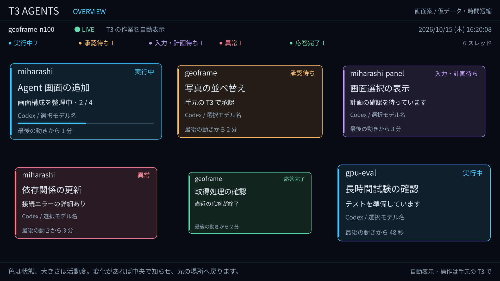
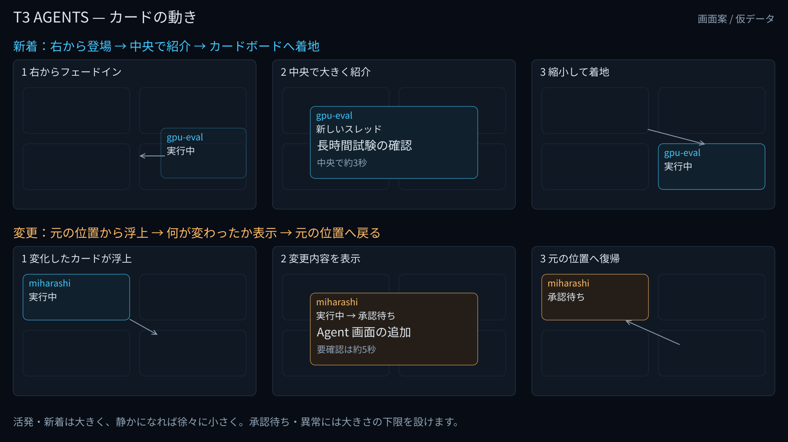
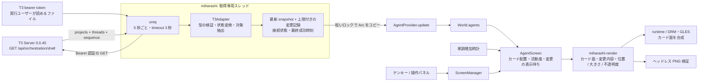
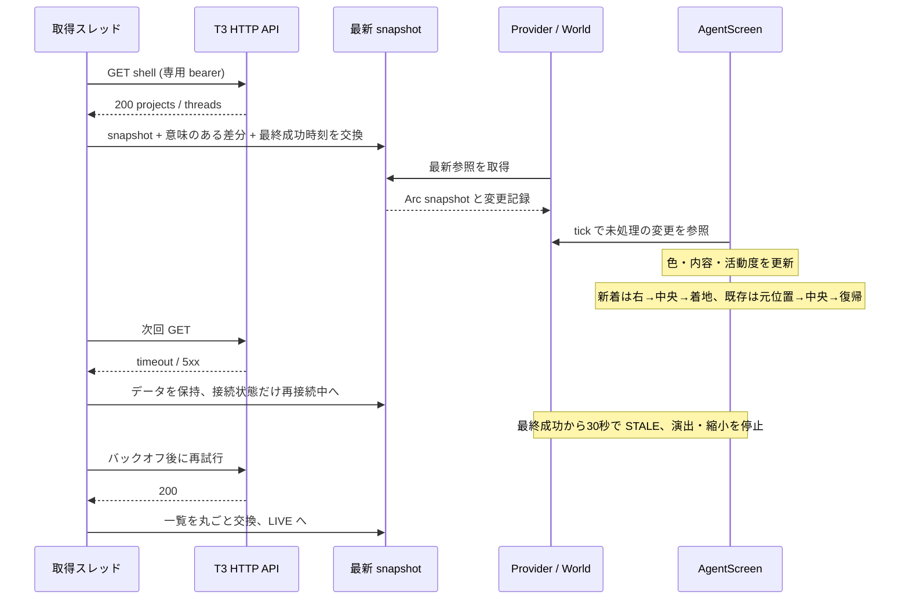

# T3 Agent 画面の概要設計

2026-10-15 作成・改訂。状態: **承認済み概要設計。実装・ローカル検証済み。実サーバーの認証済みshell APIも接続確認済み（15分セッション、GETのみ）**。
実装と検証の記録は [T3 Agent カードボード — 実装・検証記録](poc/T3-AGENTS.md) を参照。
基準: miharashi `4267f7c`、起動中の T3 Code **0.0.45 / orchestration protocol 1**。

## 1. 目的と提案

T3 で動かしている作業について「何が実行中か」「自分の応答が必要か」「エラーが出たか」を、
miharashi の常設モニターで把握できるようにする。

**推奨案は、T3 の HTTP 一覧 API を 5 秒ごとに読み、独立した `agents` 画面に表示する構成。**
既存の Rust / `ureq` / `Provider` / `Screen` を使う。追加の常駐サーバーは不要。
画面は **操作せずに眺めるカードボード 1 枚**。スレッドはプロジェクトごとの枠にまとめ、状態を色、
重要さと新しさを枠の中の並び順、変化を中央へのポップアップで知らせる。詳細画面や手動のカード選択は設けない。

ここでの「Agent」は **T3 の 1 スレッドに紐づく作業セッション**を指す。同じ Codex が複数のスレッドで
動いていれば別のカードになる。集計はスレッド数であり、OS のプロセス数や子エージェント数ではない。
子エージェントの親子関係は、今回確認した一覧スキーマでは取得できない。

既存の [画面の全体構成](DESIGN-screens.md) §1 にある「Hermes 連携をやめたため Agent 画面を作らない」は
当時の経緯として残す。今回の案は **T3 サーバーを取得元とする別の連携**で、Hermes exporter の再導入は含めない。

## 2. 調査結果と確度

### 2.1 実サーバーで確認したこと

| 項目 | 確認結果 |
|---|---|
| 接続先 | LAN のアドレスの 3773 番(`http://<LAN の IP>:3773`)。待受もこの LAN アドレスで、localhost の待受ではない |
| 環境 | `geoframe-n100`、Linux x64 |
| バージョン | `GET /.well-known/t3/environment` が 200。`serverVersion = 0.0.45`、`orchestrationProtocolVersion = 1` |
| 認証 | `GET /api/auth/session` が 200。policy は `remote-reachable`、初回認証は `one-time-token` |
| 一覧 API | 認証なしの `GET /api/orchestration/shell` は 401 `missing_credential` |
| MCP 認証情報 | この調査セッションの MCP 用 bearer を一覧 API に使うと 401 `invalid_credential`。画面用に流用できない。安定版 v0.0.45 の `t3 auth session issue` はscope指定に対応せず、発行tokenには更新権限も含まれる。miharashiは環境情報GETと認証付き一覧GETだけを行い、更新系APIは呼び出さない |
| Activity 配信 | descriptor の `agentActivityPublishing = false`。今回の取得経路には使わない |

2026-10-15の接続試験で、認証済み `GET /api/orchestration/shell` が HTTP 200を返し、2 projects / 3 threads、snapshotSequence 6783、7msを確認した。threadの内容値は記録・個別確認しておらず、継続負荷も未確認。試験セッションはread以外のスコープも持っていたため、GET後に失効させ、設定には登録していない。
以下のデータ項目と API 契約は、実行中と同じ 0.0.45 の配布済みクライアントから確認した。
画面案の値はすべて仮データである。T3 の内部 DB・会話ログの直接読み取りは行っていない。

### 2.2 配布クライアントで確認した契約

| 取得方法 | 内容と位置づけ |
|---|---|
| `GET /api/orchestration/shell` | 一覧用。`snapshotSequence`、`projects`、`threads`、`updatedAt`。初期実装はこれを使う |
| `GET /api/orchestration/threads/:threadId` | 本文・活動などを含む詳細。カードと変更表示には一覧の項目を使い、この API は呼ばない |
| `GET /api/orchestration/snapshot` | メッセージを含む全体データ。常時監視には使わない |
| WS `/ws` の `orchestration.subscribeShell` | 初期 snapshot と差分を購読できる。低遅延化・データ量削減が必要になった場合の候補 |

一覧の thread には `id`、`projectId`、`title`、`modelSelection`、`branch`、`worktreePath`、
`session`、`latestTurn`、`hasPendingApprovals`、`hasPendingUserInput`、`hasActionableProposedPlan`、
`backgroundLiveness`、`planProgress`、`archivedAt`、`updatedAt` などがある。

- `session.status`: `idle / starting / running / ready / interrupted / stopped / error`。
- `session`: provider 名・instance ID、active turn ID、`lastError`、更新時刻も持つ。null の場合もある。
- `latestTurn.state`: `running / interrupted / completed / error`。要求・開始・終了時刻を持つ。
- `planProgress`: 現在の step、完了 step 数、全 step 数。任意項目なので常にあるとは限らない。
- `backgroundLiveness`: `working / monitoring`。任意項目。

`latestTurn.completed` は **直近の応答が終わったこと**で、作業全体や PR の完了を保証しない。
`session.ready` も作業完了とはみなさない。

## 3. 初期実装の範囲

| 含めるもの | 後続の検討 |
|---|---|
| 1 台の T3 サーバー、全プロジェクトのスレッド一覧 | 複数環境の統合、画面上でのプロジェクト絞り込み |
| 状態色、プロジェクト / スレッドのカード、活動度に応じた大小 | 子エージェントのツリー、ツール実行履歴 |
| 新着の登場演出、変更時の中央ポップアップと元位置への復帰 | 会話本文、質問・承認の具体的な内容 |
| 取得失敗・認証切れ・古いデータ・0 件の表示 | T3 への入力・承認・中断操作、音や点灯による通知 |

初期実装は閲覧用とし、承認待ちを見つけたら手元の T3 で対応する。
接続失敗を「Agent が停止した」と扱わず、通信状態と作業状態を別に管理する。

## 4. 画面案

### 4.1 カードボード `OVERVIEW`



この SVG とモックは初期案(活動度でカードの大きさを変え、6 枚ごとにボードを切り替える)。
2026-10-15 にプロジェクトごとの枠へ変更した。配置は §4.2、件数が増えたときは §4.5 を正とする。

[動きのモック](assets/t3-agents-motion.html): 新着 → 中央で紹介 → 着地、状態変化 → 中央で変更内容 → 元位置へ、
時間経過による縮小を自動再生する。**仮データを使う設計確認用 HTML であり、T3 接続やキオスク実装ではない。**
モックの時間経過は短縮してある。6 枚で動きを確認するためのもので、大量カードの自動巡回や実サーバーとの
同期は含まない。

- 上部: `T3 AGENTS`、環境名、接続状態、最終取得時刻、時計。
- その下に小さな凡例兼件数表示。大きな集計タイルはなくし、カードを主役にする。
- **1 スレッド = 1 カード**。カードには状態ラベル・経過時間、スレッド名、詳細、モデル・進捗を表示する。
  プロジェクト名は枠の見出しに出し、カードには出さない(中央に出したカードだけは枠から離れるので出す)。
  新しいプロジェクトも最初のスレッドのカードとして登場し、空のプロジェクトだけの枠は作らない。
- 実行中・起動中・監視中はシアン、承認待ちはアンバー、入力・計画待ちは紫、異常は赤。
  応答完了は緑、待機・中断・不明はグレー。背景の淡い色、枠・左の帯、状態名で区別する。
- カードはクリック・選択・展開できない。状態変化の要点は自動の中央ポップアップで見せる。
- 後ろに重なったカードは上端の 1 行に状態・スレッド名・経過時間をまとめる。
  `planProgress` がなければ進捗 % を作らない。

### 4.2 プロジェクトの枠と配置

ボードは 1 枚だけにし、スレッドを **プロジェクトごとの枠**にまとめる。枠はプロジェクトを初めて見た順に
左から並べ、件数の増減で枠の順番を入れ替えない。枠の見出しはプロジェクト名、スレッド数、状態色の点。

| 項目 | 方針(1080p での値) |
|---|---|
| カードの基本の大きさ | 幅 380〜760px(列数で決まる)、高さ 210px |
| 列 | 1 枠 1 列が基本。幅 380px 以上を保てる数が目安(2560px 幅で 6 列、1920px 幅で 4 列)。積んでも枠が多いときは列を細くする |
| 件数が多い枠 | 列に余りがあれば、1 列あたりの件数が最も多い枠に列を足す |
| 列が足りない | 1〜数件の小さい枠を 1 列に縦に積む |
| 件数が少ない | 全部が入る列では、カードを縦に伸ばして列を埋める。伸びた分は折り返した題名・詳細に使う |
| それでも入らない列 | カードを重ねる。静かなものを上に重ねて 1 行だけ見せ、重要なものほど下の手前に全体を見せる |
| 重ねても入らない列 | 1 行が 40px を切る分は最も静かなものから隠し、列の上に「ほか N 件」と出す |

枠の中の並びは、要確認(承認・入力・計画待ち・異常)、実行中、最後の意味のある変化が新しい順、
T3 の `updatedAt` の新しい順。初期案の「活動度でカードの大きさを変える」はやめ、この並び順で表す。
並びや件数が変わったときは、カードを 0.5 秒で新しい位置へ滑らせる。
識別キーは `(environmentId, threadId)`。中央に出ている間も、そのカードの位置は空けて予約しておく。

### 4.3 変化を見せる動き



**新着のカード**は、右の画面外から薄く現れ、中央へ移動しながら大きくなる。
中央で「新しいスレッド」とプロジェクト / スレッド名・現在の状態を見せ、
少し下に着地する感覚で縮小し、カードボードの空き位置へ収まる。

**既存カードの変化**は、そのカードが元の場所から中央へ浮き上がって拡大する。
「実行中 → 承認待ち」「計画の進捗 2/4 → 3/4」「応答が終了」のように、**何が変わったか**を表示する。
表示後は縮小しながら元の場所へ戻る。別の詳細画面に遷移したり、同じカードを二重に置いたりしない。

| 段階 | 新着 | 既存の変化 | 仮の時間 |
|---|---|---|---|
| 登場 / 浮上 | 右外 → 中央、fade-in・拡大 | 元位置 → 中央、拡大 | 0.7 秒 |
| 注目 | 新しいスレッドの紹介 | 前後の状態・変更の要点 | 通常 3 秒、要確認・異常は 5 秒 |
| 着地 / 復帰 | 空き位置へ移動・縮小 | 元位置へ移動・縮小 | 0.8 秒 |

イージングは滑らかな加減速。ポップダウンは「中央からカードボードに収まる」動きとして扱い、
強いバウンドや点滅は使わない。背景は少し暗くする程度とし、他のカードの存在が分かるようにする。

初回取得の既存カードはまとめて静かに配置し、すべてを新着として順番に飛び込ませない。
初回以降に初めて見つかった ID を新着とするが、実際の作成時刻を確認できないものは「新しく検出」と表示する。
再接続は一括同期として扱い、大量の新着演出を再生しない。

### 4.4 更新の選び方・重なった場合

意味のある変化は、正規化状態、待ちフラグ、active turn ID、計画の step / 完了数、タイトル、エラー要約の変化。
`updatedAt` だけの変化、取得時刻、経過秒の進行では中央に出さない。
新着・承認 / 入力 / 計画待ち・異常・応答終了・実行再開を優先する。
同じ状態の進捗更新はカード内へ即時反映し、中央への表示は同じスレッドで 15 秒に 1 回までにまとめる。

- 中央に出すカードは **同時に 1 枚**。通知が重なってもカード同士をぶつけない。
- 表示待ちの更新はスレッド単位にまとめ、最新の値で表示する。解決済みの承認待ちを後から強調しない。
- 通常は受信順。要確認・異常は未表示の進捗更新より先に出す。すでに中央で表示中のカードは途中で割り込まない。
- 待ち行列は最大 32 スレッド。あふれた進捗更新は中央演出を省き、件数を「ほか N 件更新」と表示する。
  30 秒以上前の変更は一括の更新表示にまとめ、古い演出を長く再生し続けない。
- 非表示・消灯・地震災害アラート中は演出を止め、最新状態の取り込みだけ続ける。復帰時は現在のカードを静かに表示する。
- HTTP の 5 秒取得では取得間の細かな遷移は見えない。変更表示は **前回観測した値と今回の差**であり、全イベント履歴ではない。

### 4.5 件数が増えた場合・カードの退場

件数が増えてもボードは増やさず、§4.2 のとおり列を足す・小さい枠を積む・カードを重ねるの順で 1 枚に収める。
上部には「N スレッド · M プロジェクト」と、要確認があれば「要確認 N 件」を出す。
新着は自分のプロジェクトの枠に位置を予約してから中央で紹介し、その位置へ着地する。

対象は `archivedAt == null` のうち実行中・要確認・異常のスレッドと、最近 24 時間に更新されたその他のスレッド。
前者は古くても除外しない。`settled` だけで除外しない。小さくなっただけでは削除せず、対象外・アーカイブ・削除で
フェードアウトする。対象が中央表示中に消えたときも重複や空のカードを残さず退場する。
これらの時間・件数は画面案の初期値として実機で調整する。

### 4.6 共通操作との関係

`agents` 内に操作は設けない。5・8・2 は何も実行せず、カードのクリックもない。
既存の 4/6・0 や操作パネルで **他の画面へ切り替える共通操作**はそのまま残す。
`id = agents`、title は `T3 AGENTS`。現在の登録済み画面の末尾へ追加する。
地震・災害アラートは引き続き最前面。Agent の待ち状態だけで点灯させる変更は含めない。

### 4.7 データがない・古い場合

| 状態 | 表示 |
|---|---|
| 初回取得前 | 接続しています。カードはまだ置かず、件数は `--` |
| 取得成功・対象 0 件 | 対象のスレッドはありません。集計は 0、最終取得時刻は表示 |
| 通信失敗 | 再接続中。最後の取得時刻とキャッシュを表示 |
| 最終成功から 30 秒以上 | `STALE / 最終取得 hh:mm:ss`。カードは薄くし「前回取得時」と表示。活動度の縮小と新しい演出を止める |
| 401 | 認証が必要。取得済みデータがあれば「前回取得時」として表示 |
| 403 | 閲覧権限が不足。認証失敗と区別 |
| 応答形式・互換性エラー | T3 API を確認してください。最後の値を保持 |

接続失敗・認証失敗は、30 秒を待たずヘッダーに出す。鮮度は **ローカルで最後に取得に成功してからの経過**で
判定する。スレッドの `updatedAt` が古いだけでは STALE にしない。
疎通が戻り、正しい一覧を取得できたときにのみ LIVE に戻す。

## 5. 状態の変換

T3 の値を表示用 `AgentState` に変換する。上から最初に一致した条件を主状態とする。
承認・入力・計画のフラグは同時に立ちうるため、主状態以外もカードの補助バッジで示す。

| 条件 | 表示 | 集計 |
|---|---|---|
| `hasPendingApprovals` | 承認待ち | 承認待ち |
| `hasPendingUserInput` | 入力待ち | 入力・計画待ち |
| `hasActionableProposedPlan` | 計画の確認待ち | 入力・計画待ち |
| `session.status == error`、または直近 turn が error で、それより新しい active turn がない | 異常 | 異常 |
| `session.status == starting` | 起動中 | 実行中 |
| `backgroundLiveness == monitoring` | 監視中 | 実行中 |
| `session.status == running`、active turn がある、または `backgroundLiveness == working` | 実行中 | 実行中 |
| `session.status == interrupted / stopped` | 中断 / 停止 | その他 |
| `latestTurn.state == interrupted` | 中断 | その他 |
| `latestTurn.state == completed` | 応答完了 | 応答完了 |
| `session.status == idle / ready` | 待機 | その他 |
| セッションなし・未知の値・矛盾する情報 | 未開始 / 不明 | その他 |

異常の判定は active turn ID と latest turn ID も照合する。前回の失敗のあとに新しい turn が始まっていれば、
過去の error で新しい実行を上書きしない。`lastError` という文字列が残っているだけでも異常とは判定しない。
内部には raw status も保持する。未知の列挙値は正常や停止へ丸めず「不明」にする。
「監視中」はフリーズの推測ではなく、取得元の明示値に限る。

## 6. データフロー

### 6.1 全体構成



1. 起動時に設定・認証ファイルを読み、取得スレッドを開始する。有効時だけ画面と Provider を登録する。
2. 取得スレッドが即時に 1 回、その後は 5 秒ごとに一覧を GET する。同時リクエストは 1 本。
3. レスポンスを検証し、project ID で名前を結合、状態を変換する。前回の成功値との差から
   新着・状態変化・進捗などの `AgentChange` を作り、ローカルで単調増加する ID を付ける。
   最新 snapshot と最大 64 件の変更記録を一括で交換する。同じ取得値では変更記録を作らない。
4. `AgentProvider::update` は snapshot と変更記録の共有参照を `World.agents` に写すだけ。
   ネットワーク待ち・JSON 解析・認証ファイルの読み取りを描画ループで行わない。
5. `AgentScreen` は最後に処理した変更 ID 以降を 1 回だけ取り込み、活動度とカード内容を更新する。
   上限付きの中央表示待ちへまとめ、画面が表示中なら `登場 → 注目 → 復帰` を `Instant` で進める。
   64 件を超える取得があれば最新 snapshot へ追従し、一括更新として示す。
6. 描画層はカード面を作り、GPU で位置・拡大縮小・不透明度を補間して合成する。
   `ScreenManager` の共通の重ね描きと runtime の出力へつなぐ。

現実の `ScreenManager::tick` は **画面の tick の後に Provider.update** を呼ぶ。
この順序はそのまま使い、次の画面 tick で変更を取り込む。データ反映の目安は **取得周期 5 秒 + 通信時間 + 次の tick**。
中央演出には表示待ち時間が別に加わるが、カードの色・内容は最新値へ先に更新する。
画面が非表示・モニターが消灯中でも収集は継続し、過去の演出だけをため込まない。

活動度は時刻から計算する。縮小の目標は 15 秒ごとに見直して短い補間でつなぎ、数分間ずっと 60fps で
再描画し続けない。GPU では移動・拡縮・fade の間だけ `Screen::animating()` を true にし、内容が変わらない
カード面は再描画・転送しない。初期目標は移動中 60fps、CPU 経路は同じ動きを低い fps で成立させてから測定する。
滑らかさや CPU 費用は未検証で、静止画の全面描き直しだけでは要件達成としない。

### 6.2 取得・失敗の時系列



通信失敗は 5 → 10 → 20 → 30 秒のバックオフ、成功後は 5 秒に戻す。
401/403 は認証エラーとして通常の取得を止め、認証ファイルの変更を 30 秒間隔で確認して再開する。
429 は `Retry-After` を尊重する。HTTP の全体 timeout は初期値 3 秒とし、LAN で測定して調整する。

HTTP 方式では毎回完全な snapshot を受け取り、消えたカードも次の成功時に退場できる。
部分的な解析成功を完全な一覧として採用しない。未知の追加フィールドは許容し、必須構造が壊れていれば
前回値を保持する。未知の状態値はそのカードを「不明」にする。sequence は記録するが、再起動時に小さくなっても
新しい成功レスポンスを拒否しない。ETag / 304 の対応は未確認で、初期案では前提にしない。

## 7. データモデルと項目の対応

以下は miharashi 内部の **追加案**。T3 API のレスポンスそのものではない。

| 内部データ | 主な項目 |
|---|---|
| `AgentSnapshot` | environment ID / label、server version、sequence、`Arc<[AgentEntry]>`、上限付き変更記録、接続状態、最終成功の wall clock と `Instant`、取得エラー種別 |
| `AgentEntry` | thread / project ID、project / thread 名、provider、model、正規化状態と raw status、待ちフラグ、step 進捗、branch、時刻、エラー要約 |
| `AgentChange` | ローカル変更 ID、thread ID、種類、前後の状態と進捗、観測時刻。初回・再同期と通常更新を区別 |
| `AgentScreen` | カードの帰る場所、活動度の基準時刻、処理済み変更 ID、自動巡回、中央表示の待ち行列・段階・開始時刻 |
| `AgentsView` | 凡例兼件数、カード面、各位置・大きさ・不透明度、中央に出す変更内容、取得状態の帯 |

| 画面の項目 | T3 の取得元 | 欠損時 |
|---|---|---|
| 環境名 / version | environment descriptor | 設定の接続先を表示 |
| プロジェクト名 | `projects[].title` を `thread.projectId` で結合 | project ID の短縮形 |
| 作業名 | `thread.title` | 無題 |
| provider | `session.providerName`、なければ `modelSelection.instanceId` | `--`。instance ID を正式な製品名と決めつけない |
| モデル | `thread.modelSelection.model` | 表示を省く。現在の選択値であり、実行時の使用モデルとは限らない |
| 状態 / 待ち理由 | §5 の値 | 不明 |
| 進捗 | `planProgress.step / completedSteps / totalSteps` | 進捗情報なし。擬似的な % は作らない |
| 実行経過 | active turn と一致する `latestTurn.startedAt`、なければ `requestedAt` | `--` |
| 最終変更 | `thread.updatedAt` | `--` |
| 応答終了 | `latestTurn.completedAt` | `--` |
| エラー補足 | `session.lastError` | エラー詳細なし。中央の変更表示で短い要約を使う |
| 新着・変更の表示 | 前回成功時との差、`createdAt`、状態・待ちフラグ・進捗等 | 未観測の途中経過を推測しない |

branch / worktree は初期画面に出さない。中央ポップアップも同じ shell データで構成し、会話の要約を生成しない。

進捗の全 step 数が 0、範囲が矛盾、時刻が未来の場合はバーや経過時間を `--` にし、異常な数値を描画しない。
受信文字列は制御文字を除き、表示枠に合わせて省略する。会話本文・添付・承認 payload は取得しない。

## 8. 接続・認証・設定案

一覧 API は認証が必要。v0.0.45 の `t3 auth session issue` はscope指定に対応せず、発行tokenは `orchestration:operate` など更新系を含む広い権限を持つ。そこで、ペアリング用トークンを `POST /oauth/token` で `orchestration:read` だけのトークンに交換し、週 1 回作り直す([トークンの更新](DESIGN-t3-token.md))。Bearer tokenは `GET /api/orchestration/shell` にだけ使い、表示用の環境情報は認証なしの `GET /.well-known/t3/environment` で取得する。更新系APIは呼び出さない。

```toml
[agents]
enabled = true
url = "http://192.0.2.10:3773"
token_file = "/var/lib/miharashi/t3-agent.token"
poll_secs = 5
timeout_secs = 3
stale_secs = 30
recent_hours = 24
```

- token ファイルは実行ユーザーが読める 0600、または管理者所有・実行ユーザーのグループだけ読める 0640。
- 平文 HTTP は既存の HA 連携と同様、明示した IP / localhost に限定する。現在の LAN 宛て HTTP は暗号化されないため、
  信頼できる LAN 内の接続として扱う。外部へ接続する場合は HTTPS を使う。
- Authorization 付きの他ホストへの redirect は追わない。認証エラー本文・URL の query に秘密を残さない。
- descriptor は起動時と再接続時に確認する。0.0.45 を互換性検証の基準とし、更新時は契約を再確認する。

## 9. 取得方式の比較

| 案 | 利点 | 費用・制約 | 判断 |
|---|---|---|---|
| Rust から HTTP shell を定期取得 | 既存の `ureq` を使える。別サービス不要。再取得で状態が揃う | 数秒の遅延。全件取得のサイズ・負荷を実測する必要 | **初期案** |
| Rust から WS subscribeShell | 差分で低遅延 | WS と T3 / Effect RPC の framing、sequence、再購読、認証 ticket などの対応が増える | 必要時に追加 |
| TypeScript 取得ブリッジ → miharashi | T3 固有のクライアント処理を分離できる | 別プロセス・配布・認証・障害箇所が増える | 現状は追加しない |

WS に移す場合は初期 snapshot と `thread/project-upserted`、`thread/project-removed` を適用し、
切断・sequence の不整合時に全体を同期し直す。変更のない時間を疎通失敗と誤認しない生存確認も必要になる。

## 10. 実装の配置と進め方

既存の実装では `World` は `system` と `photo_feed` だけであり、Agent 領域はまだない。
以前の設計書の `Option<AgentSnapshot>` や registry 自動 PNG 出力を、実装済みとは扱わない。

| 追加・変更先 | 内容 |
|---|---|
| `crates/miharashi-app/src/agents.rs` (新規) | T3 DTO / adapter、取得スレッド、意味のある差分、上限付き変更記録、`AgentProvider` |
| `crates/miharashi-app/src/screen.rs` | `World.agents`、カード合成用の `Composite` variant の追加。`Provider` 契約は維持 |
| `crates/miharashi-app/src/app/screens/agents.rs` (新規) | 帰る場所、活動度、演出の状態機械・待ち行列、自動巡回。画面内操作なし |
| `crates/miharashi-render/src/agents.rs` (新規) | カード面・変更内容と CPU 合成。ネットワークを持たせない |
| `crates/miharashi-gpu/src/compose.rs` / app の `runtime.rs` | キャッシュしたカード面を位置・拡縮・不透明度で合成する経路と `Composite` の接続 |
| `config.rs` / `config/example.toml` | `[agents]` と値の検証 |
| `app.rs` / `main.rs` | module 宣言、取得開始、有効時の画面 / Provider 登録、PNG 用の仮データと出力追加 |
| ドキュメント | 接続手順、操作、実機確認結果。既存の Hermes 連携中止と今回の T3 連携を区別 |

カードの動きには新しい GPU 合成経路を設け、runtime にその接続を足す。既存の `Canvas / Photo / Radar` の
合成とアラートの前面表示を維持する。操作パネルの `screens` は登録画面から作られるので、新しい id の登録で
選択肢になる。個別カード操作をパネル API に足す必要はない。

| 段階 | 成果と確認 |
|---|---|
| A: 接続 PoC | 専用tokenで shell の200。会話本文を出さず項目・件数・応答サイズ・時間を確認。token の期限と更新方法を決める |
| B: 取得と変換 | 同じ snapshot で通知を繰り返さないこと、意味のある差分、初回・再同期・未知値・認証失敗を確認 |
| C: 画面 | カード・中央表示・着地の PNG と動画。新着・変更・縮小・大量更新・削除・自動巡回を仮の時計で確認 |
| D: 実機 | アラート・画面切替・消灯からの復帰、T3 停止 / 再起動。移動中の frame 時間、静止時の CPU、RSS・転送量を測定 |

受け入れの目安は、通常 5 秒の取得周期で状態が反映されること、失敗から 30 秒以内に古い値と分かること、
新着は右から中央を経て着地し、既存カードは元の場所へ戻ること、時間だけで活動度が下がり下限で止まること。
承認待ち・異常が小さく埋もれず、操作なしで全カードを確認でき、長時間取得してもキューやメモリが増え続けないこと。
性能値は [監視のコスト](DESIGN-monitoring-cost.md) の方針に沿って **miharashi と T3 の両方**を測る。
初期試験では応答上限を 4 MiB とし、超過時は一覧を途中まで採用せず取得エラーにする。
実サイズと全件取得の負荷が大きければ、対象削減の API 可否や WS 方式を再検討する。

## 11. 実装前に解決する事項

1. token の期限・更新方法と配置。→ [DESIGN-t3-token.md](DESIGN-t3-token.md) で決めた(読み取りだけのトークンを週 1 回作り直す)。miharashi 側も一覧APIのGETのみに固定する。
2. 認証済み shell の実レスポンス。未取得・停止・完了・承認待ち・バックグラウンド監視時の値の組み合わせ。
3. 日常のスレッド件数・応答サイズ・CPU / 通信量。5 秒間隔と「最近 24 時間」の妥当性。
4. 中央の滞在時間、活動度の減衰、自動巡回の間隔と、GPU カード合成の性能。

以上は実データの接続確認で詰める項目であり、この文書の画面案を実機で確認済みという意味ではない。

## 12. 参照根拠

- miharashi `4267f7c`: `crates/miharashi-app/src/screen.rs`、`app.rs`、`app/manager.rs`、`main.rs`、`config.rs`。
- [画面管理インターフェース](DESIGN-screen-interface.md) §10 以降の実装記録、[画面の全体構成](DESIGN-screens.md)。
- 実機 HTTP 調査: `/.well-known/t3/environment`、`/api/auth/session`、`/api/orchestration/shell` (2026-10-15)。
- T3 **0.0.45 配布物**: `~/.t3/runtime/versions/0.0.45/client/assets/utils-OGVAI8-o.js`。
  HTTP `shellSnapshot` 定義、shell / thread / session / latestTurn スキーマ、認証 scope / token exchange 契約。
- 同配布物 `atomRegistry-9jUeosI9.js`: protocol version 検査、WS ticket 発行と接続。

参照したのは稼働バージョンの配布物で、upstream HEAD や公開 API の将来の互換性を保証するものではない。
