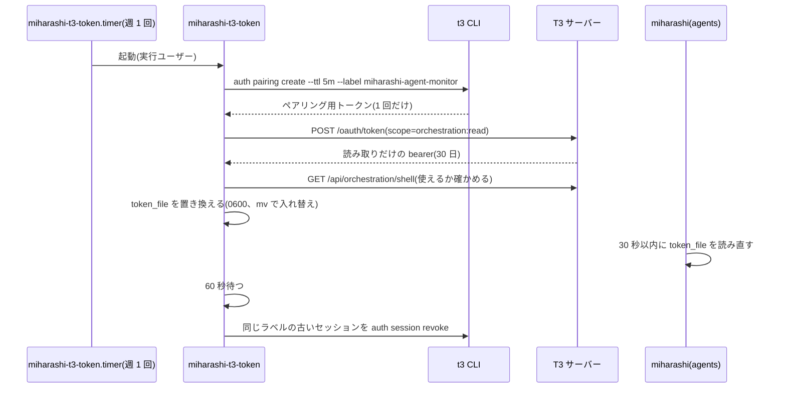

# 設計: T3 Agent 画面のトークンの更新

T3 Agent 画面(`agents`、[概要設計](DESIGN-t3-agent-monitor.md))は、T3 の一覧 API を bearer トークンで読む。
このトークンには期限がある。この文書は、T3 の認証の仕組みを調べた結果と、トークンを手で差し替えずに済ませる方法をまとめる。

調べたのは T3 Code **v0.0.45**(github.com/pingdotgg/t3code のタグ `v0.0.45`)のソース。v0.0.46 の preview でも、
下の「延長・refresh の仕組みが無い」点は変わっていない。T3 を上げたときは §5 を見直す。

## 1. T3 の認証の仕組み(v0.0.45)

### 1.1 トークンの種類

| もの | 作り方 | 期限 | 使える回数 | 権限 |
|---|---|---|---|---|
| bearer セッション | `t3 auth session issue` | 既定 30 日。`--ttl` で変えられ、上限は無い | 期限まで何度でも | 管理者の権限すべて(`terminal:operate`・`access:write` など) |
| ペアリング用トークン | `t3 auth pairing create`(または画面の「ペアリング」) | 既定 5 分 | **1 回だけ** | 交換するときに絞れる(§1.2) |
| desktop-bootstrap | デスクトップアプリが、自分で起動したサーバーに渡す | 24 時間(起動のたびに作り直す) | 何度でも | 管理者の権限 |

- bearer の期限が切れると、HTTP も WebSocket も拒否される。セッションを延長する API や、OAuth の refresh トークンにあたるものは無い。
- ペアリング用トークンは、交換した時点で使用済みになる。OAuth にたとえると refresh トークンではなく、使い捨ての認可コードに近い。
- 何度でも交換できる種は desktop-bootstrap だけで、デスクトップアプリのプロセスの中にしか無い。外から作ることはできない。

参照: `apps/server/src/auth/SessionStore.ts`(既定の期限、期限切れの判定)、`apps/server/src/auth/PairingGrantStore.ts`
(使用済みにする処理、desktop-bootstrap)、`apps/server/src/cli/auth.ts`(CLI が付ける権限)。

### 1.2 ペアリング用トークンの交換(`POST /oauth/token`)

OAuth のトークン交換(RFC 8693)の形で、フォーム(`application/x-www-form-urlencoded`)を送る。

| 項目 | 値 |
|---|---|
| `grant_type` | `urn:ietf:params:oauth:grant-type:token-exchange` |
| `subject_token` | ペアリング用トークン |
| `subject_token_type` | `urn:t3:params:oauth:token-type:environment-bootstrap` |
| `requested_token_type` | `urn:ietf:params:oauth:token-type:access_token` |
| `scope` | 欲しい権限を空白区切りで(例: `orchestration:read`)。ペアリング用トークンが持つ権限の中から選ぶ |
| `client_label`・`client_device_type` | セッションの一覧に出る名前と種類(任意) |

- 返ってくるのは bearer トークンで、期限は 30 日(DPoP を使うときだけ 1 時間)。
- `scope` で絞れるので、**読み取りだけ(`orchestration:read`)のトークン**を作れる。`session issue` ではできない。
- 読み取りだけのトークンで書き込み系の API(例: `POST /api/auth/pairing-token`)を呼ぶと、403(`insufficient_scope`)になる(実機で確認)。

参照: `packages/contracts/src/auth.ts`(`AuthTokenExchangeRequest`)、`apps/server/src/auth/http.ts`(`token`)、
`apps/server/src/auth/EnvironmentAuth.ts`(`exchangeBootstrapCredentialForAccessToken`)。

### 1.3 公式のアプリはどうしているか

| つなぎ方 | 更新 |
|---|---|
| デスクトップアプリが自分で起動したサーバー | desktop-bootstrap を何度でも交換し直すので、切れない |
| T3 クラウド(relay)経由 | DPoP の 1 時間のトークンを、期限の手前でクラウドから種をもらい直して交換する(`packages/client-runtime/src/authorization/service.ts`) |
| LAN でペアリングしたリモートのサーバー | **更新しない**。30 日で切れ、もう一度ペアリングする(`packages/client-runtime/src/state/environmentHttpAuth.ts` は DPoP のときだけ交換し直す) |

miharashi は 3 つ目と同じ立場(LAN のサーバーを bearer で読む)なので、何もしなければ 30 日ごとに差し替えが要る。

## 2. 選んだ方法: 週 1 回、読み取りだけのトークンを作り直す

miharashi は T3 と同じマシンで、T3 を動かしているのと同じユーザーとして動く。そのユーザーは手元の `t3` CLI で
ペアリング用トークンを作れる。これを使い、systemd のタイマーで週 1 回、次の手順を回す(`systemd/miharashi-t3-token`)。

- 権限が `orchestration:read` だけになっていなければ、トークンを置き換えずに止める。
- 新しいトークンで一覧を読めなければ、置き換えずに止める(古いトークンはそのまま使える)。
- 交換の前に失敗したら、使わなかったペアリング用トークンを消す。
- トークンはコマンドの引数・環境変数・ログに出さない。一時ファイル(0600、終わったら消す)で curl に渡す。
- 失敗するとサービスが failed になり、状況画面の DETAILS の「failed ユニット」に出る。トークンは 30 日もつので、
  週 1 回なら 3 回続けて失敗しても切れる前に気づける。

### 2.1 外部のスクリプトにした理由

miharashi の画面の部品の中で更新する案(部品から `t3` CLI を呼ぶ)も考えた。外に出したのは次の理由。

- miharashi の取得処理は、決めた URL に GET するだけにしておける(T3 の CLI や認証の手順に依存しない)。
- T3 の CLI や交換の形が変わっても、直すのはスクリプト 1 本で、キオスクを作り直さずに済む。
- 手で差し替える運用(§3)と、ファイルを置き換えるという同じ仕組みを共有できる。

設定ファイルにペアリング用トークンを置いて miharashi が交換する案は、ペアリング用トークンが 1 回しか使えない(§1.1)ので成り立たない。

### 2.2 採らなかった方法

| 方法 | 採らない理由 |
|---|---|
| `t3 auth session issue --ttl 3650d` で長い期限にする | 管理者の権限すべて(端末の操作を含む)を持つトークンが長く残る。LAN 上は平文の HTTP なので、漏れたときの影響が大きい |
| T3 クラウド(relay)経由でつなぐ | T3 のアカウントと外部のサービスを経由する。家の中で閉じる構成に合わない |
| 認証なしで読む | v0.0.45 には、ローカルからの接続を信用する設定が無い |

## 3. 運用

- 導入・確認・手で差し替える手順は [USAGE.md の「T3 Agent 一覧」](USAGE.md#t3-agent-一覧)。
- `[agents] token_file` は、実行ユーザーが書ける `/var/lib/miharashi/t3-agent.token` にする(スクリプトが置き換えるため)。
- T3 のセッションの一覧では、ラベル `miharashi-agent-monitor`・権限 `orchestration:read` のものが常に 1 つになる。

## 4. 制約

- T3 と同じマシン・同じユーザーで動かす前提。別のマシンの T3 を読むときは、この自動更新は使えない(手で差し替える)。
- `t3` CLI の `--json` の出力と、`/oauth/token` の形に依存する。
- LAN でペアリングした他のクライアント(別の PC のデスクトップアプリなど)も 30 日で切れる。それは T3 の仕様で、この仕組みの対象外。

## 5. T3 を上げたときに確かめること

1. `t3 auth pairing create --json` が `id` と `credential` を返すか。
2. `POST /oauth/token` が上の項目で読み取りだけのトークンを返すか(`systemctl start miharashi-t3-token` で試せる)。
3. セッションの延長・refresh の仕組みが入ったか。入っていれば、この仕組みをそれに置き換える。
