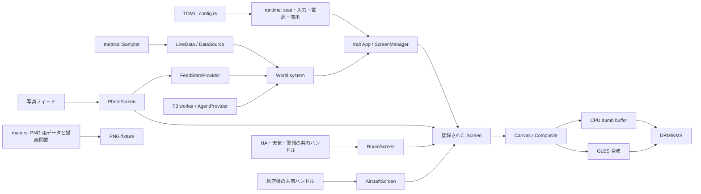

# Miharashi — 技術設計書

版: 0.4 / 作成日: 2026-10-11 / ソース照合: 2026-10-16
要件の基準: [PRD](PRD.md)。この文書は現在の実装を説明する。実機での確認結果は [検証記録](README.md#検証記録)、操作と導入手順は [使い方](USAGE.md) を参照。

## 1. 設計の中心

Linux の DRM/KMS に直接表示するキオスク。デスクトップ環境は使わない。画面ロジックと、seat・入力・表示先を扱う実行ループを分ける。

CPU の描画は tiny-skia・cosmic-text・image、GPU の合成は OpenGL ES 3.2 を使う。文字やカード画像の生成は CPU、写真の配置・ぼかし・フェード、航空機のレーダー、T3 Agent のカードの移動・拡縮・透明度は GPU 経路で扱う。Taffy・Plotters・Tokio・汎用 AgentAdapter は採用していない。

表示先と監視する GPU は別設定である。CPU/GPU の型番や `/dev/dri/cardN` の番号を製品の前提にしない。

## 2. 全体構成



`png` は各画面の描画関数を使う確認用コマンドで、実行中の KMS 画面のキャプチャでも、Screen の登録一覧をそのまま回す仕組みでもない。

## 3. Rust ワークスペース

| crate | 責務 | 主なソース |
|---|---|---|
| `miharashi-render` | Canvas、文字、グラフ、各画面の描画、地図、メニュー、グリッチ | `src/canvas.rs`・`text.rs`・`screens.rs`・`agents.rs` など |
| `miharashi-linux` | libseat、evdev、DRM/KMS、CPU/GPU・電力量の収集 | `src/seat.rs`・`input.rs`・`drm_select.rs`・`kms.rs`・`metrics.rs` |
| `miharashi-gpu` | EGL/GBM/GLES、写真・レーダー・カードの合成、offscreen 検証 | `src/display.rs`・`compose.rs`・`photo.rs`・`offscreen.rs` |
| `miharashi-video` | FFmpeg/VA-API の動画ベンチマーク | `src/lib.rs` |
| `miharashi-app` | CLI、設定、runtime、画面管理、外部データ取得、操作パネル | `src/main.rs`・`config.rs`・`runtime.rs`・`screen.rs`・`app/` |

既定のビルド対象は video を除く 4 crate。app の Linux/GPU 依存は Linux 向けに限定し、video は `--features miharashi-app/video` で有効にする。render は Linux 専用 crate に依存しない。実際の依存は各 `Cargo.toml` と `Cargo.lock` を基準にする。

## 4. 共通フレームと描画形式

[`Canvas`](../crates/miharashi-render/src/canvas.rs) は tiny-skia の `Pixmap` を持つ。内部形式は premultiplied RGBA8、上から下、stride は `width × 4`。PNG 保存は `Pixmap::save_png` に委ねる。

CPU の KMS 出力は XRGB8888。`Canvas::write_xrgb8888` がメモリ上の B/G/R/X に変換し、DRM が返した pitch に合わせて各行へ書く。CPU 経路の `kms::Display` は 1 枚の dumb buffer に書き込む。GLES 経路の表示は `miharashi-gpu` が扱う。

GPU 経路では [`Composite`](../crates/miharashi-app/src/screen.rs) が次の描画内容を runtime へ渡す。

| 種類 | 内容 |
|---|---|
| `Canvas` | CPU で描いた完成画面 |
| `Photo` | 写真と透明な重ね絵。写真は CPU 合成済み、デコード済みの元画像、GPU に保持済みのいずれか |
| `Radar` | 航空機の背景とレーダーの幾何情報 |
| `Agents` | 背景とカードの描画情報 |

CPU 経路でも各画面を描ける。GPU の背景・写真・カードのキャッシュは、画面復帰や重ね絵の変更時に無効化・更新する。

## 5. UI レイアウトと文字

各画面の Rust コードで寸法から座標を計算し、グラフは自前の描画関数で描く。`TextEngine` は cosmic-text のフォントと字形キャッシュを持ち、ScreenManager が画面間で共有する。`ui.font` でフォントを指定できる。

写真は `photo_layout` で配置を決め、CPU と GPU で同じ配置を使う。写真画面は現在・次の写真やフェードの状態を所有する。デコードは取得側で行い、毎フレーム繰り返さない。GPU のテクスチャ上限を超える写真は CPU で完成フレームを作る。

## 6. 収集と状態モデル

外部取得は `std::thread` と同期 HTTP クライアント `ureq` を使う。描画ループで HTTP 完了を待たず、取得側の共有値や受信イベントを読む。

[`World`](../crates/miharashi-app/src/screen.rs) の実フィールドは次の 3 つ。

| 領域 | 更新元 | 用途 |
|---|---|---|
| `system: Snapshot` | ScreenManager が `DataSource::update` を 1 秒ごとに呼ぶ。日付と時刻もここに設定 | 状況画面と共通の時計 |
| `photo_feed: FeedState` | `FeedStateProvider` | 写真の接続状態・位置、状況画面の HEALTH、操作パネル |
| `agents: AgentSnapshot` | `AgentProvider` | T3 の一覧・変更・接続状態 |

室内環境・天気・警報は `RoomScreen` の `RoomFeeds`、航空機は `AircraftScreen` の `Shared` が直接保持する。`World.clock`・`env`・`weather`・`warnings`・`aircraft`・`llm` というフィールドはない。

システムの実測値は `metrics::Sampler` がバックグラウンドで集め、`LiveData` が画面用の `Snapshot` に写す。履歴は `data::HISTORY = 120` 点。初期の履歴は 0 で埋める。個々のセンサー値は `Option` で欠損を扱う。

- CPU・メモリ・PSI・通信量などは `/proc`、温度・ファンなどは sysfs/hwmon を読む。
- NVIDIA の監視は NVML、内蔵 GPU は DRM/sysfs を使う。取得できない値は欠損表示になる。
- CPU 電力は RAPL。任意の root ヘルパーが値を書き出し、キオスク本体は一般ユーザーで読む。GPU の電力と混同しない。
- 監視項目は毎秒・5 秒・30 秒などに分けて取得する。間隔とコストの記録は [監視のコスト](DESIGN-monitoring-cost.md) にある。

T3 は専用 worker が環境情報と一覧 API を GET する。会話本文は取得しない。トークンは専用ファイルから読み直す。仕様と制約は [概要設計](DESIGN-t3-agent-monitor.md)、[トークン更新](DESIGN-t3-token.md) に記載。デモは `agent_demo` の仮データで、Hermes/OpenClaw 用の Adapter は実装していない。

## 7. 入力とナビゲーション

Linux の `input::Action` は `Prev / Select / Next / Up / Down / Menu / Quit`。runtime が Quit を処理し、ほかの 6 種類を app の `KeyPress` に変換する。物理キーのリピートは無視する。

ScreenManager は 4/6 の画面巡回と 0 のメニューを処理し、5・8/2 を画面の `ScreenAction` に渡す。画面で使わない操作は何もしない。メニュー中は 8/2(4/6 も)で選択、5 で移動、0 で閉じる。アラート中の通常キーはアラートを閉じる。Esc/q は runtime の終了操作で、アラートを閉じるキーにはならない。

消灯中の通常キーは点灯だけに使い、画面を切り替えない。手動の `force_off` ではキーを押しても点灯しない。入力デバイスがないときは 10 秒間隔で再検出する。操作パネルが有効ならキーボードなしでも起動できる。

`runtime.quit_key` 設定は存在しない。systemd は正常終了でも再起動するので、常駐を止めるときは `systemctl stop miharashi` を使う。

## 8. DRM デバイス選択

[`drm_select.rs`](../crates/miharashi-linux/src/drm_select.rs) が sysfs のカードと接続状態を調べる。

- `display.card`: `auto`、デバイスパス、`pci:`、`driver:`。auto は接続済みコネクターのあるカードから `boot_vga` でないものを優先する。
- `display.connector`: auto なら選んだカードの接続済みコネクター、名前指定ならそのコネクター。
- `display.mode`: `preferred` または `WxH` / `WxH@Hz`。KMS が確定した寸法を画面に渡す。
- `metrics.gpu`: `auto`、NVML インデックス、`pci:`。表示先とは独立して選ぶ。

`kms-info` で候補と選択結果を確認できる。表示用 primary node と render node を混同しない。

## 9. seat・VT 管理

[`seat::Session`](../crates/miharashi-linux/src/seat.rs) に libseat を統合済み。`runtime.seat` は次の 3 種類。

| 値 | 動作 |
|---|---|
| `auto` | libseat を試し、利用できない・有効にならない場合は直接オープン |
| `libseat` | libseat が必須。使えなければエラー |
| `direct` | デバイスを直接開く。必要なデバイス権限を別途用意する |

libseat の backend は logind または seatd。logind の実機確認記録があり、seatd は未確認。auto の direct への切替は、seat/VT の仲介と同等の保証ではない。

seat disable 時は表示を suspend し、入力を閉じて libseat に解放完了を通知する。無効中は通常の更新ループを進めず待機する。enable 時に表示を resume して入力を開き直し、再描画する。停止時は表示の後片付けと seat のクローズを行う。

## 10. 表示経路とエラー

`display.renderer` の既定は `cpu`。`gles` は GPU の初期化に失敗するとエラー、`auto` は GLES を試して失敗したら CPU の dumb buffer へ戻る。これは描画方式の切替であり、DRM が使えないときに PNG モードへ移る機能ではない。

`run` で表示先を開けない場合は理由を出して終了する。`on_unavailable`・PNG Presenter への自動移行は実装していない。seat 復帰時の表示再開に失敗した場合は、ログを出して再試行する。

モニターのホットプラグとつなぎ替えは MVP の残件。対応するコネクターや解像度は実機で確認する。

## 11. 設定

実際の項目は [`config/example.toml`](../config/example.toml)、型・既定値・検証条件は [`config.rs`](../crates/miharashi-app/src/config.rs) を基準とする。未知のキーは `deny_unknown_fields` で拒否する。過去の航空機用 `every_photos` / `show_secs` だけは互換性のため読み、警告して使わない。

検索順は `--config` → `$XDG_CONFIG_HOME/miharashi/config.toml`(未指定なら `~/.config/…`) → `/etc/miharashi/config.toml` → 既定値。ファイル内の相対パスを設定ファイルの親へ変換する処理はなく、実行プロセスの作業ディレクトリを基準に解釈する。常駐用のファイルパスは絶対パスで指定する。

```toml
[runtime]
seat = "auto"

[display]
card = "auto"
connector = "auto"
mode = "preferred"
renderer = "cpu"

[ui]
start_screen = "status"
```

PNG の寸法とローカル写真は CLI の `--size` / `--photo` で指定する。初期案の `[render]`・`[data]`・`[photo]`・`[offscreen]`・`[session]` は使えない。

## 12. systemd と SSH 運用

[`miharashi.service`](../systemd/miharashi.service) は一般ユーザー、`PAMName=login`、`TTYPath=/dev/tty7` で logind のローカルセッションを作る。起動前に VT7、停止後に VT1 へ切り替える。VT7 の getty とは共存しない。

`Restart=always`、再起動間隔 3 秒、5 分以内に 5 回の起動制限、SIGTERM と停止タイムアウト 15 秒を設定する。状態は `/var/lib/miharashi` に保存する。root の RAPL ヘルパーは任意の別サービスである。

`systemd/install.sh` はバイナリ・ユニット・設定を導入し、既存設定を保持する。キオスクの起動・自動起動の有効化は別操作。専用の seatd 用ユニットは用意していない。

SSH から systemctl と journal を使って管理する。キオスクのログは PAM セッションに入るため `journalctl -t miharashi` で見る。ブート時の自動起動はユニットとして用意されているが、現在の版での実機確認は未完了。

## 13. 検証と残件

過去の試験結果を現在の版の合格とは扱わない。実装済み・実機確認済み・未確認を [文書一覧](README.md#現在の状況) と各検証記録で区別する。

現状の残件は、現在の版の長時間試験、ブート時の自動起動確認、写真のディスクキャッシュ、テストの CI、モニターのつなぎ替え、リリースノート。詳細は [MVP #7](https://github.com/ysogabe/miharashi/issues/7)。今回のソース照合は実機試験の再実行ではない。
