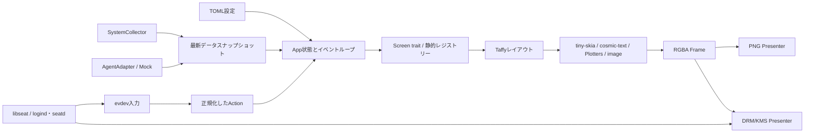
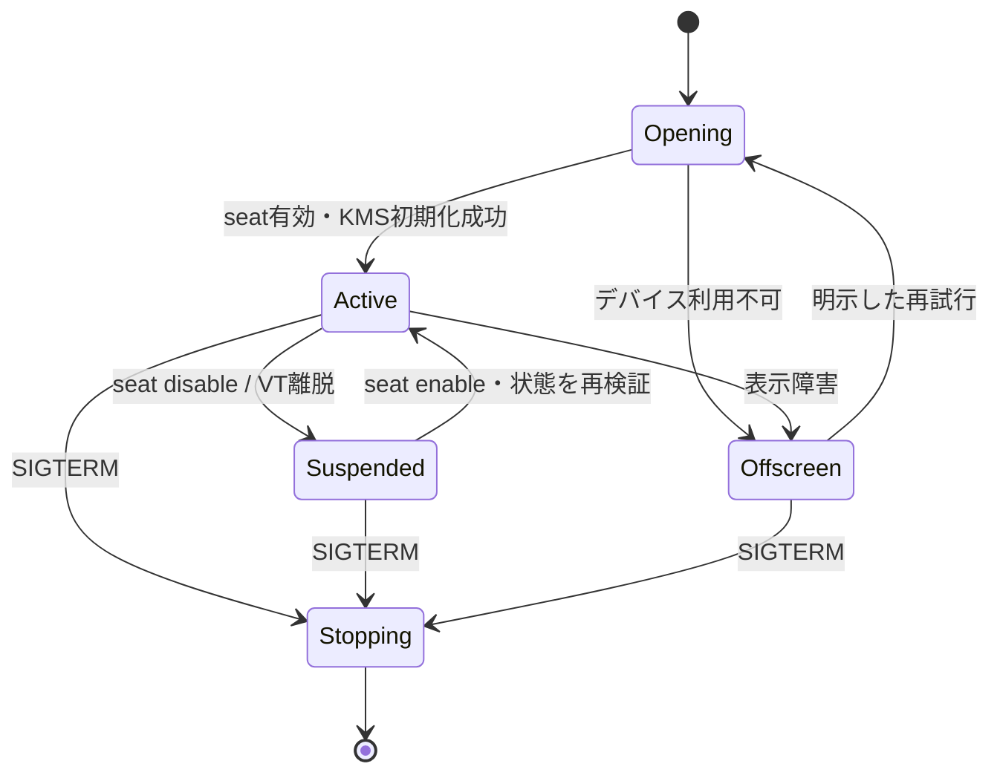

# Miharashi — 技術設計書

版: 0.2 / 作成日: 2026-10-11 / 状態: 実装前の設計案  
要件の基準: [PRD](PRD.md)

## 1. 設計の中心

すべての画面を共通のオフスクリーンバッファに描き、PNG出力とDRM/KMS出力で同じフレームを使う。レンダラーはデバイスを開かず、画面は外部データを収集しない。

tiny-skiaはCPUによるソフトウェア描画を担当する。描いたバッファは、設定または自動検出で選んだDRMデバイスから表示する。GPUのメーカー・型番や搭載メモリ容量は固定しない。単一GPUでも動作でき、複数GPUがある場合は表示用と計算用を分けて選択できる。GPUを使ったラスタライズは後続の最適化候補である。

## 2. 全体構成



M1は`Frame → PNG`までを完成させる。M2では同じフレームにLinuxのseat・入力・KMSを接続する。

## 3. Rustワークスペース案

```text
miharashi/
  Cargo.toml
  crates/
    miharashi-core/       # モデル、Action、Screen/Adapter契約
    miharashi-render/     # Taffy、RGBA、文字、図形、グラフ、写真
    miharashi-screens/    # system、agents、photo
    miharashi-data/       # 非同期収集、Linuxセンサー、MockAdapter
    miharashi-linux/      # libseat、evdev、DRM/KMS（Linuxのみ）
    miharashi-app/        # CLI、TOML、レジストリー、実行ループ
  config/example.toml
  systemd/
  docs/
  site/                   # 製品説明・画面構成・想定FAQ
```

依存は`core → render/screens/data → app`の向きに整理する。`miharashi-render`からLinux専用crateへの依存は禁止する。Linux専用crateはtarget条件とfeatureで切り分け、Linux以外の開発ホストでもPNG生成経路をビルド可能にする。

実行ファイル名は `miharashi`、設定ディレクトリ名は `miharashi`、systemdユニット名は `miharashi.service` に統一する。

バージョンは実装時に互換性を確認してCargo.lockで固定する。ネイティブLinux側ではlibseat等のビルド依存をREADMEへ記載する。

## 4. 共通フレームと描画形式

| 境界 | 形式・処理 |
|---|---|
| レンダラー内部 | tiny-skiaに合わせたpremultiplied RGBA8、上から下、stride = width × 4 |
| cosmic-text | 字形の色とcoverageをtiny-skiaのpremultiplied RGBAへ合成 |
| Plotters | RGB8バッファに描画し、alpha=255のRGBAへ変換 |
| image | straight RGBAをデコードし、必要ならpremultiplyして合成 |
| PNG | エンコーダーが要求するstraight RGBAへ変換。完全不透明フレームでは画素値は一致 |
| KMS | 対応するDRM形式へ変換。初期候補はXRGB8888、little-endianメモリではB/G/R/X。pitchはDRMの返値を使う |

寸法・stride・バッファ長・乗算オーバーフローを検査する。KMSの行幅を`width × 4`と決めつけない。表示前に不透明背景へ合成し、透明な画素の扱いを統一する。

```rust
// 設計用の契約例。実装時に所有権とエラー型を具体化する。
pub trait Screen: Send {
    fn id(&self) -> ScreenId;
    fn render(&mut self, canvas: &mut Canvas, context: &RenderContext) -> Result<()>;
    fn on_action(&mut self, action: &Action, state: &mut ScreenState);
}

pub trait AgentAdapter: Send + Sync {
    fn snapshot(&self) -> Result<Vec<AgentStatus>>;
}

pub trait Presenter {
    fn dimensions(&self) -> (u32, u32);
    fn present(&mut self, frame: &Frame) -> Result<()>;
}
```

画面管理の契約(`Screen` / `Provider` / `World` / `App`)は、実装後のコードを基準に [DESIGN-screen-interface.md](DESIGN-screen-interface.md)(Issue #9)で決め直した。上の trait 例はそれに置き換える。

各画面はRustコードとしてコンパイルし、`ScreenRegistry`へ明示登録する。trait objectでの実行時dispatchは使えるが、共有ライブラリを動的ロードするプラグイン方式は採用しない。

## 5. UIレイアウトと文字

- 画面内のヘッダー・カード・グラフ・リスト・フッターをTaffyのFlex/Gridで計算する。
- グラフだけをPlottersの領域へ描き、軸の日本語ラベル等は共通文字レンダラーで重ねる方式も使える。
- cosmic-textのFontSystemとglyph cacheはアプリで共有し、フレームごとの全作成を避ける。
- 日本語フォントを設定可能にし、システムフォントのフォールバックも使う。未収録字形は警告とプレースホルダーで検出可能にする。
- 画像は画面サイズとfit設定ごとにキャッシュし、毎フレームのデコードを避ける。
- 画像fitは`cover`と`contain`を設定可能にする。containの余白は背景色で埋める。

画面構成とテンキー動作は[PRDの画面仕様](PRD.md#5-画面構成)を基準とする。

## 6. 非同期収集と状態モデル

収集タスクはTokio等の非同期ランタイムで動かし、描画側に最新スナップショットを渡す。長いI/OやCPU処理はblocking taskへ出す。同期Adapter契約を用いる場合も、イベントループから直接呼ばない。

`watch` channel等で最新値を保持し、履歴は上限付きリングバッファへ格納する。初期案は1秒収集、120点保持。欠損値を0として履歴へ入れない。

| モデル | 主なフィールド |
|---|---|
| MetricValue | value: Option、単位、source、取得時刻、状態（live/mock/stale/unavailable） |
| SystemSnapshot | CPU、RAM、GPU配列、温度、電力、履歴、取得エラー |
| GpuSnapshot | PCI識別、デバイス名、用途、利用率、VRAM、温度、電力 |
| AgentStatus | 安定ID、表示名、状態、作業概要、最終更新、source、mockフラグ |
| AppState | 現在画面、メニュー選択、詳細表示、最新データ、seat状態、再描画フラグ |

データの鮮度は壁時計の変更に影響されない単調時計で判定する。表示用の日時はタイムゾーン設定に従う。

### システムデータ

- CPU利用率: `/proc/stat`の差分から計算する。初回と無効な差分はN/A。
- メモリ: `/proc/meminfo`の`MemTotal`と`MemAvailable`を使用する。
- DRM/sysfs Adapter: ドライバーが公開する負荷/VRAM属性を検出し、対応していて読み取り可能なときだけ使用する。
- 温度/電力: hwmon等の値をセンサー名・対象とともに保持する。CPUパッケージとGPUボードの値を混同しない。
- GPU固有API Adapter: sysfsで取得できない値は、必要に応じてメーカーAPIを扱う任意のAdapterで追加する。利用可能なAPIとドライバー対応を検出し、未対応ならN/Aを表示する。特定メーカーのAPIを共通レンダラーの必須依存にしない。
- 権限のないセンサーを読むためにアプリ全体をrootへ昇格させない。

### エージェント

最初はMockAgentAdapterのみを有効にする。Hermes/OpenClaw/Codex/Claude Codeという名称は例示行の識別に使う。ローカルの秘密のデータベース、ログ、会話内容を推測して読み取らない。

後続Adapterはファイル・API・CLI等の取得元とタイムアウトを明示して追加する。停止・遅延は`stale`または`offline`へ遷移し、成功したような状態を保持し続けない。

## 7. 入力とナビゲーション

evdevはseatから与えられた入力デバイスFDを読む。キーの`value=1`の押下をActionへ変換し、画面切替ではリピートを無視する。

KP4/KP6/KP0/KP5に加えて、対応するLeft/Right/Insertやデバイス固有の中央キーコードを正規化する。evdevでの物理キーコードと、ブラウザーLPでの`KeyboardEvent.code`の確認は別の検証として扱う。

メニュー中の4/6は項目選択、5は決定。メニューを閉じると元の画面へ戻る。詳細表示中の5は詳細を閉じる。入力デバイスの切断時は収集・描画を継続し、再検出する。

## 8. DRMデバイス選択

表示先と監視対象GPUを別設定にする。表示先の選択順は次の案とする。

1. 明示したPCI by-pathまたはデバイスパスを開く。
2. 指定がなければprimary DRMノードを列挙し、接続コネクターと有効モードを調べる。
3. 設定されたPCI識別・コネクター条件を照合する。GPUメーカーや内蔵/外付けという分類だけで表示先を決めない。
4. 候補が複数なら候補一覧と選択理由をログへ出し、明示設定できるようにする。

`card0`等の番号だけでGPUの用途や機種を決めつけない。実際の配線、PCI識別、コネクター名をM2で確認する。表示先と監視対象は同じデバイスでも別デバイスでもよい。`renderD*`は表示用primary nodeとして選ばない。

KMSモードが確定したら、その解像度を画面レイアウトへ渡す。オフスクリーンの場合は設定のwidth/heightを使う。

## 9. rootに依存しないseat・VT管理

libseatをSessionBackendの実装候補にし、logindとseatdを共通のインターフェースで扱う。libseatがこれらのbackendとデバイスアクセス仲介を提供していることは、[公式README](https://github.com/kennylevinsen/seatd#readme)に記載されている。ここでの採用は本プロジェクトの設計上の提案であり、まだ統合済みではない。

SessionBackendは、デバイスを開くことに加え、enable/disable通知を実行ループへ渡す。単に一般ユーザーで`File::open`するだけでは、VTやseatのライフサイクルを満たした扱いにしない。



- disable時: scanout更新とevdev処理を停止し、seat管理側へ解放完了を通知する。権限のない状態でDRMへ書き込まない。
- enable時: FDの状態、コネクター、モード、バッファを再確認して再描画する。
- 停止時: 所有中のseatで可能なら元のCRTC状態を復元し、入力・フレームバッファ・device handleを閉じる。
- VT離脱中もオフスクリーンのデータ状態を更新できるが、端末を強制的に奪い返さない。

SSHセッションやuser serviceのlingerだけで、active local seatの権限を取得できるとは想定しない。rootプロセスでのアプリ常駐や広範なvideo/inputグループ付与は標準経路にしない。

## 10. KMS出力とフォールバック

`drm` crateの安全なインターフェースからコネクター・CRTC・モードを扱う。初期scanoutはdumb buffer、可能な対象ではダブルバッファとpage flipで更新する。[drm公式ドキュメント](https://docs.rs/drm/latest/drm/)を参照する。

作成したバッファ/FB/モード変更は所有するハンドルで管理し、部分初期化に失敗しても解放する。画面更新に失敗したときは、バックエンド状態とエラーを表示データにも残す。

`on_unavailable=offscreen`では、PNG Presenterへ切り替え、設定したsnapshotファイルを更新する。`on_unavailable=exit`なら明確な非ゼロ終了にする。オフスクリーン移行を「実機表示成功」と記録しない。

ホットプラグ、複数コネクターの同時出力、atomic modesetting対応の拡大はM2の基本表示・seat/VT受け入れ後に行う。

## 11. 設定案

次は実装用のスキーマ案であり、現時点で実行可能な設定ではない。

```toml
[display]
backend = "auto"                 # auto / drm / offscreen
device = "auto"                  # PCI by-path等を明示可能
connector = "auto"
mode = "preferred"
on_unavailable = "offscreen"      # offscreen / exit

[render]
width = 1280                     # オフスクリーンの例示値。変更可能
height = 720
font_paths = []
refresh_ms = 1000

[data]
mode = "live"                    # live / mock
sample_ms = 1000
history_points = 120
stale_after_ms = 5000

[agents]
adapter = "mock"

[photo]
path = ""
fit = "cover"                    # cover / contain
overlay = true

[offscreen]
snapshot_path = "./snapshots/latest.png"

[session]
backend = "auto"                 # logind / seatdも選択可能
```

width/heightの範囲、更新間隔の下限、履歴上限、enum文字列を起動時に検査する。相対パスは設定ファイルの親を基準にする。未認識項目は警告またはエラーにしてタイプミスを検出する。

## 12. systemdとSSH運用

実装段階で次の2系統の例を用意する。

| 起動経路 | 前提 |
|---|---|
| logindで管理されたローカルVTセッション | 一般ユーザーのactive local sessionから起動する。TTYとsessionの関係を確認する |
| seatd + systemd専用サービス | 専用ユーザーで実行し、seatd socketへのアクセス権を設定する。seatdへ接続できることを実機検証する |

`miharashi.service` には作業パス、設定パス、再起動方針、停止タイムアウトを明記する。`PrivateDevices=yes`等が必要なDRM/入力アクセスを遮断しないよう、実機に合わせて確認する。アプリの実行ユーザーはrootにしない。

SSHからは設定ファイル、systemd状態、journalログを確認して再起動する。アプリにSSHサーバーを追加しない。SSHからの直接起動がローカルseatを所有できるとは仮定しない。

## 13. 検証と実装順序

| 段階 | 検証 | 合格の証拠 |
|---|---|---|
| M1-a | 共通Frame、色/alpha/stride、PNG保存 | コンパイル・限定した単体テスト・基準画像 |
| M1-b | 3画面、日本語、グラフ、写真、欠損表示 | オフスクリーンPNGを目視確認 |
| M1-c | 画面遷移、NumLockキー正規化、設定、Adapter停止 | ヘッドレスの意味のあるシナリオテスト |
| M2-a | Linux専用crate | Linux対象でのビルド結果 |
| M2-b | DRM選択、evdev、一般ユーザー、VT往復 | 実機操作結果とログ |
| M2-c | SIGTERM、systemd再起動、SSH管理、fallback | 対象Linux環境での運用確認 |

現在確認できているのは実装前資料とLPだけである。開発ホストでPNG動作確認ができても、DRM・evdev・seat管理・GPUセンサーはLinux実機で別途確認する。

## 14. 残る確認事項

ディストリビューション、libseatの提供パッケージ、実際のDRM/PCI/コネクター名、日本語フォント、利用するGPUドライバーと取得可能なセンサー、各エージェントの状態源、写真素材を実装段階で確定する。性能・対応センサー・VT復帰の結果は実測後に文書へ追記する。

技術資料: [Taffy](https://docs.rs/taffy/latest/taffy/) / [tiny-skia](https://docs.rs/tiny-skia/latest/tiny_skia/) / [cosmic-text](https://docs.rs/cosmic-text/latest/cosmic_text/) / [Plotters](https://docs.rs/plotters/latest/plotters/) / [image](https://docs.rs/image/latest/image/) / [evdev](https://docs.rs/evdev/latest/evdev/) / [drm-rs](https://docs.rs/drm/latest/drm/) / [libseat](https://github.com/kennylevinsen/seatd#readme)
