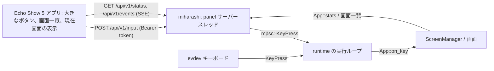

# Miharashi 操作パネル(Echo Show 5 / Android)の設計

状態: **設計(未実装)**。2026-10-13 作成、同日に改訂(v0.2: 単体アプリの前提に改めた)。
対象: Android 化した Echo Show 5(960×480)で動く、**Miharashi 専用の単体アプリ**。ほかの操作盤との同居や、既存アプリからの派生は設計に入れない。
画面側の契約: [DESIGN-screen-interface.md](../DESIGN-screen-interface.md)(Issue #9、PR #10)。パネルからの操作は、この契約の `KeyPress` として実行ループに入る。

表記: **決定** / **推奨**(実装時に覆してよい)/ **確認済み**(コードや実機で見た)/ **推測**(未確認)。

## 1. 目的

Miharashi(モニターに常時表示する Rust 製キオスク)を、手元に置いた小さな画面(Echo Show 5、960×480)から操作する。テンキーの 4 / 6(画面切替)、5(決定・詳細)、0(メニュー)、8 / 2(項目移動)を大きなボタンにし、押した結果(今どの画面か、写真の何枚目か)を手元でも確かめられるようにする。将来は LLM 管理([gpu-eval#19](https://github.com/ysogabe/local-model-lab/issues/19))やエージェント監視の状態も手元に出す。

電源を入れれば操作盤になり、触れば必ず応答し、消えてもキオスクには何も起きない。これが単体アプリとしての目標。

## 2. 前提(調査結果)

### 2.1 Echo Show 5 と ROM

| 項目 | 内容 | 根拠 |
|---|---|---|
| 機種 | Echo Show 5 Gen 1(`checkers`)。5.5 インチ 960×480、RAM 1GB、MediaTek 4 コア | 初期調査(分解記事、ROM の説明)(確認済み) |
| ROM | 非公式 LineageOS 18.1(Android 11、SDK 30)。bootloader 解除は amonet 系の exploit → TWRP → ROM | 初期調査(確認済み)。Android 11 であることは推測 |
| 通常の APK で使えるもの | Wi-Fi(INTERNET)、振動、起動時の自動開始(BOOT_COMPLETED)、前景サービス、全画面と常時点灯。ROM の変更は要らない | Android 11 の標準(確認済み) |
| BLE 周辺機器(HOGP)にする場合に要るもの | `android.hardware.bluetooth_le` の feature 宣言を `/system/etc/permissions/` に追加、APK を `/system/priv-app` に置いて `BLUETOOTH_PRIVILEGED` を許可、署名鍵の厳格な管理(失うと更新も入れ直しも不可)。APK 更新で GATT サーバーが作り直され、ホスト側の HID が外れることがある | 初期調査(Android 化した Echo で HOGP を動かした事例)(確認済み) |
| Wi-Fi | 2.4 / 5GHz。5GHz の不安定の報告があり、実機で測る | 推測 |

### 2.2 Miharashi 側(geoframe-n100)

| 項目 | 内容 | 根拠 |
|---|---|---|
| 入力 | evdev のキーボードだけ。`Keys` は KP4 か Left を持つデバイスを全部開く(名前で絞ることも可)。ネットワークの口はない | `crates/miharashi-linux/src/input.rs`、`runtime.rs`(確認済み) |
| Bluetooth | AX210 の Bluetooth(USB 8087:0032)を認識、ファームウェア 2024.48 版が正常に読み込まれている。**bluez は未導入**(`bluetooth.service` なし)。カーネルは uhid / hidp に対応 | `lsusb`、`journalctl -k`、`dpkg -l bluez`、`/boot/config`(確認済み) |
| 設計の制約 | キオスクに SSH サーバーなどの常駐の口を足さない方針。root では動かさない | [DESIGN.md](../DESIGN.md) §9・§12 |
| 画面管理 | `App::on_key(KeyPress)` に入れば、どの入力源でも同じに扱われる(設計済み、実装は #5) | [DESIGN-screen-interface.md](../DESIGN-screen-interface.md) §3 |

### 2.3 単体アプリとしての前提(決定)

- Echo は **Miharashi 専用の操作盤**として扱う。ほかの用途やアプリとの同居、切替は設計に入れない。
- **普通のユーザーアプリ**にする。priv-app にしない、ROM を変えない。自前の鍵で署名し、`adb install -r` で更新できる。
- **電源を入れれば操作盤になる**。起動時に自動で前面に出て、全画面(immersive)、常時点灯。
- **状態を持たない**。画面名や写真の位置はすべてキオスクの `/status` から取り直す。アプリが落ちても、端末が再起動しても、同じ表示に戻る。
- **権限は最小**。INTERNET、ACCESS_NETWORK_STATE、VIBRATE、RECEIVE_BOOT_COMPLETED だけ。Bluetooth、マイク、カメラは使わない。

## 3. 接続方式の比較

| 観点 | A. BLE キーボード(HOGP) | B. ネットワーク API(Wi-Fi) |
|---|---|---|
| Miharashi 側の変更 | **なし**。bluez が入ればふつうのキーボードとして evdev に出る(推測。bluez 導入は sudo が要るのでユーザー作業) | 待ち受けの追加(HTTP、トークン認証、`KeyPress` への変換、`/status`)。Rust の実装とテストが要る |
| Echo 側の変更 | BLE 周辺機器(GATT サーバー、Report Map、広告、ペアリング UI)を新規に実装。LineageOS で周辺機器にするには **ROM の変更(feature 宣言、priv-app)と署名鍵の管理**が要り、APK 更新のたびに再ペアリングの危険がある(§2.1) | HTTP クライアントだけ。**通常の APK** で済む |
| 操作の向き | 一方向。手元に「今どの画面か」は出せない(BLE の状態だけ) | 双方向。画面名、写真 n/N、将来の LLM・エージェント状態を手元に出せる |
| Echo 以外からの利用 | 不可(BLE キーボードは Echo だけ) | スマホのブラウザー、curl、別の端末からも同じ API |
| 遅延 | 接続間隔 7.5〜50ms が下限。実測値の出典はなく、10〜30ms 程度(推測) | LAN の HTTP で数〜数十 ms(推測)。SSE で push もできる |
| ネットワークの口 | なし | キオスクに待ち受けが増える。既定 OFF、トークン、1 インターフェース限定で DESIGN.md §12 の方針を守る |
| 故障時 | パネルが消えてもキオスクは無関係。BlueZ の自動再接続は要検証(AX210 の再接続不良の報告あり) | パネルが消えてもキオスクは無関係。Echo の 5GHz Wi-Fi に不安定の報告あり |
| ホストの準備 | bluez の導入、ヘッドレスのペアリング(`bluetoothctl` で pair / trust)、再起動後の再接続の確認 | なし(LAN か Tailscale で到達できればよい) |
| 検証のしやすさ | Echo と bluez がそろうまで何も試せない | Echo がなくても curl で Miharashi 側を検証できる |
| 未検証 | ペアリング済みでの Echo 再起動、Bluetooth OFF/ON、APK 更新後の HID 復帰(Linux では未確認) | Echo の Wi-Fi 安定性、トークン運用の手間 |

### 決定

**B(ネットワーク API)を採用する。** 当初(v0.1)は「ほかの操作盤と同じ端末で同居できる」を理由の 1 つにしていたが、単体アプリの前提に改めてその理由を外しても結論は変わらない。残る理由は 3 つ。

1. Echo 側が通常のアプリで済む。ROM の変更、priv-app、署名鍵の管理、更新のたびの再ペアリングを避けられる。
2. 手元に状態を出せる。これは「手元の操作盤」の価値そのもので、LLM 管理(gpu-eval#19)やエージェント監視と同じ `/status` の考え方で広げられる。
3. Echo がなくても Miharashi 側を curl で検証でき、スマホや別の端末からも同じ API で使える。

A は Miharashi 側の変更がゼロという強い利点があるので捨てない。**付録 A** に「やるなら何が要るか」を残し、Wi-Fi が使えない場所で試す選択肢にする。

## 4. 置き場所

| 候補 | 判断 |
|---|---|
| 設計、LP、Miharashi 側の API | **miharashi リポジトリ**(この文書、`site/panel/`、`crates/miharashi-app`)。製品の一部であり、Pages の公開経路もある |
| Android アプリ | **新リポジトリ `miharashi-panel`** にゼロから書く(決定)。ほかのアプリから派生しない。miharashi リポジトリには入れない(JDK / Android SDK / 署名鍵を Rust のワークスペースに持ち込まない)。API の契約は、この文書の §5.2 と `/status` の JSON 例(フィクスチャ)で共有する |

## 5. 設計

### 5.1 全体



- パネルは**キーボードと同じ `KeyPress` を送るだけ**で、画面の切替やメニューの論理はキオスク側にある(手元の画面一覧も、キオスクの `/status` の `screens` をそのまま出し、選んだ画面への遷移は `KeyPress` の列ではなく `POST /api/v1/screen` で指示する。§5.2)。
- 実行ループは `Keys::poll()` と同じ場所でチャネルから `KeyPress` を取り出す。DRM / VT / seat の流れは変わらない(#9 の受け入れ条件)。
- キオスクは**コマンドを実行しない**。API でできるのは、キー操作、画面の指定、状態の読み出しだけ。

### 5.2 API(案)

> P1 で入っているのはこの一部です(キーは `prev` / `next` / `select` だけ、`/api/v1/screen` は未実装)。§6 の P1 を参照。

| メソッド | パス | 内容 |
|---|---|---|
| GET | `/api/v1/status` | `{schema_version, host, screen: {id, title, index, count}, screens: [{id, title}], photo: {position, total} \| null, feed: "online" \| "retrying", display: {on, mode: "auto" \| "force_on" \| "force_off" \| null, control}, uptime_s, generated_at}` |
| POST | `/api/v1/input` | `{"key": "prev" \| "next" \| "select" \| "up" \| "down" \| "menu"}` → `204`。`quit` は受け付けない |
| POST | `/api/v1/screen` | `{"id": "photo"}` → `204`。登録されていない id は `404` |
| POST | `/api/v1/display` | `{"mode": "force_off" \| "force_on" \| "auto"}` → `204`。キオスクのモニターの消灯・点灯。キオスクが HA の手動オーバーライド(`screen_power.mode_entity` の input_select)を書き換え、すぐ問い合わせ直して反映する。HA と表示が食い違わないよう、キオスクの中だけでは切り替えない。mode エンティティが未設定なら `409`、HA に届かなければ `502` |
| GET | `/api/v1/events` | SSE。画面が変わるたびに `status` と同じ JSON を 1 行。接続中は 15 秒ごとに `: keepalive` |
| GET | `/api/v1/healthz` | 認証なし。`{"ok": true}` だけ |

- 認証: `Authorization: Bearer <token>`。トークンは設定ファイルで指定したファイル(`/etc/miharashi/panel.token`、`ha-token` と同じく root:<実行ユーザー> 0640 か 0600。誰でも読める権限なら起動しない)から読む。不一致は `401`。`healthz` 以外は全て必須。
- 待ち受け: 設定の `[panel] listen = "192.168.x.x:8790"` のように**インターフェースを指定**する(`0.0.0.0` は拒否)。既定は無効(`enabled = false`)。
- 実装: `tiny_http` のスレッド 1 本(写真の `Feed` と同じ形)。`KeyPress` は `std::sync::mpsc` で実行ループへ。`/status` はループが更新する `Arc<Mutex<PanelStatus>>` を読む。
- レート: 1 秒に 20 操作を超えたら `429`(連打の暴走を止める)。
- ログ: 接続元と操作を `eprintln!`(journal)に出す。状態ログ(`App::stats()`)に `panel=connected/idle` を足す。

### 5.3 設定(`config/example.toml` に追加する案)

```toml
[panel]
# enabled = false
# listen = "192.168.1.10:8790"      # インターフェースを指定する。0.0.0.0 は不可
# token_file = "/etc/miharashi/panel.token"
# max_rate_per_sec = 20
```

### 5.4 パネルの画面(960×480)

左に画面一覧のレール、中央に現在の画面と 4 / 5 / 6、右に 8 / 2 / 0、ヘッダーに接続の点灯。

```
+------------------------------------------------------------------------------+
| MIHARASHI   geoframe-n100          ● API  ● WIFI           12:48   SETTINGS   |
|------------------------------------------------------------------------------|
| 画面       |  現在の画面                              |                        |
| 01 STATUS  |  02 PHOTO FRAME                          |    8   項目 ↑          |
| >02 PHOTO  |  写真 12 / 187   feed online             |                        |
| 03 AGENT   |   +---------+  +---------+  +---------+  |    2   項目 ↓          |
|            |   |    4    |  |    5    |  |    6    |  |                        |
|            |   |  前の画面|  |決定/詳細|  | 次の画面|  |    0   メニュー        |
| 設定       |   +---------+  +---------+  +---------+  |                        |
+------------------------------------------------------------------------------+
```

- 左のレール: キオスクの画面一覧(`/status` の `screens`)をそのまま出し、現在の画面を強調する。タップで `POST /api/v1/screen` による直接遷移(P3。それまでは表示だけ)。下に設定。
- 中央: 現在の画面名を大きく出す(`/status` と SSE で更新)。写真画面のときは `12 / 187`、状況画面のときはページ名。その下に 4 / 5 / 6 の大きなボタン。
- 右: 8 / 2 / 0(PoC-003 で統一操作が入ってから有効。それまでは灰色)。
- ヘッダー: `API`(直近 5 秒以内に `/status` が取れた)、`WIFI` の点灯。取れないときは `STALE` → 15 秒で `OFFLINE`。
- フィードバック: 押下音と触覚。長押し確定は使わない(誤操作しても画面が変わるだけで、取り返しがつく)。
- 設定: ホストの URL とトークン、夜間の減光(時刻範囲)。

### 5.5 ペアリング(トークンの受け渡し)

初回だけ、キオスク側のトークンをパネルに入れる。推奨は**キオスクの画面に QR を出す**方法(`miharashi` の状況画面 DETAILS に「PANEL」タイルを置き、`0` 長押しで 60 秒だけ URL とトークンの QR を表示する。パネルのカメラは使えないので、スマホで読んで手入力、または設定画面に貼る)。最初の実装は設定画面への手入力でよい。

### 5.6 アプリの振る舞い(単体アプリとして)

| 項目 | 内容 |
|---|---|
| 起動 | `BOOT_COMPLETED` と `MY_PACKAGE_REPLACED` で `PanelActivity` を前面に出す(決定)。HOME の intent-filter を持ち、ランチャーに指定できるようにする(推奨。指定すれば Home を押しても操作盤に戻る) |
| 表示 | 横固定、immersive sticky、`FLAG_KEEP_SCREEN_ON`(決定)。夜間は設定した時刻範囲で輝度を落とす(推奨) |
| 同期 | 起動時と 5 秒ごとに `/status`、並行して `/events` の SSE。SSE が切れたら 1、2、4 … 30 秒で再接続(推奨)。直近 5 秒以内の成功で `API` 点灯、15 秒で `OFFLINE` |
| 操作 | タップで即 `POST /input`。`204` で押下音と触覚。失敗したら赤く点滅して再送しない(二重送信を避ける。次のタップでまた送る) |
| 状態 | 持たない(決定)。SharedPreferences に入れるのは設定だけ。表示はすべて `/status` から組み立て直せる |
| 技術 | Kotlin、minSdk 30、View と Canvas(推奨。RAM 1GB と SDK 30 の端末には Compose は重いと見ている。実装時に起動時間とメモリを測って覆してよい)。依存は最小(HTTP は `HttpURLConnection` か OkHttp) |
| 配布 | 通常の APK、自前の鍵、`adb install -r`。build 手順は `miharashi-panel` に置く |
| 試験 | `KioskClient` は MockWebServer に対する単体テスト。`PanelState` は miharashi の `/status` フィクスチャを読む |

## 6. 段階

| 段階 | 内容 | 確認方法 |
|---|---|---|
| P0(済) | 設計と LP | — |
| P1 | miharashi に `[panel]` と API(既定 OFF)。`KeyPress` の注入、`/status`、SSE、トークン、レート制限。#5 より先に、今の `KeyPress`(Prev / Switch / Next)へ直接つなぐ最小版を入れた。キーは `prev` / `next` / `select` だけで、`up` / `down` / `menu` は `400`(#5 で `KeyPress` が増えたら受け付ける)。`/api/v1/screen` は P3 | **Echo なしで検証できる**: `curl -H "Authorization: Bearer ..." -d '{"key":"next"}'` で画面が切り替わり、`/status` が変わる。24 時間試験のログに `panel=` が出る |
| P2 | 単体アプリ `miharashi-panel` の最小版。4 / 5 / 6、画面一覧、現在画面の表示、自動起動、全画面と常時点灯 | 実機で 4 / 6 の往復。Wi-Fi 切断 → 復帰で `OFFLINE` → `API` 点灯。端末を再起動すると自動で前面に出る |
| P3 | 8 / 2 / 0、写真 n/N、レールからの直接遷移(`/api/v1/screen`)、夜間の減光 | PoC-003 の後 |
| P4 | LLM 管理(gpu-eval#19)とエージェントの状態を手元に表示 | gpu-eval 側の `/status` をキオスクが中継するか、パネルが直接読むかを決める |

## 7. 未決・未検証

| 項目 | 状況 |
|---|---|
| Echo の Wi-Fi の安定性(2.4 / 5GHz) | 未検証。P2 で 24 時間の `API` 点灯率を測る |
| `listen` の既定インターフェース | **決定(P1)**: LAN(`enp11s0`)だけで待ち受ける。Tailscale では待ち受けない |
| 8 / 2 / 0 | PoC-003(#5)の統一操作が前提 |
| ホストの発見 | 最初は手入力。mDNS(`_miharashi._tcp`)での自動発見は P3 で検討(キオスク側に依存が増える) |
| UI の技術 | View と Canvas を推奨(§5.6)。Compose の起動時間とメモリを測ってから決めてよい |
| 夜間の減光 | 時刻範囲か照度センサーか。Echo の照度センサーが LineageOS で読めるかは未確認 |

## 付録 A. A 案(BLE キーボード)をやる場合に要るもの

| 側 | 作業 |
|---|---|
| Echo | BLE HOGP の周辺機器を新規に実装する。GATT の HID サービス、Report Map は Keyboard(Report ID 1、8 バイト: modifier、予約、キー 6 個)だけ、広告、ペアリング UI。押下と解放の 2 レポートを送る。LineageOS では feature 宣言と priv-app、署名鍵の管理が要り、APK 更新で GATT サーバーが作り直されてホスト側の HID が外れることがある(§2.1) |
| ホスト | `apt install bluez`、`systemctl enable --now bluetooth`、`bluetoothctl` で `agent NoInputNoOutput` → `pair` → `trust` → `connect`。`/proc/bus/input/devices` に `Handlers=... eventN` が出れば `miharashi` は変更なしで拾う(`Keys` は KP4 を持つデバイスを開く)。再起動後の自動再接続と、AX210 の再接続不良の報告(forum)を実機で確認 |
| キー | KP4 = 0x5C、KP5 = 0x5D、KP6 = 0x5E、KP0 = 0x62、KP8 = 0x60、KP2 = 0x5A(HID Usage ID)。NumLock の状態は evdev には影響しない(PoC-002 で確認済み) |
| 制約 | 手元に状態は出ない。Echo 以外の端末からは使えない |

## 付録 B. アプリの構成案(`miharashi-panel`)

| 部品 | 役割 |
|---|---|
| `PanelActivity` | 全画面、常時点灯、横固定。`PanelView` を載せ、`KioskClient` の購読を lifecycle に合わせて開閉する |
| `PanelView` | Canvas 描画。レール、現在画面、大きなボタン、側キー、ヘッダーの点灯。タップの判定と押下音・触覚 |
| `KioskClient` | `/status` の取得、`/events` の SSE 受信、`/input` と `/screen` の送信。Bearer、タイムアウト、再接続の間隔 |
| `PanelState` | `/status` の JSON を写した不変オブジェクト。鮮度(`fresh` / `stale` / `offline`)と取得時刻を持つ |
| `Settings` | ホスト URL、トークン、減光の時刻範囲。SharedPreferences |
| `BootReceiver` | `BOOT_COMPLETED` と `MY_PACKAGE_REPLACED` で `PanelActivity` を起動 |
| `fixtures/` | miharashi の `/status` の JSON 例をコピーし、`PanelState` と描画のテストに使う |
