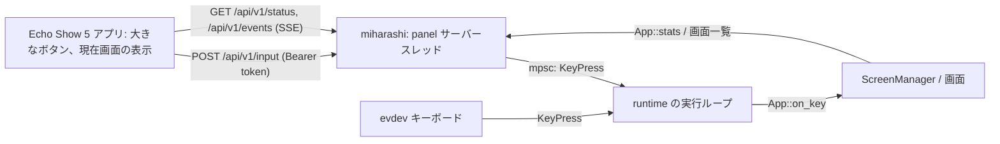

# Miharashi 操作パネル(Echo Show 5 / Android)の設計

状態: **設計(未実装)**。2026-10-13 作成。
参考にした実装: [ysogabe/echo-vibe-panel](https://github.com/ysogabe/echo-vibe-panel)(private。Echo Show 5 Gen 1「checkers」を Mac の Codex 用操作盤にした Android アプリ。BLE HOGP で Mac に接続)。
画面側の契約: [DESIGN-screen-interface.md](../DESIGN-screen-interface.md)(Issue #9、PR #10)。パネルからの操作は、この契約の `KeyPress` として実行ループに入る。

表記: **決定** / **推奨**(実装時に覆してよい)/ **確認済み**(コードや実機で見た)/ **推測**(未確認)。

## 1. 目的

Miharashi(モニターに常時表示する Rust 製キオスク)を、手元に置いた小さな画面(Echo Show 5、960×480)から操作する。テンキーの 4 / 6(画面切替)、5(決定・詳細)、0(メニュー)、8 / 2(項目移動)を大きなボタンにし、押した結果(今どの画面か、写真の何枚目か)を手元でも確かめられるようにする。将来は LLM 管理([gpu-eval#19](https://github.com/ysogabe/local-model-lab/issues/19))やエージェント監視の状態も手元に出す。

## 2. 前提(調査結果)

### 2.1 Echo Show 5 と ROM

| 項目 | 内容 | 根拠 |
|---|---|---|
| 機種 | Echo Show 5 Gen 1(`checkers`)。5.5 インチ 960×480、RAM 1GB、MediaTek 4 コア | 参考実装の README・manifest、分解記事(確認済み) |
| ROM | 非公式 LineageOS 18.1(Android 11、SDK 30)。bootloader 解除は amonet 系の exploit → TWRP → ROM | 参考実装の runbook、XDA(確認済み)。Android 11 であることは推測 |
| BLE 周辺機器(HOGP)に必要だった ROM 変更 | `android.hardware.bluetooth_le` の feature 宣言を `/system/etc/permissions/` に追加、APK を `/system/priv-app` に置き `BLUETOOTH_PRIVILEGED` を許可、署名鍵の厳格な管理(失うと更新も入れ直しも不可) | 参考実装の README「現在の制約」、`system/*.xml`、runbook §7(確認済み) |
| Wi-Fi | INTERNET 権限と自前 WebSocket(音声機能、外向き 443)が動作済み。通常の APK で使える | 参考実装の manifest と `voice/WsClient.java`(確認済み)。端末の Wi-Fi 接続自体の記述は見つかっていない(推測) |
| 壊れやすさ | APK 更新で GATT サーバーが作り直され、ホスト側の HID が外れることがある。GATT スキーマや Report Map を変えると再ペアリング。ペアリング済み状態での再起動、Bluetooth OFF/ON、長時間運用は未検証 | runbook §9・§13(確認済み) |
| 参考実装の HID | Report Map に Keyboard(ID 1)/ Consumer(2)/ Mouse(3)/ Vendor(6)を宣言するが、**実際に送るのは Vendor ID 6 の JSON だけ**。素のキーボードレポートを送るコードはない | `VibeBleHogpDevice.java`、`VibeHidDevice.REPORT_DESCRIPTOR`(確認済み) |

### 2.2 Miharashi 側(geoframe-n100)

| 項目 | 内容 | 根拠 |
|---|---|---|
| 入力 | evdev のキーボードだけ。`Keys` は KP4 か Left を持つデバイスを全部開く(名前で絞ることも可)。ネットワークの口はない | `crates/miharashi-linux/src/input.rs`、`runtime.rs`(確認済み) |
| Bluetooth | AX210 の Bluetooth(USB 8087:0032)を認識、ファームウェア 2024.48 版が正常に読み込まれている。**bluez は未導入**(`bluetooth.service` なし)。カーネルは uhid / hidp に対応 | `lsusb`、`journalctl -k`、`dpkg -l bluez`、`/boot/config`(確認済み) |
| 設計の制約 | キオスクに SSH サーバーなどの常駐の口を足さない方針。root では動かさない | [DESIGN.md](../DESIGN.md) §9・§12 |
| 画面管理 | `App::on_key(KeyPress)` に入れば、どの入力源でも同じに扱われる(設計済み、実装は #5) | [DESIGN-screen-interface.md](../DESIGN-screen-interface.md) §3 |

### 2.3 最初に決めるべきこと: その Echo Show 5 は Codex 用の操作盤と同じ端末か

参考実装の Echo は Mac と BLE でボンドしている。**BLE の周辺機器は同時に 1 台のホストとしか接続できない**ので、同じ端末を BLE キーボードとして Miharashi につなぐと Codex 用の役割と両立しない。Wi-Fi なら両立する。端末が別(2 台目)ならこの制約はなくなるが、ROM の準備(feature XML、priv-app、署名鍵)を 2 台目でやり直すことになる。この文書は**同じ端末を共用する**前提で書き、2 台目の場合の違いを §4 に記す(ユーザー確認待ち)。

## 3. 接続方式の比較

| 観点 | A. BLE キーボード(HOGP) | B. ネットワーク API(Wi-Fi) |
|---|---|---|
| Codex 用操作盤との共存 | **不可**(BLE は 1 ホスト) | 可(BLE は Mac、Wi-Fi は Miharashi) |
| Miharashi 側の変更 | **なし**。bluez が入ればふつうのキーボードとして evdev に出る(推測。bluez 導入は sudo が要るのでユーザー作業) | 待ち受けの追加(HTTP、トークン認証、`KeyPress` への変換、`/status`)。Rust の実装とテストが要る |
| Echo 側の変更 | キーボードレポート(ID 1)の送信を新規に書き、Report Map を作り直す → **再ペアリング**。priv-app と feature XML は済んでいる(共用の場合) | HTTP クライアントを足すだけ。priv-app も Bluetooth 権限も要らない |
| 操作の向き | 一方向。手元に「今どの画面か」は出せない(BLE の状態だけ) | 双方向。画面名、写真 n/N、将来の LLM・エージェント状態を手元に出せる |
| 遅延 | 接続間隔 7.5〜50ms が下限。実測値の出典はなく、10〜30ms 程度(推測) | LAN の HTTP で数〜数十 ms(推測)。WebSocket か SSE で push もできる |
| ネットワークの口 | なし | キオスクに待ち受けが増える。既定 OFF、トークン、1 インターフェース限定で DESIGN.md §12 の方針を守る |
| 故障時 | パネルが消えてもキオスクは無関係。BlueZ の自動再接続は要検証(AX210 の再接続不良の報告あり) | パネルが消えてもキオスクは無関係。Echo の 5GHz Wi-Fi に不安定の報告あり |
| ホストの準備 | bluez の導入、ヘッドレスのペアリング(`bluetoothctl` で pair / trust)、再起動後の再接続の確認 | なし(LAN か Tailscale で到達できればよい) |
| 未検証 | ペアリング済みでの Echo 再起動、Bluetooth OFF/ON、APK 更新後の HID 復帰(Linux では未確認) | Echo の Wi-Fi 安定性、トークン運用の手間 |
| 参考実装の流用 | BLE の土台(GATT・広告・ペアリング・Service・BootReceiver、約 1.2k 行)がほぼそのまま | Service・BootReceiver・Canvas UI・長押し確定・状態表示は流用。BLE 部分は不要 |

### 決定

**B(ネットワーク API)を採用する。** 理由は 3 つ。

1. 同じ Echo を Codex 用の操作盤と共用できる(A は不可)。
2. Echo 側に ROM の変更や再ペアリングが要らず、参考実装が一番苦労した部分(priv-app、署名鍵、HID の復帰)を避けられる。
3. 手元に状態を出せる。これは「手元の操作盤」の価値そのもので、LLM 管理(gpu-eval#19)やエージェント監視と同じ `/status` の考え方で広げられる。

A は Miharashi 側の変更がゼロという強い利点があるので捨てない。**付録 A** に「やるなら何が要るか」を残し、Wi-Fi が使えない場所や 2 台目の端末で試す選択肢にする。

## 4. 置き場所

| 候補 | 判断 |
|---|---|
| 設計、LP、Miharashi 側の API | **miharashi リポジトリ**(この文書、`site/panel/`、`crates/miharashi-app`)。製品の一部であり、Pages の公開経路もある |
| Android アプリ(共用の端末の場合) | **echo-vibe-panel に「Miharashi」プロバイダーを足す**(推奨)。Service、BootReceiver、Canvas UI、build.sh、署名鍵がそのまま使え、端末の設定を変えずに済む。プロバイダーの切替は参考実装の上段ボタン(CODEX → CLAUDE CODE → OMP → MIHARASHI) |
| Android アプリ(2 台目の端末の場合) | echo-vibe-panel から派生した新リポジトリ `miharashi-panel`(voice と bridge を除く)。miharashi リポジトリには入れない(JDK / Android SDK / 署名鍵を Rust のワークスペースに持ち込まない) |

## 5. 設計

### 5.1 全体



- パネルは**キーボードと同じ `KeyPress` を送るだけ**で、画面の切替やメニューの論理はキオスク側にある(手元のメニュー UI も、キオスクの「画面一覧」を取って表示し、選んだ画面への遷移は `KeyPress` の列ではなく `POST /api/v1/screen` で指示する。§5.2)。
- 実行ループは `Keys::poll()` と同じ場所でチャネルから `KeyPress` を取り出す。DRM / VT / seat の流れは変わらない(#9 の受け入れ条件)。
- キオスクは**コマンドを実行しない**。API でできるのは、キー操作、画面の指定、状態の読み出しだけ。

### 5.2 API(案)

| メソッド | パス | 内容 |
|---|---|---|
| GET | `/api/v1/status` | `{schema_version, host, screen: {id, title, index, count}, screens: [{id, title}], photo: {position, total} \| null, feed: "online" \| "retrying", uptime_s, generated_at}` |
| POST | `/api/v1/input` | `{"key": "prev" \| "next" \| "select" \| "up" \| "down" \| "menu"}` → `204`。`quit` は受け付けない |
| POST | `/api/v1/screen` | `{"id": "photo"}` → `204`。登録されていない id は `404` |
| GET | `/api/v1/events` | SSE。画面が変わるたびに `status` と同じ JSON を 1 行。接続中は 15 秒ごとに `: keepalive` |
| GET | `/api/v1/healthz` | 認証なし。`{"ok": true}` だけ |

- 認証: `Authorization: Bearer <token>`。トークンは設定ファイルで指定したファイル(`/etc/miharashi/panel.token`、0600)から読む。不一致は `401`。`healthz` 以外は全て必須。
- 待ち受け: 設定の `[panel] listen = "192.168.x.x:8790"` のように**インターフェースを指定**する(`0.0.0.0` は拒否)。既定は無効(`enabled = false`)。
- 実装: `tiny_http` のスレッド 1 本(写真の `Feed` と同じ形)。`KeyPress` は `std::sync::mpsc` で実行ループへ。`/status` はループが更新する `Arc<Mutex<PanelStatus>>` を読む。
- レート: 1 秒に 20 操作を超えたら `429`(連打の暴走を止める)。
- ログ: 接続元と操作を `eprintln!`(journal)に出す。状態ログ(`App::stats()`)に `panel=connected/idle` を足す。

### 5.3 設定(`config/example.toml` に追加する案)

```toml
[panel]
# enabled = false
# listen = "192.168.1.10:8790"      # インターフェースを指定する。0.0.0.0 は不可
# token_file = "/etc/miharashi/panel.token"
# max_rate_per_sec = 20
```

### 5.4 パネルの画面(960×480)

参考実装の構成(左に幅 13.5% のサイドレール、右にカード、ヘッダーに状態の点灯)を踏襲する。

```
+------------------------------------------------------------------------------+
| MIHARASHI   geoframe-n100          ● API  ● WIFI           12:48   SETTINGS   |
|------------------------------------------------------------------------------|
| CODEX    |  現在の画面                              |                         |
| CLAUDE   |  [01 SERVER STATUS] 02 PHOTO  03 AGENT  |    8   項目 ↑           |
| OMP      |                                         |                         |
| >MIHARA  |   +---------+  +---------+  +---------+ |    5   決定 / 詳細      |
|          |   |    4    |  |    5    |  |    6    | |                         |
|          |   |  前の画面|  |決定/詳細|  | 次の画面| |    2   項目 ↓           |
| 戻る     |   +---------+  +---------+  +---------+ |                         |
|          |   写真 12 / 187   feed online            |    0   メニュー         |
+------------------------------------------------------------------------------+
```

- 左のレール: プロバイダーの切替(共用の場合)。Miharashi を選ぶとこの画面。
- 中央: 現在の画面名(`/status` と SSE で更新)と、4 / 5 / 6 の大きなボタン。写真画面のときは `12 / 187` を出す。
- 右: 8 / 2 / 0(PoC-003 で統一操作が入ってから有効。それまでは灰色)。
- ヘッダー: `API`(直近 5 秒以内に `/status` が取れた)、`WIFI` の点灯。取れないときは `STALE` → 15 秒で `OFFLINE`(参考実装の `SYNC STALE` と同じ考え方)。
- フィードバック: 押下音と触覚(参考実装の `ToneGenerator` と `performHapticFeedback`)。長押し確定は使わない(誤操作しても画面が変わるだけで、取り返しがつく)。
- 設定: ホストの URL とトークン(参考実装の設定ダイアログと同じ形)。

### 5.5 ペアリング(トークンの受け渡し)

初回だけ、キオスク側のトークンをパネルに入れる。推奨は**キオスクの画面に QR を出す**方法(`miharashi` の状況画面 DETAILS に「PANEL」タイルを置き、`0` 長押しで 60 秒だけ URL とトークンの QR を表示する。パネルのカメラは使えないので、スマホで読んで手入力、または設定ダイアログに貼る)。最初の実装は設定ダイアログへの手入力でよい。

## 6. 段階

| 段階 | 内容 | 確認方法 |
|---|---|---|
| P0(この PR) | 設計と LP | — |
| P1 | miharashi に `[panel]` と API(既定 OFF)。`KeyPress` の注入、`/status`、SSE、トークン、レート制限。#5(画面管理の実装)の後、または `KioskApp::on_key` へ直接つなぐ最小版を先に | **Echo なしで検証できる**: `curl -H "Authorization: Bearer ..." -d '{"key":"next"}'` で画面が切り替わり、`/status` が変わる。24 時間試験のログに `panel=` が出る |
| P2 | echo-vibe-panel に Miharashi プロバイダー(4 / 5 / 6 と現在画面の表示) | 実機で 4 / 6 の往復、Wi-Fi 切断 → 復帰で `OFFLINE` → `API` 点灯 |
| P3 | 8 / 2 / 0、写真 n/N、`/api/v1/screen` による直接遷移 | PoC-003 の後 |
| P4 | LLM 管理(gpu-eval#19)とエージェントの状態を手元に表示 | gpu-eval 側の `/status` をキオスクが中継するか、パネルが直接読むかを決める |

## 7. 未決・未検証

| 項目 | 状況 |
|---|---|
| Echo は Codex 用と同じ端末か | **ユーザー確認待ち**(§2.3)。別の端末なら §4 の置き場所と、付録 A の A 案の評価が変わる |
| Echo の Wi-Fi の安定性(2.4 / 5GHz) | 未検証。P2 で 24 時間の `API` 点灯率を測る |
| `listen` の既定インターフェース | 実機の LAN(`enp11s0`)か Tailscale か。P1 で決める |
| 8 / 2 / 0 | PoC-003(#5)の統一操作が前提 |

## 付録 A. A 案(BLE キーボード)をやる場合に要るもの

| 側 | 作業 |
|---|---|
| Echo | `VibeBleHogpDevice` に Report ID 1(8 バイト: modifier、予約、キー 6 個)の notify を足し、押下と解放の 2 レポートを送る。Report Map を Keyboard だけに作り直す(Vendor / Mouse / Consumer を外す)→ 再ペアリング。広告名を変える。参考実装の Service / BootReceiver / ペアリング UI はそのまま |
| ホスト | `apt install bluez`、`systemctl enable --now bluetooth`、`bluetoothctl` で `agent NoInputNoOutput` → `pair` → `trust` → `connect`。`/proc/bus/input/devices` に `Handlers=... eventN` が出れば `miharashi` は変更なしで拾う(`Keys` は KP4 を持つデバイスを開く)。再起動後の自動再接続と、AX210 の再接続不良の報告(forum)を実機で確認 |
| キー | KP4 = 0x5C、KP5 = 0x5D、KP6 = 0x5E、KP0 = 0x62、KP8 = 0x60、KP2 = 0x5A(HID Usage ID)。NumLock の状態は evdev には影響しない(PoC-002 で確認済み) |
| 制約 | Mac とのボンドと両立しない。手元に状態は出ない |

## 付録 B. 参考実装から流用する部品(B 案)

| 部品 | 扱い |
|---|---|
| `BleHogpService` の foreground / `START_STICKY` / `BootReceiver` の起動 | 流用(BLE を使わないプロバイダーでも常駐の形は同じ) |
| `PanelView` の Canvas 描画、サイドレール、カード、長押し、スワイプ戻り、`ToneGenerator`、触覚 | 改修して流用 |
| 設定ダイアログ(URL 入力) | 流用(トークン欄を足す) |
| `BridgeClient`(HTTP 診断、`127.0.0.1:8765`) | 形だけ参考。LAN と認証を前提に書き直す(参考実装の HTTP は無認証のため LAN 公開禁止) |
| `voice/*`、`VibeHidDevice`(Classic)、Codex / Claude Code の観測 | 使わない |
