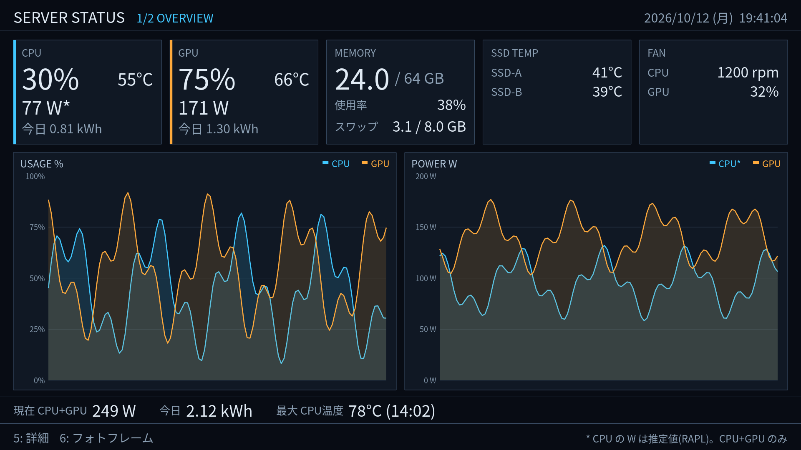
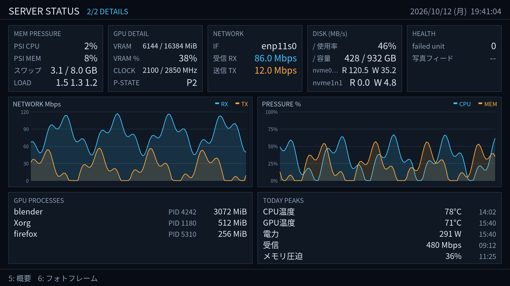
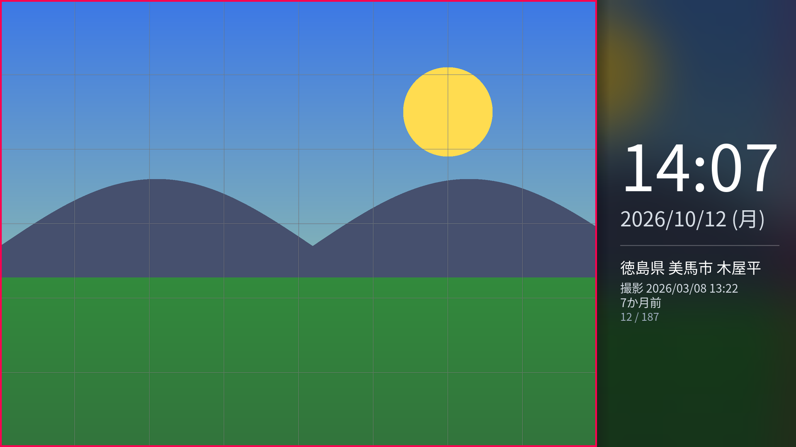
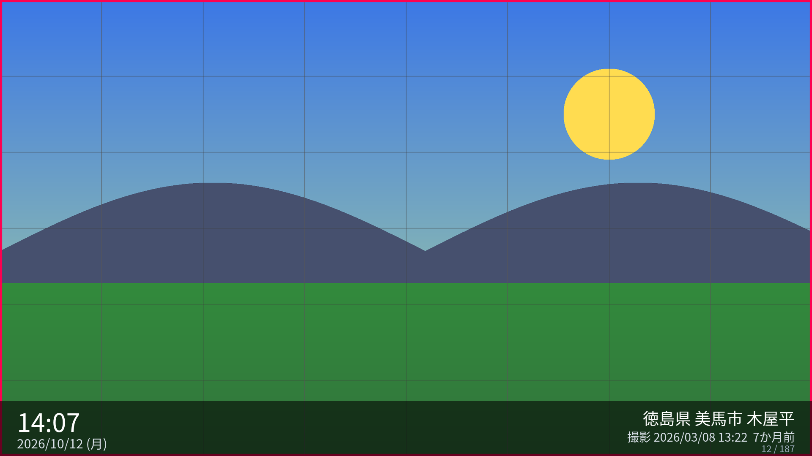

# PoC-002 Kiosk Runtime 結果

目的: PoC-001のCPUソフトウェア描画とDRM/KMS直接表示を維持したまま、常時稼働できるキオスク基盤(seat/VT、systemd、設定、復旧)を作る。親Issue: [#3 ロードマップ](https://github.com/ysogabe/miharashi/issues/3)、本Issue: [#4](https://github.com/ysogabe/miharashi/issues/4)。

検証日: 2026-10-12

> **この文書の読み方**: 「実機で確認」は、このホストで実際に動かして得た結果。ただし、モニターの見た目は作業した側が直接見られていない箇所があり、その場合は「ログで確認」と書く(set_crtc の成功、フレーム数の増加、DRMエラーなし)。未確認の項目は「未確認」と明記する。

## 受け入れ条件の結果

| 条件 | 結果 | 根拠 |
|---|---|---|
| 実機で24時間連続稼働(RSSの持続増加なし、入力/更新停止なし) | **進行中** | 3回目を 2026-10-12 19:39:06 JST に開始(画面改修を取り込んだバイナリ)。2回目は13.6時間で入れ替えのため停止。詳細は[24時間試験](#24時間試験) |
| VT往復10回後に表示が正常復帰 | 合格(ログで確認) | 10回すべてで 無効化→有効化→表示復元。DRMエラーなし。復帰後もフレーム数が増加 |
| systemd stop/restart後に表示が正常復帰 | 合格 | stopでtty1へ戻りサービスinactive。restartを3回連続で実行しいずれもtty7で稼働 |
| SSH操作後に表示が正常復帰 | 一部確認 | SSH経由の `systemctl`/`chvt` 操作中も表示は継続。物理キーボードのCtrl+Alt+Fnは未確認 |
| GeoFrame停止→再開後に自動で写真取得を回復 | 合格 | 実機サービスで確認(模擬サーバー)。単体テストでも確認。本物のGeoFrameは停止していない |
| 監視GPUと表示先GPUを独立に指定でき、接続GPUで実機検証 | **一部のみ** | 設定は独立(`display.card` と `metrics.gpu`)。選択ロジックは2GPUの偽sysfsで単体テスト。実機はGPU 1枚のみで、2枚構成での検証は未実施 |
| 正常終了時にコンソール復帰。強制終了時の復旧方法を文書化 | 合格 | SIGTERMでtty1へ復帰。`kill -9` は自動再起動で復旧。手順は[復旧方法](#復旧方法) |
| 試験環境・ログ・未確認事項を文書化 | 合格 | 本書 |

## 実装項目の結果

| 項目 | 結果 |
|---|---|
| `/dev/dri/card0` 固定の廃止、DRMカード/コネクタ自動検出、明示設定、GPU/PCI識別 | 実装。`auto` / `/dev/dri/cardN` / `pci:...` / `driver:...`。起動ログにドライバーとPCIアドレスを出力。`kms-info` で候補と選択結果を確認可 |
| libseat(logind/seatd)による DRM master・入力・VT の取得と解放 | logindバックエンドを実機で確認(seat0、一般ユーザー)。seatdバックエンドは未確認 |
| VT非アクティブ時の描画停止、再有効化時の復元、SIGINT/SIGTERMの正常終了 | 実装、実機で確認 |
| root常駐に依存しないsystemdサービス、自動起動/再起動、SSHからのjournal確認 | サービス・再起動・journalは実機で確認。**ブート時の自動起動は未確認**(再起動できないため) |
| TOML設定(表示・入力・GeoFrame・写真間隔・更新頻度・監視GPU) | 実装、単体テスト(未知キー・不正値は拒否) |
| GeoFrameの指数バックオフ再接続、最後の写真/代替画像 | 実装、実機で確認。停止中は最後の写真を表示し続け、写真が1枚もないときは案内メッセージを表示 |
| 物理テンキーでNumLock ON/OFF、連打、デバイス重複 | **未確認**(テンキー付きキーボードが手元にない)。[未確認事項](#未確認事項)参照 |
| 既存2画面・PNG出力・実測値・写真切替の回帰テスト | 27件の自動テスト(下記) |
| READMEの旧「未実装」記述とPoC報告の不整合の修正 | 修正済み |

## 試験環境

| 項目 | 内容 |
|---|---|
| OS | Debian 13、Linux 6.12.111、systemd 257、libseat 0.9.1 |
| CPU / GPU | AMD Ryzen 7 9700X / NVIDIA RTX 5060 Ti(nvidia-drm、ドライバー 615.71.09、`modeset=Y`) |
| 表示 | `card0`(PCI 0000:01:00.0)の `HDMI-A-1`、1920×1080@60Hz。GPUは1枚のみ(内蔵Radeonは見えない) |
| 入力 | Lenovo ThinkPad Compact USB Keyboard(テンキーなし、evdevノード2つ) |
| 実行ユーザー | `hermes`(一般ユーザー。`video`・`input` グループにも所属するが、サービスはseat経由で取得) |
| 写真 | 実機の通常運用はGEOFRAME(`127.0.0.1:8080`)。停止試験は模擬サーバー |
| 共用ホスト | 別プロセス(約29GB使用)がメモリを使い、スワップが起きる。RSSの急減や数十msのフレーム時間の揺れはこの影響(PoC-001と同様) |
| 操作方法 | 試験は開発セッション(SSH相当)から `systemctl` と `chvt` で実施 |

## 構成

```
crates/
  miharashi-render/   描画(Canvas、文字、写真、グラフ、画面)。デバイスを開かない
  miharashi-linux/    DRM選択・KMS出力、seat(libseat)、VT、evdev、実測センサー
  miharashi-app/      バイナリ `miharashi`: 設定、写真取得(再接続)、画面ロジック、実行ループ
config/example.toml   設定例
systemd/              miharashi.service、miharashi-rapl.service(CPU 電力ヘルパー)、install.sh
tools/soak_summary.py 長時間試験の集計
```

実行ループ(`runtime.rs`)と画面ロジック(`app.rs` の `KioskApp`)を分離した。ループは、seatの有効/無効、シグナル、入力の読み出し、再描画、状態ログを担当し、画面は `on_key` / `tick` / `render` だけを提供する。PoC-003で画面管理を差し替えるときは `KioskApp` の側を変える。

## 運用

```sh
cargo build --release
sudo systemd/install.sh <実行ユーザー>      # バイナリ、/etc/miharashi/config.toml、ユニットを導入(起動はしない)
sudo systemctl start miharashi-rapl         # 任意: CPU の消費電力を出す root ヘルパー
sudo systemctl start miharashi              # VT7 に切り替えて表示を開始
sudo systemctl stop miharashi               # 停止して VT1(通常のコンソール)へ戻る
sudo systemctl enable miharashi             # ブート時の自動起動(未確認)
sudo journalctl -t miharashi -f             # アプリのログ(状態ログは60秒ごと)
```

- ユニットは `User=<一般ユーザー>`、`PAMName=login`、`TTYPath=/dev/tty7`。logindのseat0セッションとして動き、rootでは動かない。
- アプリのログは `journalctl -u miharashi` には出ない(PAMセッションのscopeに入るため)。`-t miharashi` を使う。journalを読むには、sudoか `systemd-journal` グループへの所属が必要。
- 状態ログの例: `stats: t=180s rss=12MB fds=26 frames=182 worst_frame=88ms ticks=181 keys=0 screen=Status photo=1 feed=online cpu=Some(14.0) gpu=Some(100.0)`
- 設定は `/etc/miharashi/config.toml`(`~/.config/miharashi/config.toml`、`--config` も可)。全項目は [`config/example.toml`](../../config/example.toml)。

## 復旧方法

| 状況 | 手順 |
|---|---|
| 通常停止 | `sudo systemctl stop miharashi`。ExecStopPost で VT1 に戻る |
| 画面が固まった/キー操作できない | SSHから `sudo systemctl stop miharashi` → 戻らなければ `sudo chvt 1`。物理キーボードでは Ctrl+Alt+F1(未確認) |
| プロセスが終了した(SIGKILL、クラッシュ、Esc/q) | `Restart=always`(3秒後)で自動再起動する。`kill -9` で再起動を確認 |
| 再起動が続いて止まった(5分で5回) | 原因を `journalctl -t miharashi` で確認し、`sudo systemctl reset-failed miharashi` → `start` |
| `set_crtc` が失敗する | 別のプロセスがDRM masterを持っている。`sudo systemctl stop` で他の表示プロセスを止める |
| seat が有効にならない | そのVTがアクティブでない、またはseat外のセッション。`seat = "direct"` にして `video`・`input` グループで直接開くことは可能 |

起動前の VT7 は `KD_GRAPHICS` にして、カーネルのテキスト描画がフレームを上書きしないようにしている。終了時は元のモードへ戻す。SIGKILL後にVT7が `KD_GRAPHICS` のまま残るかは未確認(他のVTには影響しない)。

## 検証記録

### 自動テスト(27件、すべて成功)

| 対象 | 内容 |
|---|---|
| 設定 | 既定値、部分上書き、表示GPUと監視GPUの独立、未知キー・不正値の拒否、同梱の設定例が読めること |
| DRM選択 | 2GPUの偽sysfsで、接続済みカードの自動選択(card0に固定されない)、boot_vga以外の優先、PCI/ドライバー/パス指定、未接続コネクターの拒否、モード指定 |
| 入力 | テンキー・矢印・メイン列のキー対応 |
| 実測センサー | 実機のCPU使用率・メモリが取れること、GPU指定の解釈 |
| 写真 | 前後切替と位置、指数バックオフ、**GeoFrame停止→再開で自動回復**、起動時にGeoFrameがなくても後から接続できること |
| 画面 | 状況画面・フォトフレームの1920×1080描画(領域の色)、4/5/6の画面遷移、写真切替 |
| 描画 | XRGB8888変換とpitch、写真の縮小・切り抜き |

### VT往復10回(実機)

tty7のキオスクとtty1を、`chvt` で10回往復した。

```
round 1〜10: away=tty1 back=tty7 service=active
seat: 無効化(描画を停止) ×10 / seat: 有効化(復帰処理) ×10 / seat: 表示を復元 ×10、エラー 0
```

### 停止・再起動・強制終了(実機)

- `systemctl stop`: inactive、アクティブなVTは tty1、ログに「終了: シグナルを受信」
- `systemctl restart` を3回連続: すべて active、tty7
- `kill -9`: 約8秒後に自動再起動(`NRestarts=1`)、tty7 で稼働

### GeoFrame停止→再開(実機サービス + 模擬サーバー)

```
online      : feed=online photo=3
停止後      : feed=GEOFRAME に接続できません(8秒後に再試行)   ← 最後の写真(3枚目)を表示し続ける
再開後      : feed=online photo=2 → 4 → 5                      ← キー操作なしで回復
```

再試行間隔は 1→2→4→8秒(上限)の指数バックオフ。描画ループは止まらない。

### 試験中に見つけて直した問題

1. **VT往復のたびにfdが約15個ずつ漏れていた**: libseatの `close_device` はデバイスIDを解放するだけで、`open_device` が返したfdは呼び出し側が閉じる必要がある。修正後、新規25個、VT往復10回後も26個で安定。状態ログに `fds=` を追加した。
2. **seat外のセッションでlibseatが有効にならない**: SSHなどでは `seat` が `Enable` を出さない。`seat = "auto"` では3秒で直接オープンへフォールバックする(`libseat` 指定時はエラー)。
3. **アプリのログが `journalctl -u` に出ない**: `journalctl -t miharashi` を使う。
4. **ユニットの `StartLimit*` が `[Service]` では無効**: `[Unit]` へ移した。

## 画面改修(フォトフレーム刷新、Server Status 拡張)

長時間試験を新しい画面で行うため、[DESIGN-next-screens.md](DESIGN-next-screens.md) の設計を PoC-002 で前倒しして実装した。表示は今のモニター(1920×1080)で確認し、2560×1080 は PNG で確認した。

**Server Status(2ページ、5 キーで切替)**

| OVERVIEW | DETAILS |
|---|---|
|  |  |

- OVERVIEW: CPU/GPU の使用率・温度に加え、消費電力 W と今日の kWh。使用率と電力のグラフ、現在の合計 W・今日の kWh・電気代(`[power] price_per_kwh` を設定したときだけ)・今日のピーク。
- DETAILS: メモリ圧迫(PSI)・スワップ・ロードアベレージ、VRAM・クロック・P-state、ネットワーク速度、ディスク使用率と I/O、failed ユニット数と写真フィードの状態、GPU を使っているプロセス、今日のピーク。
- GPU の電力・VRAM などは NVML。CPU の電力は RAPL の `energy_uj`(root のみ読める)を、root のヘルパー `miharashi-rapl.service` が 1 秒ごとに `/run/miharashi-rapl/energy` へ書き出し、キオスクはそれを読む(キオスクは root で動かさない)。ヘルパーが無い・止まったときは CPU の W を `--` にする。AMD の値はモデルによる推定値。
- 電力量は `/var/lib/miharashi/energy.json`(`StateDirectory=`)に 60 秒ごとに保存し、再起動後も累計を続ける。今日の値はローカル時刻 0 時でリセット。
- 実機の値の照合: GPU 32.6W / VRAM 417MiB / 2595MHz / P1(`nvidia-smi` は 33.0W / 418MiB / 2610MHz / P1)、ロードアベレージは `/proc/loadavg` と一致。CPU はヘルパー経由で 57W(負荷 13% 時)。

**フォトフレーム**

| 写真を高さに合わせて表示(横に時刻・日付・情報) | 横長すぎる写真は全面表示+下部の帯 |
|---|---|
|  |  |

(画像は合成した試験用写真)

- 写真は高さに合わせて全体を表示し、空いた所に写真をぼかして暗くした背景を敷く。時刻(HH:MM)と日付を大きく、その下に場所・撮影日時・「7か月前」などの経過・n/N。
- 写真の位置は 左 → 右 → 中央 の順に巡回し、収まらない位置は飛ばす。1920×1080 では 4:3 は左右のみ、3:2・16:9 は全面表示。2560×1080 では 4:3 で 3 か所すべて。
- 文字は 1 分ごとに最大 ±8px ずらす(焼き付き防止)。
- 合成(縮小・ぼかし・配置)は写真取得スレッドで 1 枚につき 1 回だけ行う(2560×1080 で約 300ms、1920×1080 で約 200ms)。毎フレームは合成済みの画像を貼って文字を描くだけ。

**キー**: 状況画面では 5 で OVERVIEW/DETAILS を切替、6/→ でフォトフレームへ。フォトフレームでは 4/6 で写真の前後、5 で直前の状況ページへ戻る。

自動テストは 61 件(写真配置・巡回・ぼかし・経過時間、各パーサー・RAPL の桁あふれ・電力量の日付リセットと保存、2 ページの 1920×1080 / 2560×1080 描画など)。clippy の警告 0。

## 24時間試験

- 1回目: 2026-10-12 01:29:23 JST に開始し、約4.5時間(16,080秒)で、Esc/qキーの誤操作により終了した(ログ: `終了: キー操作(Esc/q)`、05:58)。この間のRSSは10〜12MB、fdは26個のままで、`ticks` の停止もなかった。24時間には届いていないため、受け入れ条件の判定には使わない。
- 2回目: 2026-10-12 05:59:30 JST に開始し、13.6時間後の 19:38:58 に、[画面改修](#画面改修フォトフレーム刷新server-status-拡張)を取り込むため `systemctl stop` で停止した(24時間には届かないため判定には使わない)。この間の結果:
  - プロセス起動 1 回(再起動なし)、fd 26→27、`ticks` の停止 0 件、GeoFrame 非接続 0 / 818 区間、キー入力 19 件(操作確認)。
  - **ホスト全体のメモリ枯渇を生き延びた**: 06:45〜07:09 と 07:12〜07:15 頃、共用ホストの別プロセスによるメモリ枯渇でホスト全体が停止した。systemd-journald・systemd-logind がウォッチドッグで強制終了され、NVIDIA ドライバーが `NVRM: failed to allocate page table!` を出した。この間 miharashi も丸ごとスワップアウトされ(状態ログ `rss=0MB`)、状態ログが約22分途切れた(`worst_frame=1056890ms` はこの停止)。復帰後は同じ PID のまま描画・写真取得・キー入力(12:08)を続け、logind の再起動後も seat は失われなかった。
  - RSS は前半の中央値 71MB・後半 61MB で、持続的な増加はない(PoC-001 より大きいのはスワップからの戻り方による揺れ)。
- 3回目(判定対象): **2026-10-12 19:39:06 JST に開始**。画面改修を取り込んだバイナリ、`miharashi.service`(`Restart=always`)、CPU 電力ヘルパー `miharashi-rapl.service` を起動(どちらも `enable` はしていない)、既定設定、実際のGeoFrame、実測値、状況画面(OVERVIEW)から開始。終了は 2026-10-13 19:40 JST 以降。
  - 開始直後の状態ログ: `stats: t=60s rss=81MB fds=26 frames=62 worst_frame=19ms ticks=61 keys=0 screen=Status(Overview) photo=1 feed=online`
- 終了後の集計: `sudo journalctl -t miharashi -o short-iso --since "2026-10-12 19:39" | python3 tools/soak_summary.py`
- 結果: **未記入**(試験の終了後に、RSS・fd・フレーム時間・更新停止・GeoFrame接続状況を追記する)
- 試験中に `miharashi png --live` を実行しないこと: サービスと同じ `/var/lib/miharashi/energy.json` に書き込むため、電力量の積算がずれる。

試験中は、共用ホストの別プロセスによるメモリ逼迫でRSSが急減したり、数十ms〜100ms程度のフレーム時間の揺れが出ることがある(PoC-001と同じ)。判定は、RSSの持続的な増加、fd数の増加、`ticks` が止まる区間の有無で行う。

## 未確認事項

- **終了キー(Esc/q)**: 1回目の24時間試験は誤操作で中断した。ユニットを `Restart=always` に変え、Esc/q で終了しても3秒後に再起動するようにした(止めるときは `systemctl stop`)。キー自体を無効にするかは未決定。
- **ホストのメモリ枯渇時のスワップアウト**: 2回目の試験で miharashi が丸ごとスワップアウトされた。プロセスは PAM セッションの scope に入るため、ユニットの `MemorySwapMax=` などは効かない。必要なら `mlockall` などを検討する。
- **24時間連続稼働**: 進行中(3回目)。
- **物理テンキー(KP4/KP6)、NumLock ON/OFF、連打、デバイス重複**: テンキー付きキーボードがない。evdevのキーコードはNumLockの状態に依存せず `KEY_KP*` で届く想定で、対応表は単体テスト済み。実機は未確認。PoC-001では、同名の2ノード(キーボード本体とTrackPoint側)を開いたまま、4/6を10回ずつ押して20件一致し、二重記録は確認されていない。
- **2GPU構成での表示先・監視GPUの独立指定**: GPUが1枚のため。BIOSで内蔵GPUを有効にする(再起動が必要)と検証できる。
- **ブート時の自動起動**(`systemctl enable`)、**再起動後の動作**。
- **seatdバックエンド**(logindのみ確認)。
- **物理キーボードでのCtrl+Alt+Fnによる VT 切替**、SIGKILL後のVT7のKDモード。
- **モニター上の見た目の目視確認**: 表示の復帰はログ(`set_crtc` 成功、フレーム数の増加)で確認した。
- マザーボードのファン回転数(センサードライバー未読み込み。PoC-001から変わらず)。

## PoC-003への引き継ぎ

- 次の画面改修(フォトフレーム刷新、Server Status の電力・指標の追加)の設計は [DESIGN-next-screens.md](DESIGN-next-screens.md)。常用モニターは 2560×1080(21:9)。

- 画面管理は `KioskApp`(`on_key` / `tick` / `render`)の差し替えで組み込める。`DataSource` でデータ収集を分離済み。
- 画面追加時も、`runtime.rs`(seat/VT/シグナル/状態ログ)は変更不要。
- 既知の課題: 描画ごとにテキストのバッファを作り直している、取得失敗時に写真をディスクへキャッシュしていない(再起動直後にGeoFrameが止まっていると案内のみ表示)。
